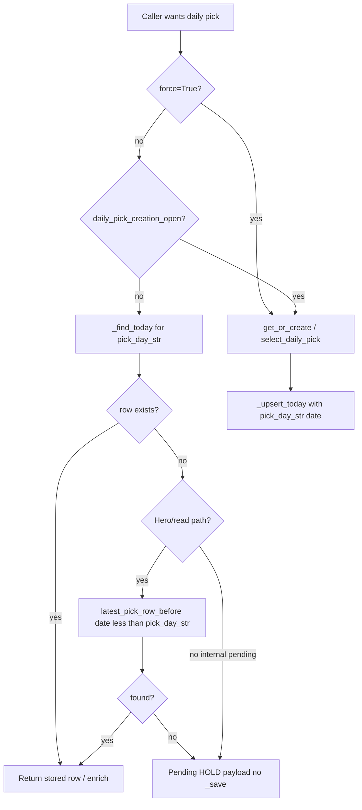

# Plan: Daily pick at ~6:05 AM America/Phoenix

**Status:** Plan only (no implementation in this PR).  
**Pinned verification SHA:** `0299d354590d179b00dd1f3807d2880b219e5b37` (`main` at review time).  
**Goal:** Move the authoritative daily pick from **00:15 UTC** (5:15 PM America/Phoenix, prior product convention) to **13:05 UTC** (~**6:05 AM** America/Phoenix, no DST), without early scoring, duplicate pick rows, or accuracy-ledger drift.

---

## 1. Problem (verified on `0299d354`)

| Mechanism | Current behavior | Why morning slot breaks if we only change env defaults |
|-----------|------------------|--------------------------------------------------------|
| Slot | `DAILY_PICK_SLOT_UTC_HOUR` / `MINUTE` default **`0` / `15`** (`internal/council/pick_scheduler.py`) | Changing to `13` / `5` alone does not define when “today” starts. |
| Pick-day key | `_today_str()` → `datetime.now(timezone.utc).date().isoformat()` in `daily_pick_engine.py` and copies | At **00:00 UTC** the stored `date` field rolls to a new calendar day **~13 hours before** the new slot. |
| Cold boot | `DailyPickScheduler.start(immediate=False)` schedules first tick in **45s** (“create today soon”) | Any boot between 00:00–13:05 UTC can score and persist a pick for the new UTC calendar `date` before the intended slot. |
| Side paths | `get_or_create_today_pick(..., force=False)` creates when no row matches `_today_str()` | `story_path.build_story_path`, `pick_explain.explain_subnet`, and `panel_summaries.summarize_picks` still call `get_or_create_today_pick` (see §4). |

**America/Phoenix:** fixed UTC−7 (no DST). Target slot **13:05 UTC** = **06:05** local.

**Pick-day rollover at 13:00 UTC:** aligns the logical “pick day” boundary with the Arizona morning window (one hour before slot gives a stable pre-slot window where the previous pick day is still authoritative).

**13:00–13:05 gap (must be designed explicitly):** at **13:00 UTC** `pick_day_str()` advances to calendar date **D**, but the authoritative row for **D** does not exist until the **13:05** tick. Any reader keyed only on `pick_day_str()` with no fallback would show an empty/pending hero for five minutes even though yesterday’s published pick is still the correct product surface until the new pick lands.

---

## 2. Target behavior

1. **Authoritative generation** runs once per pick day, at **`DAILY_PICK_SLOT_UTC_*` default `13:05` UTC** (overridable via env, unchanged knob names).
2. **Pick-day identity** (`date` on rows in `data/daily_picks.json`, audit filenames, ledger heal, loop health, conviction alerts, API meta) uses a **shared helper** with **13:00 UTC rollover**, not raw UTC calendar midnight.
3. **Before the slot** on the current pick day: **no scoring persist** except explicit `force=True` (ops/scripts only). **Read paths** behave as follows:
   - If a row exists for `pick_day_str()`, return it (unchanged).
   - If **no** row exists for `pick_day_str()` (always true during **13:00–13:05 UTC** on cutover mornings, and true for the whole pre-slot window when the pick-day key has not yet been written for that day), **hero / hydrate / SSE / letter** must fall back to the **latest stored row with `date < pick_day_str()`** (same netuid the site showed an hour earlier), not a synthetic pending gap that hides the prior LONG.
   - Internal **`get_or_create_today_pick(..., force=False)`** when creation is closed and no row for `pick_day_str()` may still return a **non-persisted** pending/HOLD dict for APIs that explicitly mean “today’s slot not written yet” — but **`/api/daily-pick` hydrate**, cockpit snapshot, and homepage hero must use the **prior-row fallback** above until 13:05 creates the new row (see §5).
4. **Scheduler cold start** arms the **next slot** (or retry interval if today’s pick day row exists but is `scheduler_hold`), not a 45s “create today” tick when creation is not allowed.
5. **Transition cutover** uses **Option A migration map only** (§6) so prod never has two competing rows for one logical pick day and accuracy ledger stays consistent.

---

## 3. Shared pick-day module (new)

**Proposed path:** `internal/council/pick_day.py` (single source; ponytail: no second “today” helper).

### 3.1 Constants (env-overridable, documented in `DEPLOY.md`)

| Constant | Proposed default | Role |
|----------|------------------|------|
| `PICK_DAY_ROLLOVER_UTC_HOUR` | `13` | Instant when pick-day string advances |
| `PICK_DAY_ROLLOVER_UTC_MINUTE` | `0` | |
| `DAILY_PICK_SLOT_UTC_HOUR` | `13` | Scheduler target (existing names in `pick_scheduler.py`) |
| `DAILY_PICK_SLOT_UTC_MINUTE` | `5` | |

Keep existing clamps in `_seconds_until_daily_slot()`.

### 3.2 API

```python
def pick_day_str(now: datetime | None = None) -> str:
    """ISO date string for the current pick day (13:00 UTC rollover)."""

def pick_day_start_utc(pick_day: str) -> datetime:
    """UTC instant when that pick day began: pick_day D starts at D 13:00:00 UTC."""

def daily_pick_creation_open(now: datetime | None = None) -> bool:
    """True when scheduler/API may call select_daily_pick and persist (>= slot on current pick day)."""

def read_pick_day_str_from_record(rec: dict) -> str | None:
    """Normalize legacy rows that used UTC-calendar date before cutover."""

def latest_pick_row_before(picks: list, pick_day: str | None = None) -> dict | None:
    """Newest row with date < pick_day (default pick_day_str()); used by read paths in §2.3."""
```

**Rollover rule (normative):**

- Let `now` be UTC-aware.
- If `now.time() < 13:00:00`, pick day = `(now.date() - 1 day).isoformat()`.
- Else pick day = `now.date().isoformat()`.

**Pick-day start (normative):** for pick-day string **D**, `pick_day_start_utc(D)` = **`D 13:00:00 UTC`**. That instant is when the pick-day key advances to **D**; it is the anchor for `daily_pick_creation_open` (slot = start + 5 minutes → **D 13:05 UTC** by default).

**Creation gate:**

- `daily_pick_creation_open(now)` is true iff `now >= pick_day_start_utc(pick_day_str(now)) + slot offset` (slot defaults **13:05** on that pick day).

**Pre-slot read fallback (normative):** when `_find_today` misses for `pick_day_str()`, read paths call `latest_pick_row_before(_load(), pick_day_str())` before synthesizing pending meta. Meta may include `prior_pick_day: true` or reuse stored `date` from the fallback row so clients do not treat the hero as “unpublished” during **13:00–13:05**.

### 3.3 Replace `_today_str()` in engine

- `internal/council/daily_pick_engine.py`: delete local `_today_str`; import `pick_day_str` as the pick-day key for `_find_today`, `_upsert_today`, payloads, and `write_scheduler_hold`.
- **`get_or_create_today_pick`:** at top, compute `day = pick_day_str()`. If not `force` and not `daily_pick_creation_open()` and no existing row for `day`, return a **non-persisted** pending dict (same shape as `_daily_pick_pending_hold`) or `None` per existing caller contracts — **must not** call `select_daily_pick` or `_save`. (Callers that need the visible hero must not rely on this alone; see §5.)
- If row exists for `day`, behavior unchanged (stale HOLD regen, gates, etc.).

---

## 4. Call sites to migrate (enumerated @ `0299d354`)

### 4.1 `_today_str()` definitions → use `pick_day_str`

| File | Notes |
|------|--------|
| `internal/council/daily_pick_engine.py` | Canonical writer/reader for `daily_picks.json` |
| `internal/council/pick_selection_audit.py` | Audit paths `data/pick_audits/{date}.json` |
| `internal/learning/outcome_snapshot.py` | Loads today’s pick audit |
| `internal/conviction_alerts/evaluate.py` | Filters daily pick candidates |

**Import-only (already delegate to engine after engine change):**

| File | Notes |
|------|--------|
| `server.py` | Shed-to-stash guard imports `_today_str` — switch to `pick_day_str` |
| `scripts/nightly_pick_audit.sh` | Imports `_today_str` from audit module |

### 4.2 Inline UTC calendar `date` tied to daily pick (must use `pick_day_str`)

| File | Lines (approx) | Usage |
|------|----------------|--------|
| `internal/learning/ledger_heal.py` | `_today_record`, `_downgrade_today_to_hold` | Match heal targets to pick-day row |
| `internal/learning/loop_health.py` | `_daily_pick_today` | Health panel “today’s pick” |
| `internal/ops/readiness.py` | `_daily_pick_summary` | Readiness daily pick section |
| `internal/cockpit/picks_snapshot.py` | **`127`** — fallback `"date"` in `_load_day_snapshot` | SSE day slice meta; must use `pick_day_str` + prior-row fallback when no row yet |
| `server.py` | **`3212`**, **`3224`**, **`3321`** — `_daily_pick_timeout_hold`, `_daily_pick_pending_hold`, error payload `date` | API `date` field consistency; hydrate/shed guard at **`3307–3312`** uses `_today_str` → `pick_day_str` |

### 4.3 Related UTC date (evaluate in implementation PR)

These use UTC calendar date; confirm whether they mean **pick day** or **wall-clock UTC day** before migrating:

| File | Lines (approx) | Risk / classification |
|------|----------------|------------------------|
| `internal/council/selector.py` | — | May tag selection artifacts — align if tied to daily pick |
| `internal/ops/evidence.py` | — | Ops bundles — likely pick-day if referencing daily pick files |
| `internal/preview/k3_hold.py`, `internal/preview/tribunal_hero.py` | — | Preview UI — align with hero pick read + §2.3 fallback |
| `internal/simivision/caution_cells.py` | — | SimiVision cells — confirm product intent |
| `internal/message_intel/rollup.py` | **`520`**, **`2728`**, **`2735`** | **`date` = wall-clock “yesterday”** for Telegram/message-intel recap windows (`yesterday_start.date()`), **not** pick-day identity — document in code; do **not** blindly swap to `pick_day_str` unless product ties recap to pick day |
| `internal/letter/brain_letter.py` | **`9`** (`_today_utc`), **`137`** (`_today_pick_block` match on `records`), **`232`** (`_yesterday_graded_outcome` uses resolver `created_at` date) | **`137` → pick_day_str + prior-row fallback** for letter hero; **`232` stays wall-clock yesterday** for graded resolver rows (orthogonal to pick-day key) |

### 4.4 `get_or_create_today_pick` callers (creation guard)

| Caller | Prod? | Plan |
|--------|-------|------|
| `internal/council/pick_scheduler.py` | Yes | Respects `daily_pick_creation_open`; cold-start delay uses `_seconds_until_daily_slot()` when creation closed; keep retry path when `scheduler_hold` |
| `internal/council/pick_explain.py` | Yes (`/api/pick-explain/{netuid}`) | **Read** via `_find_today(_load())` + prior-row fallback; only use `get_or_create` when `force` ops flag (default off) |
| `internal/learning/story_path.py` | Yes (SSR + `/api/mindmap/story-path`) | Same read-only pattern as homepage hydrate |
| `internal/learning/panel_summaries.py` | **`summarize_picks` only** | Prod mindmap uses **`summarize_picks_lite`** (already `_find_today` only); change `summarize_picks` for consistency or mark deprecated |
| `server.py` | Import for engine availability | No direct create on hot paths (verified: homepage/tests enforce read-only) |

### 4.5 Already read-only (no create guard needed beyond pick-day key + fallback)

- `internal/cockpit/picks_snapshot.py` — `_day_from_disk()` via `_find_today`; **also** apply `latest_pick_row_before` in `_load_day_snapshot` when building SSE payload
- `internal/learning/panel_summaries.summarize_picks_lite`
- `server.py` `/api/daily-pick` hydrate — `_hydrate_daily_pick_lite` / `_find_today` + prior-row fallback before `_daily_pick_pending_hold`

### 4.6 Scheduler / boot

| Location | Change |
|----------|--------|
| `internal/council/pick_scheduler.py` | Default slot **13:05**; cold start **do not** fire 45s create when `not daily_pick_creation_open()` — schedule until slot (min 30s rule kept) |
| `internal/background_boot.py` | `PICK_SCHEDULER_BOOT_IMMEDIATE` remains ops-only; document that immediate boot must not bypass creation gate |
| `fly.toml` / prod env | Set `DAILY_PICK_SLOT_UTC_HOUR=13`, `DAILY_PICK_SLOT_UTC_MINUTE=5` at deploy (human-gated) |

---

## 5. Boot-tick and side-path guard (design)



**13:00–13:05 UTC (normative):** at **13:00:30 UTC**, `pick_day_str()` is already the new day **D**, `_find_today` finds no row for **D**, and **`latest_pick_row_before`** must return the row written for **D−1** (still the published morning hero). Tests must freeze at **13:00:30 UTC** and assert hydrate/hero/SSE show that prior row, **not** a pending-only gap (§7).

**Scheduler-specific:** when `today_ready` is false and creation is closed, `_seconds_until_next_daily_tick` should wait until **slot**, not 15m retry (retry remains for `scheduler_hold` / errors **after** slot is open).

**Invariant:** only **`pick_scheduler` tick** (and explicit `force` / approved scripts) may persist a **new** pick-day row after cutover; read paths never score during the pre-slot window.

---

## 6. Transition-day behavior

**Cutover strategy:** **Option A (migration map) only** — no dual-read Option B in production paths. Implementation lands a one-shot migration helper (runs once on first boot after deploy) that rewrites legacy UTC-calendar keys into `pick_day_str` space without duplicating netuids.

### 6.1 Option A — migration map (committed)

On first boot after deploy, if no row exists for `pick_day_str(now)`:

1. Load the **latest** row in `data/daily_picks.json` (by stored `date`, then `timestamp_utc` if tied).
2. If that row’s `date` ≠ `pick_day_str(now)` but represents the still-valid published pick (typical: legacy row keyed **D** written at **`D 00:15 UTC`** while new code first runs at **`D 13:05 UTC`**), **map** it: set `rec.date = pick_day_str(now)` (and persist once), or insert an alias entry in a small `data/pick_day_migration.json` `{legacy_date → pick_day}` consumed by `_find_today` until heal completes — **pick one mechanism in impl PR; single visible row**.

**Cutover-day semantics (example):** legacy scheduler wrote pick for calendar **2026-11-04** at **2026-11-04 00:15 UTC**. Deploy at **2026-11-04 13:05 UTC** with 13:00 rollover: `pick_day_str()` = **`2026-11-04`**, but the on-disk row may still carry `date: "2026-11-04"` from midnight-keyed code **or** appear as **`2026-11-03`** from the old “UTC today” mismatch. Migration map ensures `_find_today` resolves exactly **one** row for **`2026-11-04`** without running `select_daily_pick` again.

**Expected accuracy-ledger entry on cutover day:** the mapped row keeps its original **`timestamp_utc` / scoring instant** (when the pick was actually selected). Resolver/heal must **not** rewrite historical scoring time to 13:05. If ledger heal inserts or upgrades a row for the pick day, the ledger entry’s **`pick_date`** (or equivalent field used in `ledger_heal.py`) must equal **`pick_day_str()`** after migration, while **`scored_at` / audit timestamp** remains the legacy instant — dry-run `scripts/heal_daily_pick_ledger.py` in staging and assert one ledger row per pick day, no duplicate netuid for the same logical morning.

### 6.2 Ops playbook

**Recommended cutover:** deploy during **America/Phoenix afternoon** (after **13:05 UTC** same day) when possible, **or**:

1. **Freeze:** no manual edits to `data/daily_picks.json` / predictions during cutover window (communicate in MC).
2. Run migration helper (§6.1) before serving traffic if deploy lands in **00:00–13:05 UTC**.
3. **No duplicate pick:** `_upsert_today` replaces same `date` key — all writers use **`pick_day_str`** after migration.
4. **Audit files:** `data/pick_audits/YYYY-MM-DD.json` uses pick-day string — night audit cron (`scripts/nightly_pick_audit.sh`) must run **after** slot (§6.6).

### 6.3 Failed 13:05 tick (timeout / HOLD / worker down)

**Rule (committed):** **Catch-up creation is allowed for the remainder of the pick day** once `daily_pick_creation_open()` is true. The scheduler keeps its post-slot retry cadence (`scheduler_hold`, errors, stall guard) until a row for `pick_day_str()` is persisted or ops intervenes with `force=True` / `scripts/heal_daily_pick_ledger.py`. **Gap-as-final-state is not accepted** for prod: an unfilled pick day would break hero, conviction alerts, and ledger invariants already promised in §2.

**Justification:** Arizona users expect a single morning pick; existing retry/HOLD machinery already handles slow scoring within the standing **90s** `DAILY_PICK_TICK_TIMEOUT_SECONDS` gate (must not bump). If the pick day ends without a row (catastrophic outage), record **`pick_day_gap: true`** in loop health / ops evidence — but implementation still **attempts** catch-up until pick-day rollover at next **13:00 UTC**.

### 6.4 Ledger integrity window (**00:00–13:00 UTC** on migration days)

During the first UTC morning after deploy, legacy rows and resolver cycles may disagree on “today” until migration runs:

- **Ordering:** run **pick-day migration map (§6.1) in the same process boot** before the resolver scheduler’s first tick that grades daily picks, **or** hold resolver daily-pick mutations until migration completes (env **`PICK_DAY_MIGRATION_BLOCK_RESOLVER=1`** default-on for one boot).
- **Heal:** `ledger_heal` / `loop_health` must read **`pick_day_str()` from the migrated row** in a **single commit** with the migration write — no window where heal targets UTC-calendar “today” while `_find_today` uses pick-day **D** and misses.
- Verify with frozen-clock tests spanning **08:00 UTC** boot + migration + resolver stub (§7).

### 6.5 Accuracy ledger (post-migration steady state)

`ledger_heal` / `loop_health` agree with pick-day key before each resolver cycle; run `scripts/heal_daily_pick_ledger.py` dry-run in staging after transition; verify `tests/test_acc0_ledger_heal.py` with pick-day clock mocking.

### 6.6 Nightly audit cron (**13:10 UTC**)

Move audit from UTC **00:xx** to **≥ 13:10 UTC** (after slot + buffer). **Audit job must not read or score “today’s pick” before the slot write completes:** it should `_find_today` for `pick_day_str()` and, if missing, **wait/retry** (or exit non-zero for ops) rather than calling `get_or_create_today_pick` or `select_daily_pick` early. Same creation gate as scheduler.

---

## 7. Tests to add or update

| Area | Action |
|------|--------|
| **New** `tests/test_pick_day.py` | Rollover at 12:59 vs 13:00 UTC; creation gate at 13:04 vs 13:05; **`latest_pick_row_before`** ordering |
| **New/extend** | **13:00:30 UTC:** `/api/daily-pick` hydrate + cockpit snapshot + homepage hero path show **prior pick-day row**, not pending-only gap (disk: row for **D−1**, none for **D**) |
| **Update** `tests/test_pick_scheduler.py` | Cold start schedules ≥ slot when creation closed; retry when `scheduler_hold` after slot; catch-up after failed 13:05 tick |
| **Update** `tests/test_daily_pick_shed_date_guard.py` | Shed guard uses `pick_day_str`, not UTC midnight (comment references 2026-08-30 incident) |
| **Update** `tests/test_stale_boot_hold.py`, `test_pick_regen_full_universe.py` | Freeze time with pick-day helper |
| **Update** `tests/test_acc0_ledger_heal.py`, `tests/test_learning_loop_health.py` | `_daily_pick_today` uses pick-day; migration-day ledger timestamp integrity |
| **New/extend** | `story_path` / `pick_explain` must not call `get_or_create` when disk miss + before slot (mirror `tests/test_homepage_pick_read_only.py`) |
| **Contract** | `tests/test_endpoint_contract.py` unchanged routes; optional assert `/api/learning/health` still 200 |
| **Do not** | Bump `DAILY_PICK_TICK_TIMEOUT_SECONDS` or unmute `LOOP_STALL_GUARD_KILL` (standing gate) |

Use `freezegun` or existing monkeypatch patterns; no new dependency if tests already freeze time manually.

---

## 8. Memory and traffic on 1 GB VM @ 13:05 UTC

Prod runs on a **single `shared-cpu-2x` machine with `memory = "1gb"`** (`fly.toml`). `DEPLOY.md` documents a **2026-09-24 soak** at **`26e7dec2`**: **~330 MB RSS peak** on that 1 GB VM (web + inline essential worker), not the leak-era 4 GB profile.

**Scoring measurement caveat:** `docs/agent-friendly/scoring-caps-measurement.md` records **~85 MB RSS** only on a **draft-branch sandbox harness** (128 tradable, fixture-thin) — **not** confirmed for the **production `get_or_create_today_pick` / full-universe `select_daily_pick`** path at 13:05. Do **not** treat 85 MB as prod headroom for the morning tick.

**Requirements before human-gated deploy:**

1. **Staging measurement:** run the **full** scheduler tick path (or scripted `get_or_create_today_pick` with production-like registry + scoring flags) on a **1 GB** Fly machine; record **peak RSS** and duration for the tick window **13:04–13:08 UTC**.
2. **Concurrency rule:** document whether **API cold miss** (hydrate + story_path + letter) can overlap the **13:05 scheduler tick** on one VM; if overlap raises RSS beyond soak baseline, **serialize** via existing pick-read executor / shed rules or defer non-critical reads — without raising `DAILY_PICK_TICK_TIMEOUT_SECONDS`.
3. **Standing gate:** no timeout bump; deploy still via contract test + Fly Deploy Guard.

---

## 9. Risks

| Risk | Mitigation |
|------|------------|
| Legacy rows keyed by UTC calendar date | **Option A migration map only** (§6.1) |
| **13:00–13:05** empty hero | **`latest_pick_row_before`** on read paths (§2.3, §5, §7) |
| Early pick via boot 45s tick | Cold-start schedule + creation gate |
| `pick_explain` / `story_path` scoring on first visitor | Read-only disk path + fallback |
| Failed 13:05 tick | Catch-up retries §6.3; no timeout bump |
| Cron / nightly audit at wrong UTC hour | **13:10+ UTC**; audit must not score early (§6.6) |
| Migration-day ledger drift **00:00–13:00 UTC** | Resolver block + single-commit heal (§6.4) |
| Arizona vs UTC messaging | UI copy: “Daily pick publishes ~6:05 AM Arizona (13:05 UTC)” |
| Env drift (web vs worker) | Same `[env]` in `fly.toml` for slot + rollover constants |
| Partial deploy (old web, new worker) | Single deploy; pick-day module shared |
| **1 GB RSS spike @ 13:05** | Staging peak measurement + concurrency rule (§8) |
| Standing gates | No timeout bump; deploy still via contract test + Fly Deploy Guard |

---

## 10. Implementation sequence (follow-on PRs, not this doc)

1. Land `pick_day.py` + engine/scheduler + tests (core).
2. Migrate ledger/health/readiness/snapshot/server meta dates + read fallbacks.
3. Switch side paths to read-only; add guard tests (incl. **13:00:30 UTC**).
4. Land migration map + resolver block; ops: env defaults, audit cron **13:10 UTC**, cutover window + ledger dry-run.
5. Staging 1 GB RSS measurement (§8); human-approved Fly deploy; post-deploy `/health`, `/api/daily-pick`, `/api/learning/health`.

---

## 11. Verification checklist (post-impl)

- [ ] At 12:30 UTC, `pick_day_str` equals previous calendar date’s pick day.
- [ ] At **13:00:30 UTC**, hero/read paths show **prior pick-day row**, not pending-only gap.
- [ ] At 13:06 UTC, scheduler tick persists exactly one row for new pick day.
- [ ] Restart at 08:00 UTC does not create a pick before 13:05.
- [ ] `/api/daily-pick` returns stored or prior-row fallback; never blocks on scoring.
- [ ] `build_learning_loop_health` `daily_pick.date` matches pick-day row after migration.
- [ ] No duplicate dates in `daily_picks.json` after 7-day soak.
- [ ] Staging 1 GB peak RSS logged for full morning tick path (§8).

---

## Appendix: diagnosis cross-check (`diagnosis_5548.md`)

The assigned upload path was **not present** in the cloud agent environment; claims were verified directly against git **`0299d354`**.

| Diagnosis claim | Verdict @ `0299d354` |
|-----------------|----------------------|
| Slot defaults `0` / `15` | **Confirmed** (`pick_scheduler.py`) |
| `_today_str()` UTC calendar in engine + ~8 copies | **Partially confirmed:** 4 named `_today_str()` functions; **additional** inline `_utcnow().date().isoformat()` in `ledger_heal`, `loop_health`, plus server/readiness/snapshot paths (§4.2) |
| Slot-only change leaves ~13h window | **Confirmed** (00:00 UTC date roll vs 13:05 slot) |
| Boot/side paths can create picks early | **Confirmed** (45s cold tick; `story_path`, `pick_explain`; `summarize_picks` dormant in prod) |
| **13:00–13:05** rollover without fallback | **New gap** — plan requires `latest_pick_row_before` (§2.3, §5) |
