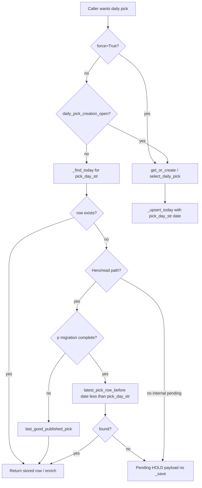
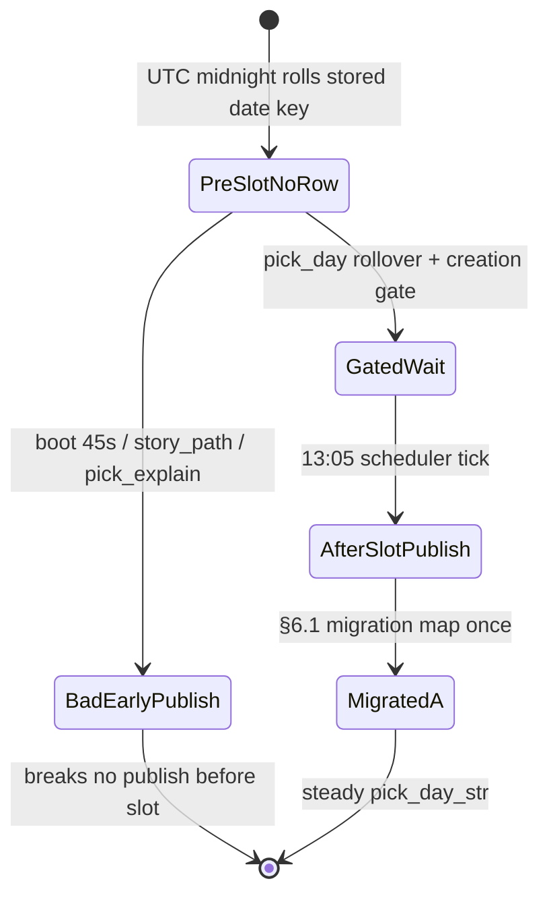

# Plan: Daily pick at ~6:05 AM America/Phoenix

**Status:** Plan only (no implementation in this PR).  
**Pinned verification SHA:** `0299d354590d179b00dd1f3807d2880b219e5b37` (`main` at review time).  
**Call-site inventory SHA:** same (`0299d354`); re-grepped on plan branch before this revision.  
**Goal:** Move the authoritative daily pick from **00:15 UTC** (5:15 PM America/Phoenix, prior product convention) to **13:05 UTC** (~**6:05 AM** America/Phoenix, no DST), without early scoring, duplicate pick rows, or accuracy-ledger drift.

---

## 1. Problem (verified on `0299d354`)

| Mechanism | Current behavior | Why morning slot breaks if we only change env defaults |
|-----------|------------------|--------------------------------------------------------|
| Slot | `DAILY_PICK_SLOT_UTC_HOUR` / `MINUTE` default **`0` / `15`** (`internal/council/pick_scheduler.py`) | Changing to `13` / `5` alone does not define when “today” starts. |
| Pick-day key | `_today_str()` → `datetime.now(timezone.utc).date().isoformat()` in `daily_pick_engine.py` and copies | At **00:00 UTC** the stored `date` field rolls to a new calendar day **~13 hours before** the new slot. |
| Cold boot | `DailyPickScheduler.start(immediate=False)` **always** calls `schedule_in_seconds(..., 45)` before checking `already running` (`pick_scheduler.py:273`; `test_daily_start_schedules_when_persisted_lifecycle_started` — second `start()` still arms 45s) | Any boot between 00:00–13:05 UTC can score and persist a pick for the new UTC calendar `date` before the intended slot. **Target:** when `not daily_pick_creation_open()`, **skip** the 45s “create today” arm and schedule the **next slot** instead (see §4.6). |
| Side paths | `get_or_create_today_pick(..., force=False)` creates when no row matches `_today_str()` | `story_path.build_story_path`, `pick_explain.explain_subnet`, and `panel_summaries.summarize_picks` still call `get_or_create_today_pick` (see §4). |

**America/Phoenix:** fixed UTC−7 (no DST). Target slot **13:05 UTC** = **06:05** local.

**Pick-day rollover at 13:00 UTC:** aligns the logical “pick day” boundary with the Arizona morning window (one hour before slot gives a stable pre-slot window where the previous pick day is still authoritative).

**13:00–13:05 gap (must be designed explicitly):** at **13:00 UTC** `pick_day_str()` advances to calendar date **D**, but the authoritative row for **D** does not exist until the **13:05** tick. Any reader keyed only on `pick_day_str()` with no fallback would show an empty/pending hero for five minutes even though yesterday’s published pick is still the correct product surface until the new pick lands.

---

## 2. Target behavior

1. **Authoritative generation** runs once per pick day, at **`DAILY_PICK_SLOT_UTC_*` default `13:05` UTC** (overridable via env, unchanged knob names).
2. **Pick-day identity** (`date` on rows in `data/daily_picks.json`, audit filenames, ledger heal, loop health, conviction alerts, API meta) uses a **shared helper** with **13:00 UTC rollover**, not raw UTC calendar midnight.
3. **Before the slot** on the current pick day: **no scoring persist** except explicit `force=True` (ops/scripts only). **Read paths** behave as follows:
   - If a row exists for `pick_day_str()`, return it (unchanged).
   - If **no** row exists for `pick_day_str()` (always true during **13:00–13:05 UTC** on steady-state mornings, and true for the whole pre-slot window when the pick-day key has not yet been written for that day), **hero / hydrate / SSE / letter / conviction alerts** must fall back per §2.3 migration gate: post-marker **`latest_pick_row_before`**; pre-marker **`last_good_published_pick`** — both **published-only** via **`is_published_daily_pick_row`** (`action` **LONG** or **BUY**, `pick` dict, no `scheduler_hold`).
   - **Migration gate (reads):** Post-marker, §2.3 **`latest_pick_row_before`** (published-only) is allowed. **Before** `pick_day_migration_complete()`, public hero/hydrate/SSE/letter/conviction/tribunal preview must **not** use the pick-day fallback helpers — they serve **`last_good_published_pick(_load())`** (newest row on disk passing **`is_published_daily_pick_row`**, §3.2) with **`prior_pick_day: true`** meta when the displayed row’s stored `date` ≠ `pick_day_str()`. **Never** return 503 or empty hero for pick surfaces solely because migration is pending; **never** surface HOLD/`scheduler_hold` as the hero.
   - Internal **`get_or_create_today_pick(..., force=False)`** when creation is closed and no row for `pick_day_str()` may still return a **non-persisted** pending/HOLD dict for APIs that explicitly mean “today’s slot not written yet” — but **`/api/daily-pick` hydrate**, cockpit snapshot, and homepage hero must use the **prior-row fallback** above until 13:05 creates the new row (see §5).
4. **Scheduler cold start** arms the **next slot** (or retry interval if today’s pick day row exists but is `scheduler_hold`), not a 45s “create today” tick when creation is not allowed.
5. **Transition cutover** uses **Option A migration map only** (§6) so prod never has two competing rows for one logical pick day and accuracy ledger stays consistent.

---

## 3. Shared pick-day module (new)

**Proposed path:** `internal/council/pick_day.py` (single source; ponytail: no second “today” helper).

### 3.1 Constants (env-overridable, documented in `DEPLOY.md`)

| Constant | Proposed default | Role |
|----------|------------------|------|
| `PICK_DAY_ROLLOVER_UTC_HOUR` | `13` | Instant when pick-day string advances |
| `PICK_DAY_ROLLOVER_UTC_MINUTE` | `0` | |
| `DAILY_PICK_SLOT_UTC_HOUR` | `13` | Scheduler target (existing names in `pick_scheduler.py`) |
| `DAILY_PICK_SLOT_UTC_MINUTE` | `5` | |

Keep existing clamps in `_seconds_until_daily_slot()`.

### 3.2 API

```python
def pick_day_str(now: datetime | None = None) -> str:
    """ISO date string for the current pick day (13:00 UTC rollover)."""

def pick_day_start_utc(pick_day: str) -> datetime:
    """UTC instant when that pick day began: pick_day D starts at D 13:00:00 UTC."""

def daily_pick_creation_open(now: datetime | None = None) -> bool:
    """True when scheduler/API may call select_daily_pick and persist (>= slot on current pick day)."""

def read_pick_day_str_from_record(rec: dict) -> str | None:
    """Normalize legacy rows that used UTC-calendar date before cutover."""

def is_published_daily_pick_row(rec: dict) -> bool:
    """Published daily pick row (normative predicate for fallback + pre-marker hero).
    True iff: not rec.get('scheduler_hold'); str(rec.get('action','')).upper() in ('LONG','BUY');
    isinstance(rec.get('pick'), dict)."""

def last_good_published_pick(picks: list) -> dict | None:
    """Newest row in picks (any stored date) passing is_published_daily_pick_row; pre-marker hero path."""

def latest_pick_row_before(picks: list, pick_day: str | None = None) -> dict | None:
    """Newest row passing is_published_daily_pick_row with stored date < pick_day (default pick_day_str())."""
```

**Rollover rule (normative):**

- Let `now` be UTC-aware.
- If `now.time() < 13:00:00`, pick day = `(now.date() - 1 day).isoformat()`.
- Else pick day = `now.date().isoformat()`.

**Pick-day start (normative):** for pick-day string **D**, `pick_day_start_utc(D)` = **`D 13:00:00 UTC`**. That instant is when the pick-day key advances to **D**; it is the anchor for `daily_pick_creation_open` (slot = start + 5 minutes → **D 13:05 UTC** by default).

**Creation gate:**

- `daily_pick_creation_open(now)` is true iff `now >= pick_day_start_utc(pick_day_str(now)) + slot offset` (slot defaults **13:05** on that pick day).

**Pre-slot read fallback (normative):** when `_find_today` misses for `pick_day_str()` **and** `pick_day_migration_complete()` is true, read paths call `latest_pick_row_before(_load(), pick_day_str())` before synthesizing pending meta. **Before marker**, use `last_good_published_pick(_load())` instead (§2.3). Meta may include `prior_pick_day: true` when the displayed row’s stored `date` ≠ `pick_day_str()`.

**Published row (normative, single definition):** **`is_published_daily_pick_row(rec)`** — `scheduler_hold` is falsy; **`action`** is **`LONG`** or **`BUY`** (case-insensitive); **`pick`** is a **`dict`**. HOLD rows, `scheduler_hold: true`, and rows with `pick: null` are **not** published. All fallback readers and pre-marker hero paths use this predicate only (no parallel “published=True” boolean on disk today).

**Legacy row identity (normative, feeds §6.1 — switchover window only):** when **`pick_day_relabel_applies(rec, cutover_deploy_date)`** is true (§6.1), a row with stored `date == X` and selection instant `timestamp_utc` (or `created_at` if absent) **strictly before `X 13:00:00 UTC`** belongs to **pick day `X−1`**. Outside the switchover window the row is **left unchanged** (log `pick_day_relabel_skipped`). `read_pick_day_str_from_record(rec)` returns the mapped pick day when relabeled, else stored `date` if it already equals a pick-day key.

### 3.3 Replace `_today_str()` in engine

- `internal/council/daily_pick_engine.py`: delete local `_today_str`; import `pick_day_str` as the pick-day key for `_find_today`, `_upsert_today`, payloads, and `write_scheduler_hold`.
- **`get_or_create_today_pick`:** at top, compute `day = pick_day_str()`. If not `force` and not `daily_pick_creation_open()` and no existing row for `day`, return a **non-persisted** pending dict (same shape as `_daily_pick_pending_hold`) or `None` per existing caller contracts — **must not** call `select_daily_pick` or `_save`. (Callers that need the visible hero must not rely on this alone; see §5.)
- If row exists for `day`, behavior unchanged (stale HOLD regen, gates, etc.).

### 3.4 Writer guards (normative — impl PR)

**`_upsert_today` / all persist paths** (`select_daily_pick` save, `write_scheduler_hold`, shed guard):

1. **Pre–pick-day-start overwrite refusal:** if an existing row for `payload["date"]` has `timestamp_utc` (parsed UTC) **strictly before `pick_day_start_utc(payload["date"])`**, **`_upsert_today` must not replace it** — return existing and log `pick_day_upsert_refused_pre_start`. This blocks catch-up / retry ticks from clobbering a relabeled legacy midnight row on cutover day.
2. **Post-marker legacy-key refusal:** when **`pick_day_migration_complete()`**, **reject any persist** where **`payload["date"] != pick_day_str()`** (old 00:15 UTC writer used UTC-calendar `_today_str()`; after marker only pick-day keys are legal). Return without write; log `pick_day_legacy_write_refused`. Applies to scheduler, side paths, and ops scripts unless an explicit break-glass env (not planned for prod).
3. **`force=True` on switchover pick day:** on the pick day recorded in the migration marker as **`cutover_pick_day`** (first pick day after marker write), **`force=True` is ignored** for persist — ops must not manual-heal over relabeled rows that day; log `pick_day_force_disabled_switchover`. After that pick day ends (next **13:00 UTC** rollover), normal force rules resume.

**File lock (ponytail):** optional `fcntl` lock around relabel + marker write; idempotent relabel makes double-run safe — lock is race hygiene only.

---

## 4. Call sites to migrate (enumerated @ `0299d354`)

**Repo-wide grep (non-test `*.py` / `*.sh`, `@0299d354`):** patterns  
`def _today_str`, `.date().isoformat()`, `datetime.now(timezone.utc).date`, `_utcnow().date().isoformat`, and `_today_utc` in `brain_letter.py`.  
**Pick-day migrate + fallback readers** vs **wall-clock UTC day** vs **tests-only** — full table in **§4.7**.

### 4.1 `_today_str()` definitions → use `pick_day_str`

| File | Notes |
|------|--------|
| `internal/council/daily_pick_engine.py` | Canonical writer/reader for `daily_picks.json` |
| `internal/council/pick_selection_audit.py` | Audit paths `data/pick_audits/{date}.json`; **also defaults at lines 300, 318, 346** (`pick_date` / `run_audit_today`) |
| `internal/learning/outcome_snapshot.py` | Loads today’s pick audit |
| `internal/conviction_alerts/evaluate.py` | Filters daily pick candidates (`55–67`); **§2.3 fallback reader** during 13:00–13:05 |

**Import-only (already delegate to engine after engine change):**

| File | Notes |
|------|--------|
| `server.py` | Shed-to-stash guard imports `_today_str` — switch to `pick_day_str` |
| `scripts/nightly_pick_audit.sh` | Imports `_today_str`; line **21** `payload.get("pick_date") or _today_str()` → **`pick_day_str()`** after audit module migrates |

### 4.2 Inline UTC calendar `date` tied to daily pick (must use `pick_day_str`)

| File | Lines (approx) | Usage |
|------|----------------|--------|
| `internal/learning/ledger_heal.py` | `_today_record`, `_downgrade_today_to_hold` | Match heal targets to pick-day row |
| `internal/learning/loop_health.py` | `_daily_pick_today` | Health panel “today’s pick” |
| `internal/ops/readiness.py` | `_daily_pick_summary` | Readiness daily pick section |
| `internal/cockpit/picks_snapshot.py` | **`127`** — fallback `"date"` in `_load_day_snapshot` | SSE day slice meta; must use `pick_day_str` + prior-row fallback when no row yet |
| `server.py` | **`3212`**, **`3224`**, **`3321`** — `_daily_pick_timeout_hold`, `_daily_pick_pending_hold`, error payload `date` | API `date` field consistency; hydrate/shed guard at **`3307–3312`** uses `_today_str` → `pick_day_str` |

### 4.3 Related UTC date (evaluate in implementation PR)

These use UTC calendar date; confirm whether they mean **pick day** or **wall-clock UTC day** before migrating:

| File | Lines (approx) | Risk / classification |
|------|----------------|------------------------|
| `internal/council/selector.py` | **`178`** | **Pick-day artifact** | **`date` field on daily-pick selection records → `pick_day_str()`** (not UTC calendar) |
| `internal/ops/evidence.py` | **`65`** | **Pick-day audit path** | **`data/pick_audits/{pick_day_str()}.json`** — replace `_today()` |
| `internal/preview/k3_hold.py` | **`37`** | **Preview hero meta** | Fixture `date` → `pick_day_str()`; prod read uses same **`_find_today` + `latest_pick_row_before`** as homepage hero |
| `internal/preview/tribunal_hero.py` | **`148`**, **`840`** | **Preview / judge link** | **`840`** fixture only: use `pick_day_str()` for `date`; prod **`judge_scores_for_daily_pick`** matches rows by **`pick_day_str()`** identity, not `ts.date()` alone |
| `internal/simivision/caution_cells.py` | **`26`**, **`56`** | **Pick-day desk tracking** | **`seen` / `_today()` keys → `pick_day_str()`** so caution cells align with today’s published call netuid |
| `internal/message_intel/rollup.py` | **`520`**, **`2728`**, **`2735`** | **`date` = wall-clock “yesterday”** for Telegram/message-intel recap windows (`yesterday_start.date()`), **not** pick-day identity — document in code; do **not** blindly swap to `pick_day_str` unless product ties recap to pick day |
| `internal/letter/brain_letter.py` | **`9`** `_today_utc()` (UTC calendar); **`137`** `_today_pick_block` match on `records`; **`189`** letter `date`; **`288`** desk header; **`411`** compose `date` — **`137/189/288/411` → `pick_day_str` + prior-row fallback** (published-only); **`232`** stays wall-clock yesterday for graded resolver rows |

### 4.4 `get_or_create_today_pick` callers (creation guard)

| Caller | Prod? | Plan |
|--------|-------|------|
| `internal/council/pick_scheduler.py` | Yes | Respects `daily_pick_creation_open`; cold-start delay uses `_seconds_until_daily_slot()` when creation closed; keep retry path when `scheduler_hold` |
| `internal/council/pick_explain.py` | Yes (`/api/pick-explain/{netuid}`) | **Read** via `_find_today(_load())` + prior-row fallback; only use `get_or_create` when `force` ops flag (default off) |
| `internal/learning/story_path.py` | Yes (SSR + `/api/mindmap/story-path`) | Same read-only pattern as homepage hydrate |
| `internal/learning/panel_summaries.py` | **`summarize_picks` only** | Prod mindmap uses **`summarize_picks_lite`** (already `_find_today` only); change `summarize_picks` for consistency or mark deprecated |
| `server.py` | Import for engine availability | No direct create on hot paths (verified: homepage/tests enforce read-only) |

### 4.5 Already read-only (no create guard needed beyond pick-day key + fallback)

- `internal/cockpit/picks_snapshot.py` — `_day_from_disk()` via `_find_today`; **also** apply `latest_pick_row_before` in `_load_day_snapshot` when building SSE payload
- `internal/learning/panel_summaries.summarize_picks_lite`
- `server.py` `/api/daily-pick` hydrate — `_hydrate_daily_pick_lite` / `_find_today` + prior-row fallback before `_daily_pick_pending_hold`
- `internal/conviction_alerts/evaluate.py` — filter against `pick_day_str()`; use **`latest_pick_row_before`** when no row for current pick day (published-only, post-migration)

### 4.7 Full UTC-“today” inventory @ `0299d354` (repo grep, non-test)

| File | Line(s) | Classification | Plan action |
|------|---------|----------------|-------------|
| `internal/council/daily_pick_engine.py` | `_today_str` ~140–355 | **Pick day** | Replace with `pick_day_str` |
| `internal/council/pick_selection_audit.py` | `_today_str` ~43; defaults ~300, 318, 346 | **Pick day** | `pick_day_str`; audit filenames follow pick day |
| `internal/learning/outcome_snapshot.py` | `_today_str` ~67; audit path ~49 | **Pick day** | `pick_day_str` |
| `internal/conviction_alerts/evaluate.py` | `_today_str` ~55–67 | **Pick day + fallback reader** | `pick_day_str` + §2.3 fallback |
| `internal/learning/ledger_heal.py` | ~32, ~229 | **Pick day** | `pick_day_str` |
| `internal/learning/loop_health.py` | ~67 | **Pick day** | `pick_day_str` |
| `internal/ops/readiness.py` | ~99 | **Pick day** | `pick_day_str` |
| `internal/cockpit/picks_snapshot.py` | ~127 | **Pick day meta** | `pick_day_str` + prior-row fallback |
| `server.py` | ~3212, ~3224, ~3321; shed ~3307–3312 | **Pick day API meta** | `pick_day_str` |
| `internal/letter/brain_letter.py` | ~9, ~137, ~189, ~288, ~411 | **Pick day read** (232 wall-clock) | §4.3 |
| `scripts/nightly_pick_audit.sh` | ~15, ~21 | **Pick day** | Import `pick_day_str` |
| `internal/council/selector.py` | ~178 | **Pick-day artifact** | **`pick_day_str()`** on daily-pick-tied selection `date` (§4.3) |
| `internal/ops/evidence.py` | ~65 | **Pick-day audit bundle** | **`pick_day_str()`** for `pick_audits` path (§4.3) |
| `internal/preview/k3_hold.py` | ~37 | **Preview hero** | **`pick_day_str()`** + §2.3 fallback (§4.3) |
| `internal/preview/tribunal_hero.py` | ~148, ~840 | **Preview hero / judges** | **`pick_day_str()`** row identity; fixture `840` uses pick day (§4.3) |
| `internal/simivision/caution_cells.py` | ~26, ~56 | **Pick-day desk** | **`pick_day_str()`** for seen/call-day keys (§4.3) |
| `internal/message_intel/rollup.py` | ~520, ~2728, ~2735 | **Wall-clock UTC “yesterday”** | Do **not** swap to `pick_day_str` unless product ties recap to pick day |
| `internal/council/formula_evolution.py` | ~441 `strftime("%Y-%m-%d")` | **Wall-clock** (formula versioning) | No change unless tied to pick row |
| `tests/*` (multiple) | see grep | **Tests only** | Update mocks to `pick_day_str` / freezegun when touching pick-day tests |

**Tests referencing UTC today (update when impl lands):** `test_acc0_ledger_heal.py`, `test_api_handler_timeouts.py`, `test_conviction_alerts.py`, `test_daily_pick_shed_date_guard.py`, `test_daily_picks_lock.py`, `test_file_lock_bypasses.py`, `test_learning_loop_health.py`, `test_pick_explain.py`, `test_pick_regen_full_universe.py`, `test_stale_boot_hold.py`, `test_tribunal_hero_live.py`.

---

### 4.6 Scheduler / boot

| Location | Current @ `0299d354` | Target change |
|----------|----------------------|---------------|
| `internal/council/pick_scheduler.py` | Default slot **13:05** (env); cold `start(immediate=False)` **always** arms **45s** tick, including when `start()` returns `already running` | When `not daily_pick_creation_open()`: **do not** arm 45s create; schedule **`_seconds_until_daily_slot()`** (min 30s). When creation open: existing retry/`scheduler_hold` paths unchanged |
| `internal/council/pick_scheduler.py` `_tick` | If prior worker still running → `skipped: previous_cycle_inflight` and reschedule | Unchanged; documents that overlapping ticks are skipped, not stacked |
| `internal/background_boot.py` | `PICK_SCHEDULER_BOOT_IMMEDIATE` ops-only; deferred `start_pick_schedulers` | Document that immediate boot must not bypass creation gate |
| Process restart | **New** process: `already running` false → 45s arms today. **Same** process: persisted `lifecycle=started` → `started: false, reason: already running` but **45s still schedules** (existing test) | After gate: restart with creation closed **skips** 45s early-create arm (waits for slot) — removes the accidental re-arm on duplicate `start()` when job already scheduled is a follow-up impl detail |
| `fly.toml` / prod env | Slot env vars | Set `DAILY_PICK_SLOT_UTC_HOUR=13`, `DAILY_PICK_SLOT_UTC_MINUTE=5` at deploy (human-gated) |

**Resolver interaction (boot):** resolver daily-pick mutations are **blocked until `pick_day_migration_complete()`** (§6.4 — gate reads **marker**, not a self-clearing env default). While blocked, **do not start a new resolver cycle**; if a cycle is **`cycle_in_flight`**, wait up to **`PICK_DAY_MIGRATION_RESOLVER_WAIT_SECONDS`** (default **3600**), then **fail-safe** (§6.4). Migration runs in the **same boot** before arming pick scheduler when deploy lands in **00:00–13:05 UTC**.

---

## 5. Boot-tick and side-path guard (design)



**13:00–13:05 UTC (normative):** at **13:00:30 UTC**, `pick_day_str()` is already the new day **D**, `_find_today` finds no row for **D**, and **`latest_pick_row_before`** (published-only, migration complete) must return the row written for **D−1** (still the published morning hero). Tests must freeze at **13:00:30 UTC** and assert hydrate/hero/SSE/letter/conviction show that prior row, **not** a pending-only gap or HOLD fallback (§7).

**Scheduler-specific:** when `today_ready` is false and creation is closed, `_seconds_until_next_daily_tick` should wait until **slot**, not 15m retry (retry remains for `scheduler_hold` / errors **after** slot is open). When creation is open and today's row missing, retry cadence unchanged.

**Invariant:** only **`pick_scheduler` tick** (and explicit `force` / approved scripts) may persist a **new** pick-day row after cutover; read paths never score during the pre-slot window.

---

## 6. Transition-day behavior

**Cutover strategy:** **Option A (migration map) only** — no dual-read Option B in production paths. Implementation lands an **idempotent** migration helper that rewrites legacy UTC-calendar keys into `pick_day_str` space without duplicating netuids.

### 6.1 Option A — migration map + cutover-day outcome (committed)

**Legacy row rule (normative, switchover window only):** row with stored `date == X` and selection instant (`timestamp_utc`, else earliest known write time) **&lt; `X 13:00:00 UTC`** belongs to **pick day `X−1`** **only when** `pick_day_relabel_applies(rec, cutover_deploy_date)` is true. **`pick_day_relabel_applies`:** stored `date` is in the inclusive calendar range **`[cutover_deploy_date − 3 days, cutover_deploy_date + 1 day]`**, where **`cutover_deploy_date`** is the UTC calendar date of the deploy boot that first runs migration (persisted in the marker). Rows outside that window are **never** relabeled (log `pick_day_relabel_skipped`); late or ops-written rows with ambiguous timestamps stay on disk unchanged.

**One-time migration marker (normative):**

- Path: **`data/pick_day_migration_v1.json`**
- Fields: `completed_at`, `schema_version: 1`, **`cutover_deploy_date`**, **`cutover_pick_day`** (pick day string active when marker written), `legacy_rows_relabeled: [{from_date, to_date, timestamp_utc}]`
- **`pick_day_migration_complete()`** returns true iff marker exists and `schema_version >= 1`
- Migration is **idempotent**: safe on every boot until marker written; after marker, no-op
- **Readiness:** `/health` or `/api/learning/health` exposes `pick_day_migration_complete`; post-marker hero uses §2.3 fallback; **pre-marker** serves **`last_good_published_pick`** (never 503 on pick hero)
- **Failed migration:** if relabel runs but marker write fails, expose **`pick_day_migration_failed: true`** on health, page ops, and **retry marker write** on next boot — reads still use **`last_good_published_pick`**, not error surfaces

**Cutover-day outcome (single choice — committed):** **Relabel legacy midnight rows, then score exactly one published pick at 13:05 for the new pick day.**

1. On first boot after deploy, migration runs **before** pick scheduler and **before** resolver daily-pick mutations (§6.4).
2. Every legacy row matching the rule above is relabeled to pick day **`X−1`**.
3. On calendar day **D**, after **13:00 UTC**, `pick_day_str() == D`. If no **published** row exists for **D**, the **13:05** scheduler tick **must** call `select_daily_pick` / persist **exactly once** for **D** (catch-up if deploy lands after 13:05 same day).
4. The former **`D 00:15`** row is **not** treated as pick day **D**; it becomes pick day **`D−1`** and remains the published hero through **`D 12:59 UTC`** under old semantics, and through **`D 13:00–13:05`** via **`latest_pick_row_before`** (published-only) after migration.

**Why not “adopt 00:15 as D and skip 13:05”:** that yields **no new pick at 13:05 on cutover day** (review failure mode “no morning pick”) while still showing a pick scored 13h early. This plan **rejects** that outcome.

**Ledger on cutover day:** relabeled rows keep original **`timestamp_utc`** (scoring instant); **`date`** field after migration equals **`pick_day_str` at scoring time under new rules** (here **`D−1`** for the midnight job). The **13:05** row for **D** gets a fresh **`timestamp_utc ≥ D 13:05 UTC`**. Resolver/heal must not duplicate netuid for the same pick day.

**§6.1 trigger (fix):** migration **always** runs the relabel pass when marker absent — **not** “only if no row for `pick_day_str()`”. The old trigger skipped cutover because a legacy **`D`** row already existed.

### 6.2 Ops playbook

**Recommended cutover:** deploy during **America/Phoenix afternoon** (after **13:05 UTC** same day) when possible, **or**:

**Deploy gate (enforced, not advisory):**

1. **Confirm old process gone:** after `fly deploy`, verify **every** machine runs the new release SHA (`fly machines list` / platform status) **before** the next **00:15 UTC** tick on a morning-window deploy. No machine may run pre-migration code that still writes UTC-calendar `_today_str()` keys once the migration marker exists (§3.4.2).
2. **Freeze:** no manual edits to `data/daily_picks.json` / predictions during cutover window (communicate in MC).
3. Run migration helper (§6.1) before serving traffic if deploy lands in **00:00–13:05 UTC** (single boot: relabel → marker → then schedulers).
4. **No duplicate pick:** `_upsert_today` §3.4 guards (pre-start refusal, post-marker legacy-key refusal); all writers use **`pick_day_str`** after migration.
5. **Audit files:** `data/pick_audits/YYYY-MM-DD.json` uses pick-day string — night audit cron (**§6.6**, **13:10 UTC**) must run **after** slot.

### 6.3 Failed 13:05 tick (timeout / HOLD / worker down)

**Rule (committed):** **Catch-up creation is allowed until the next pick-day rollover at 13:00 UTC** for the **current** `pick_day_str()` only once `daily_pick_creation_open()` is true. The scheduler keeps its post-slot retry cadence (`scheduler_hold`, errors, stall guard) until a row passing **`is_published_daily_pick_row`** exists for `pick_day_str()` or ops intervenes — **`force=True` disabled on `cutover_pick_day`** (§3.4.3). **`scripts/heal_daily_pick_ledger.py`** must respect the same guards.

**`pick_day_gap` (normative):** loop health / ops evidence flag set when **`daily_pick_creation_open()` was true for the entire pick day** (from slot through next **13:00 UTC**) and **no published row** exists for that pick day at rollover. **Not** set during **13:00–13:05** before first tick. **Not** set on cutover day when 13:05 persist succeeds.

**Catch-up boundary:** once pick day advances at **13:00 UTC**, **`D−1` can no longer be filled** — creation gate is closed for **`D−1`**. If **`D−1`** ended without a published row, emit **`pick_day_gap`** for **`D−1`** at rollover; read paths may still show **`latest_pick_row_before`** (published) labelled `prior_pick_day` until ops heal.

### 6.4 Ledger integrity window (**00:00–13:00 UTC** on migration days)

During the first UTC morning after deploy, legacy rows and resolver cycles may disagree on “today” until migration runs:

- **Ordering:** run **pick-day migration (§6.1)** in the same process boot **before** the resolver scheduler’s first tick that grades daily picks, **and before** arming the daily pick scheduler when deploy lands in **00:00–13:05 UTC**.
- **Resolver block (normative):** **`pick_day_migration_blocks_resolver()`** returns true iff **`not pick_day_migration_complete()`**. The gate reads the **marker file**, not an env var that must be manually cleared. Env **`PICK_DAY_MIGRATION_BLOCK_RESOLVER`** is **override only:** `auto` (default) = marker-driven; `force_on` / `force_off` for break-glass. While blocked, **do not start a new resolver cycle**; if a cycle is already **`cycle_in_flight`**, poll until idle or **`PICK_DAY_MIGRATION_RESOLVER_WAIT_SECONDS`** (default **3600**) elapses, then **fail-safe:** log **`pick_day_migration_resolver_wait_exceeded`**, set health flag, **allow migration marker write and pick scheduler** to proceed (do not abort mid-grade cycle), and **do not** start new resolver cycles until marker complete + idle. Daily-pick ledger mutations from resolver wait until **`pick_day_migration_complete()`** and resolver idle.
- **Heal:** `ledger_heal` / `loop_health` must read **`pick_day_str()` from the migrated row** in a **single commit** with the migration write — no window where heal targets UTC-calendar “today” while `_find_today` uses pick-day **D** and misses.
- Verify with frozen-clock tests spanning **08:00 UTC** boot + migration + resolver stub (§7).

### 6.5 Accuracy ledger (post-migration steady state)

`ledger_heal` / `loop_health` agree with pick-day key before each resolver cycle; run `scripts/heal_daily_pick_ledger.py` dry-run in staging after transition; verify `tests/test_acc0_ledger_heal.py` with pick-day clock mocking.

### 6.6 Nightly audit cron (**13:10 UTC**)

**Schedule (normative):** move `scripts/nightly_pick_audit.sh` from UTC **00:xx** to **`13:10 UTC` daily** (after **13:05** slot + buffer; Arizona ~6:10 AM). Document cron line in `DEPLOY.md` / Fly scheduler config in impl PR.

**Behavior:** audit must not read or score “today’s pick” before the slot write completes — `_find_today` for `pick_day_str()`; if missing, **retry with backoff** up to **10 minutes**, then exit **`3`**. Must not call `get_or_create_today_pick` or `select_daily_pick` early (same creation gate as scheduler).

**Exit codes (normative — extend `nightly_pick_audit.sh`):**

| Code | Meaning | Ops |
|------|---------|-----|
| **0** | Audit saved; verdict not **`MISS`** | — |
| **1** | Python exception / save failure | Page |
| **2** | Verdict **`MISS`** (published pick not oracle #1 at decision time) | Evidence loop |
| **3** | No row for **`pick_day_str()`** after slot + retries (pick not ready) | Pick scheduler / HOLD |
| **4** | **`not pick_day_migration_complete()`** or stored pick `date` ≠ `pick_day_str()` | Migration / deploy |
| **5** | Audit attempted before **`daily_pick_creation_open()`** for current pick day | Cron mis-scheduled |

---

## 7. Tests to add or update

| Area | Action |
|------|--------|
| **New** `tests/test_pick_day.py` | Rollover at 12:59 vs 13:00 UTC; creation gate at 13:04 vs 13:05; **`is_published_daily_pick_row`**; **`latest_pick_row_before`** / **`last_good_published_pick`** ordering; HOLD/`scheduler_hold`/`action=HOLD` lose |
| **New/extend** | **13:00:30 UTC (steady state):** disk row **D−1** published, none for **D**, migration complete → hydrate/cockpit/letter/conviction show **D−1**, not pending |
| **New/extend** | **Pre-marker:** migration incomplete → hero shows **`last_good_published_pick`**, HTTP **200**, not 503/HOLD |
| **New/extend** | **Cutover day D:** disk legacy row `date=D`, `timestamp_utc=D 00:15`, migration runs → relabeled **`D−1`**; **`_upsert_today` refuses** overwrite of relabeled row; freeze **13:06 UTC** → **exactly one** row passing **`is_published_daily_pick_row`** for **`D`**, **`select_daily_pick` invoked once**; **`force=True` no-op** on **`cutover_pick_day`** |
| **New/extend** | **Post-marker legacy write:** simulate old `_today_str()` persist after marker → **refused** (§3.4.2) |
| **New/extend** | **Relabel window:** row outside `[cutover_deploy_date−3, cutover_deploy_date+1]` with pre-13:00 timestamp → **unchanged** |
| **New/extend** | **Resolver wait:** in-flight cycle + wait timeout → fail-safe allows marker; health flag set |
| **Update** `tests/test_pick_scheduler.py` | Cold start schedules ≥ slot when creation closed; retry when `scheduler_hold` after slot; catch-up after failed 13:05 tick |
| **Update** `tests/test_daily_pick_shed_date_guard.py` | Shed guard uses `pick_day_str`, not UTC midnight (comment references 2026-08-30 incident) |
| **Update** `tests/test_stale_boot_hold.py`, `test_pick_regen_full_universe.py` | Freeze time with pick-day helper |
| **Update** `tests/test_acc0_ledger_heal.py`, `tests/test_learning_loop_health.py` | `_daily_pick_today` uses pick-day; migration-day ledger timestamp integrity |
| **New/extend** | `story_path` / `pick_explain` must not call `get_or_create` when disk miss + before slot (mirror `tests/test_homepage_pick_read_only.py`) |
| **Contract** | `tests/test_endpoint_contract.py` unchanged routes; optional assert `/api/learning/health` still 200 |
| **Do not** | Bump `DAILY_PICK_TICK_TIMEOUT_SECONDS` or unmute `LOOP_STALL_GUARD_KILL` (standing gate) |

Use `freezegun` or existing monkeypatch patterns; no new dependency if tests already freeze time manually.

---

## 8. Memory and traffic on 1 GB VM @ 13:05 UTC

Prod runs on a **single `shared-cpu-2x` machine with `memory = "1gb"`** (`fly.toml`). `DEPLOY.md` documents a **2026-09-24 soak** at **`26e7dec2`**: **~330 MB RSS peak** on that 1 GB VM (web + inline essential worker), not the leak-era 4 GB profile.

**Scoring measurement caveat:** `docs/agent-friendly/scoring-caps-measurement.md` records **~85 MB RSS** only on a **draft-branch sandbox harness** (128 tradable, fixture-thin) — **not** confirmed for the **production `get_or_create_today_pick` / full-universe `select_daily_pick`** path at 13:05. Do **not** treat 85 MB as prod headroom for the morning tick.

**Requirements before human-gated deploy:**

1. **Staging measurement:** run the **full** scheduler tick path (or scripted `get_or_create_today_pick` with production-like registry + scoring flags) on a **1 GB** Fly machine; record **peak RSS** and duration for the tick window **13:04–13:08 UTC**. **Include the one-shot §6.1 relabel pass** in the same boot (rewrite `daily_picks.json` under migration lock) — that profile is the least understood co-resident with **13:05** tick, **`ledger_heal`**, and score-snapshot work.
2. **Concurrency rule:** document whether **API cold miss** (hydrate + story_path + letter) can overlap the **13:05 scheduler tick** on one VM; if overlap raises RSS beyond soak baseline, **serialize** via existing pick-read executor / shed rules or defer non-critical reads — without raising `DAILY_PICK_TICK_TIMEOUT_SECONDS`.
3. **Standing gate:** no timeout bump; deploy still via contract test + Fly Deploy Guard.

---

## 9. Risks

| Risk | Mitigation |
|------|------------|
| Legacy rows keyed by UTC calendar date | **Option A migration map only** (§6.1) |
| **13:00–13:05** empty hero | **`latest_pick_row_before`** (published-only) on read paths after migration (§2.3, §5, §7) |
| Early pick via boot 45s tick | Cold-start schedule + creation gate; document duplicate `start()` still arms 45s today (§4.6) |
| Fallback before migration | **`last_good_published_pick`** on hero (§2.3); readiness exposes migration flags, not public 503 |
| Old writer after marker | §3.4.2 refuse legacy-key persist; §6.2 deploy confirms all machines on new release before 00:15 UTC |
| Cutover duplicate / missing pick | §6.1 relabel (window-bounded) + exactly one 13:05 persist; §3.4 upsert guards; §7 cutover test |
| Resolver blocked forever | Marker-driven gate + **`PICK_DAY_MIGRATION_RESOLVER_WAIT_SECONDS`** fail-safe (§6.4) |
| Phantom relabel on history | Legacy rule only **`[cutover_deploy_date−3, cutover_deploy_date+1]`** (§6.1) |
| `pick_explain` / `story_path` scoring on first visitor | Read-only disk path + fallback |
| Failed 13:05 tick | Catch-up retries §6.3; no timeout bump |
| Cron / nightly audit at wrong UTC hour | **`13:10 UTC`**; exit codes **0–5** (§6.6) |
| Migration-day ledger drift **00:00–13:00 UTC** | Marker-driven resolver block + wait fail-safe + single-commit heal (§6.4) |
| Arizona vs UTC messaging | UI copy: “Daily pick publishes ~6:05 AM Arizona (13:05 UTC)” |
| Env drift (web vs worker) | Same `[env]` in `fly.toml` for slot + rollover constants |
| Partial deploy (old web, new worker) | Single deploy; pick-day module shared |
| **1 GB RSS spike @ 13:05** | Staging peak measurement + concurrency rule (§8) |
| Standing gates | No timeout bump; deploy still via contract test + Fly Deploy Guard |

---

## 10. Implementation sequence (follow-on PRs, not this doc)

1. Land `pick_day.py` + engine/scheduler + tests (core).
2. Migrate ledger/health/readiness/snapshot/server meta dates + read fallbacks.
3. Switch side paths to read-only; add guard tests (incl. **13:00:30 UTC**).
4. Land migration map + marker-driven resolver block (wait + fail-safe §6.4); ops: audit cron **13:10 UTC** + exit codes, cutover deploy gate §6.2, ledger dry-run.
5. Staging 1 GB RSS measurement (§8); human-approved Fly deploy; post-deploy `/health`, `/api/daily-pick`, `/api/learning/health`.

---

## 11. Verification checklist (post-impl)

- [ ] At 12:30 UTC, `pick_day_str` equals previous calendar date’s pick day.
- [ ] At **13:00:30 UTC**, hero/read paths show **prior pick-day row**, not pending-only gap.
- [ ] At 13:06 UTC, scheduler tick persists exactly one row for new pick day.
- [ ] Restart at 08:00 UTC does not create a pick before 13:05.
- [ ] `/api/daily-pick` returns stored or prior-row fallback; never blocks on scoring.
- [ ] `build_learning_loop_health` `daily_pick.date` matches pick-day row after migration.
- [ ] Cutover day **D**: legacy **`D 00:15`** row relabeled to **`D−1`**, **one** published row for **`D`** after 13:05 tick, no double persist.
- [ ] Pre-marker deploy: hero shows **`last_good_published_pick`** (`action` LONG/BUY + `pick` dict), not 503/HOLD.
- [ ] Post-marker: legacy-key write attempt **refused**; all machines on new release before morning 00:15 UTC tick.
- [ ] **`cutover_pick_day`:** `force=True` persist **refused**; `_upsert_today` **refuses** pre-start overwrite.
- [ ] `pick_day_migration_v1.json` present before **`latest_pick_row_before`** active on hero.
- [ ] Nightly audit at **13:10 UTC**; exit **3** when pick missing after retries.
- [ ] Staging 1 GB peak RSS logged for full morning tick path (§8).

---

## Appendix: diagnosis cross-check (`diagnosis_5548.md`)

The assigned upload path was **not present** in the cloud agent environment; claims were verified directly against git **`0299d354`**.

| Diagnosis claim | Verdict @ `0299d354` |
|-----------------|----------------------|
| Slot defaults `0` / `15` | **Confirmed** (`pick_scheduler.py`) |
| `_today_str()` UTC calendar in engine + ~8 copies | **Partially confirmed:** 4 named `_today_str()` functions; **additional** inline `_utcnow().date().isoformat()` in `ledger_heal`, `loop_health`, plus server/readiness/snapshot paths (§4.2) |
| Slot-only change leaves ~13h window | **Confirmed** (00:00 UTC date roll vs 13:05 slot) |
| Boot/side paths can create picks early | **Confirmed** (45s cold tick; `story_path`, `pick_explain`; `summarize_picks` dormant in prod) |
| **13:00–13:05** rollover without fallback | **New gap** — plan requires `latest_pick_row_before` (§2.3, §5) |

---

## Appendix: repro + state model

### Logical repro @ `0299d354` semantics (**VERIFIED**)

Replay of UTC-calendar `_today_str()` + “missing row ⇒ `get_or_create` persists” (slot hypothetically **13:05** only; pick-day helper **not** applied). Ran on plan branch after **`eb368ad4`**.

```
2026-11-04 02:00 UTC: utc_today=2026-11-04 pick_day_13h=2026-11-03 slot_open=False early_create=True
2026-11-04 12:30 UTC: utc_today=2026-11-04 pick_day_13h=2026-11-03 slot_open=False early_create=True
2026-11-04 13:06 UTC: utc_today=2026-11-04 pick_day_13h=2026-11-04 slot_open=True early_create=True
Boot 2026-11-04T00:05:45Z: early_create=True date_key=2026-11-04
```

(`pick_day_13h` column shows what **13:00 UTC rollover** would use; **early_create=True** is the bug under slot-only change + 45s boot tick.)

### Cutover state model (Mermaid — no TLC)



### Terminology (two different A/B scales)

| Scale | Option A | Option B | **This plan commits to** |
|-------|----------|----------|---------------------------|
| **Diagnosis** (whole change) | Env-only slot → 13:05 | `pick_day.py` + **13:00 rollover** + **13:05 slot** + shared `pick_day_str()` | **Diagnosis B** |
| **Plan §6** (legacy rows on disk) | **Migration map** on first boot (§6.1) | Dual-read fallback (explicitly **out of scope**) | **§6 A** |

**One line:** implement **diagnosis B + §6 A** — window-bounded relabel, **`pick_day_migration_v1.json` marker**, **13:05 cutover-day score exactly once**, **`is_published_daily_pick_row`** fallbacks, **pre-marker `last_good_published_pick` (never 503)**, post-marker **`latest_pick_row_before`**, writer guards §3.4 — not env-only, not dual-read.
