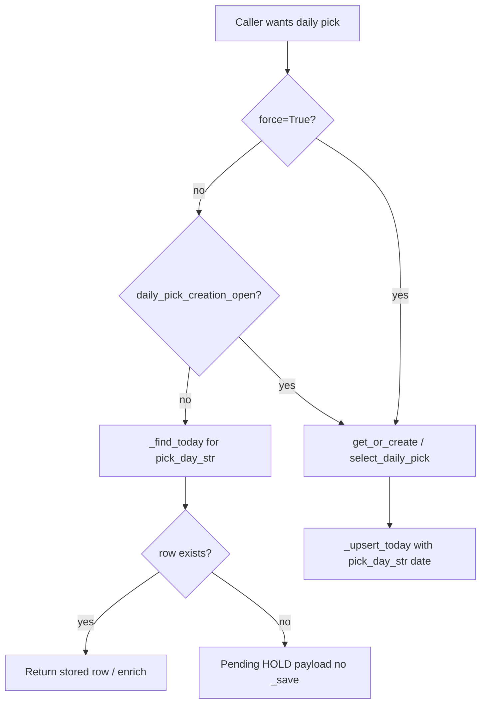

# Plan: Daily pick at ~6:05 AM America/Phoenix

**Status:** Plan only (no implementation in this PR).  
**Pinned verification SHA:** `0299d354590d179b00dd1f3807d2880b219e5b37` (`main` at review time).  
**Goal:** Move the authoritative daily pick from **00:15 UTC** (5:15 PM America/Phoenix, prior product convention) to **13:05 UTC** (~**6:05 AM** America/Phoenix, no DST), without early scoring, duplicate pick rows, or accuracy-ledger drift.

---

## 1. Problem (verified on `0299d354`)

| Mechanism | Current behavior | Why morning slot breaks if we only change env defaults |
|-----------|------------------|--------------------------------------------------------|
| Slot | `DAILY_PICK_SLOT_UTC_HOUR` / `MINUTE` default **`0` / `15`** (`internal/council/pick_scheduler.py`) | Changing to `13` / `5` alone does not define when “today” starts. |
| Pick-day key | `_today_str()` → `datetime.now(timezone.utc).date().isoformat()` in `daily_pick_engine.py` and copies | At **00:00 UTC** the stored `date` field rolls to a new calendar day **~13 hours before** the new slot. |
| Cold boot | `DailyPickScheduler.start(immediate=False)` schedules first tick in **45s** (“create today soon”) | Any boot between 00:00–13:05 UTC can score and persist a pick for the new UTC calendar `date` before the intended slot. |
| Side paths | `get_or_create_today_pick(..., force=False)` creates when no row matches `_today_str()` | `story_path.build_story_path`, `pick_explain.explain_subnet`, and `panel_summaries.summarize_picks` still call `get_or_create_today_pick` (see §4). |

**America/Phoenix:** fixed UTC−7 (no DST). Target slot **13:05 UTC** = **06:05** local.

**Pick-day rollover at 13:00 UTC:** aligns the logical “pick day” boundary with the Arizona morning window (one hour before slot gives a stable pre-slot window where the previous pick day is still authoritative).

---

## 2. Target behavior

1. **Authoritative generation** runs once per pick day, at **`DAILY_PICK_SLOT_UTC_*` default `13:05` UTC** (overridable via env, unchanged knob names).
2. **Pick-day identity** (`date` on rows in `data/daily_picks.json`, audit filenames, ledger heal, loop health, conviction alerts, API meta) uses a **shared helper** with **13:00 UTC rollover**, not raw UTC calendar midnight.
3. **Before the slot** on a new pick day: readers show **pending / prior stored row**; **no scoring persist** except explicit `force=True` (ops/scripts only).
4. **Scheduler cold start** arms the **next slot** (or retry interval if today’s pick day row exists but is `scheduler_hold`), not a 45s “create today” tick when creation is not allowed.
5. **Transition cutover** documented so prod never has two competing rows for one logical pick day and accuracy ledger stays consistent.

---

## 3. Shared pick-day module (new)

**Proposed path:** `internal/council/pick_day.py` (single source; ponytail: no second “today” helper).

### 3.1 Constants (env-overridable, documented in `DEPLOY.md`)

| Constant | Proposed default | Role |
|----------|------------------|------|
| `PICK_DAY_ROLLOVER_UTC_HOUR` | `13` | Instant when pick-day string advances |
| `PICK_DAY_ROLLOVER_UTC_MINUTE` | `0` | |
| `DAILY_PICK_SLOT_UTC_HOUR` | `13` | Scheduler target (existing names in `pick_scheduler.py`) |
| `DAILY_PICK_SLOT_UTC_MINUTE` | `5` | |

Keep existing clamps in `_seconds_until_daily_slot()`.

### 3.2 API

```python
def pick_day_str(now: datetime | None = None) -> str:
    """ISO date string for the current pick day (13:00 UTC rollover)."""

def pick_day_start_utc(pick_day: str) -> datetime:
    """UTC instant when that pick day began (rollover boundary)."""

def daily_pick_creation_open(now: datetime | None = None) -> bool:
    """True when scheduler/API may call select_daily_pick and persist (>= slot on current pick day)."""

def read_pick_day_str_from_record(rec: dict) -> str | None:
    """Normalize legacy rows that used UTC-calendar date before cutover."""
```

**Rollover rule (normative):**

- Let `now` be UTC-aware.
- If `now.time() < 13:00:00`, pick day = `(now.date() - 1 day).isoformat()`.
- Else pick day = `now.date().isoformat()`.

**Creation gate:**

- `daily_pick_creation_open(now)` is true iff `now >= pick_day_start_utc(pick_day_str(now)) + slot offset` (slot defaults 13:05 on that pick day).

### 3.3 Replace `_today_str()` in engine

- `internal/council/daily_pick_engine.py`: delete local `_today_str`; import `pick_day_str` as the pick-day key for `_find_today`, `_upsert_today`, payloads, and `write_scheduler_hold`.
- **`get_or_create_today_pick`:** at top, compute `day = pick_day_str()`. If not `force` and not `daily_pick_creation_open()` and no existing row for `day`, return a **non-persisted** pending dict (same shape as `_daily_pick_pending_hold`) or `None` per existing caller contracts — **must not** call `select_daily_pick` or `_save`.
- If row exists for `day`, behavior unchanged (stale HOLD regen, gates, etc.).

---

## 4. Call sites to migrate (enumerated @ `0299d354`)

### 4.1 `_today_str()` definitions → use `pick_day_str`

| File | Notes |
|------|--------|
| `internal/council/daily_pick_engine.py` | Canonical writer/reader for `daily_picks.json` |
| `internal/council/pick_selection_audit.py` | Audit paths `data/pick_audits/{date}.json` |
| `internal/learning/outcome_snapshot.py` | Loads today’s pick audit |
| `internal/conviction_alerts/evaluate.py` | Filters daily pick candidates |

**Import-only (already delegate to engine after engine change):**

| File | Notes |
|------|--------|
| `server.py` | Shed-to-stash guard imports `_today_str` — switch to `pick_day_str` |
| `scripts/nightly_pick_audit.sh` | Imports `_today_str` from audit module |

### 4.2 Inline UTC calendar `date` tied to daily pick (must use `pick_day_str`)

| File | Lines (approx) | Usage |
|------|----------------|--------|
| `internal/learning/ledger_heal.py` | `_today_record`, `_downgrade_today_to_hold` | Match heal targets to pick-day row |
| `internal/learning/loop_health.py` | `_daily_pick_today` | Health panel “today’s pick” |
| `internal/ops/readiness.py` | `_daily_pick_summary` | Readiness daily pick section |
| `internal/cockpit/picks_snapshot.py` | `_load_day_snapshot` fallback `date` | SSE day slice meta |
| `server.py` | `_daily_pick_timeout_hold`, `_daily_pick_pending_hold`, error payload | API `date` field consistency |

### 4.3 Related UTC date (evaluate in implementation PR)

These use UTC calendar date; confirm whether they mean **pick day** or **wall-clock UTC day** before migrating:

| File | Risk if left on UTC midnight |
|------|-------------------------------|
| `internal/council/selector.py` | May tag selection artifacts — align if tied to daily pick |
| `internal/ops/evidence.py` | Ops bundles — likely pick-day if referencing daily pick files |
| `internal/preview/k3_hold.py`, `internal/preview/tribunal_hero.py` | Preview UI — align with hero pick read |
| `internal/simivision/caution_cells.py` | SimiVision cells — confirm product intent |

### 4.4 `get_or_create_today_pick` callers (creation guard)

| Caller | Prod? | Plan |
|--------|-------|------|
| `internal/council/pick_scheduler.py` | Yes | Respects `daily_pick_creation_open`; cold-start delay uses `_seconds_until_daily_slot()` when creation closed; keep retry path when `scheduler_hold` |
| `internal/council/pick_explain.py` | Yes (`/api/pick-explain/{netuid}`) | **Read** via `_find_today(_load())`; only use `get_or_create` when `force` ops flag (default off) |
| `internal/learning/story_path.py` | Yes (SSR + `/api/mindmap/story-path`) | Same read-only pattern as homepage hydrate |
| `internal/learning/panel_summaries.py` | **`summarize_picks` only** | Prod mindmap uses **`summarize_picks_lite`** (already `_find_today` only); change `summarize_picks` for consistency or mark deprecated |
| `server.py` | Import for engine availability | No direct create on hot paths (verified: homepage/tests enforce read-only) |

### 4.5 Already read-only (no create guard needed beyond pick-day key)

- `internal/cockpit/picks_snapshot.py` — `_day_from_disk()` via `_find_today`
- `internal/learning/panel_summaries.summarize_picks_lite`
- `server.py` `/api/daily-pick` hydrate — `_hydrate_daily_pick_lite` / `_find_today`

### 4.6 Scheduler / boot

| Location | Change |
|----------|--------|
| `internal/council/pick_scheduler.py` | Default slot **13:05**; cold start **do not** fire 45s create when `not daily_pick_creation_open()` — schedule until slot (min 30s rule kept) |
| `internal/background_boot.py` | `PICK_SCHEDULER_BOOT_IMMEDIATE` remains ops-only; document that immediate boot must not bypass creation gate |
| `fly.toml` / prod env | Set `DAILY_PICK_SLOT_UTC_HOUR=13`, `DAILY_PICK_SLOT_UTC_MINUTE=5` at deploy (human-gated) |

---

## 5. Boot-tick and side-path guard (design)



**Scheduler-specific:** when `today_ready` is false and creation is closed, `_seconds_until_next_daily_tick` should wait until **slot**, not 15m retry (retry remains for `scheduler_hold` / errors **after** slot is open).

**Invariant:** only **`pick_scheduler` tick** (and explicit `force` / approved scripts) may persist a new pick-day row after cutover.

---

## 6. Transition-day behavior

**Recommended cutover:** deploy during **America/Phoenix afternoon** (after **13:05 UTC** same day) so the new pick-day boundary and slot have already passed once under old code, **or** run a one-time ops playbook:

1. **Freeze:** no manual edits to `data/daily_picks.json` / predictions during cutover window (communicate in MC).
2. **Last old-format row:** rows keyed by UTC calendar `date` may disagree with `pick_day_str` for up to ~13h. Options (pick one in implementation PR):
   - **A (preferred):** on first boot after deploy, migration helper maps latest row to `pick_day_str(now)` if no row exists for current pick day (single row, no duplicate netuid).
   - **B:** dual-read in `_find_today`: match `rec.date == pick_day_str()` **or** (legacy) `rec.date == utc_calendar_today` only until `PICK_DAY_CUTOVER_UTC` instant passed (env one-shot).
3. **No skipped pick:** if deploy lands **before** 13:05 UTC on a calendar day, creation gate prevents early write; scheduler runs at 13:05 for that pick day.
4. **No duplicate pick:** `_upsert_today` already replaces same `date` key — ensure all writers use the **same** `pick_day_str`.
5. **Accuracy ledger:** `ledger_heal` / `loop_health` must agree with pick-day key before resolver cycle; run `scripts/heal_daily_pick_ledger.py` dry-run in staging after transition; verify `tests/test_acc0_ledger_heal.py` scenarios with pick-day clock mocking.
6. **Audit files:** `data/pick_audits/YYYY-MM-DD.json` uses pick-day string — night audit cron (`scripts/nightly_pick_audit.sh`) must run **after** slot (adjust cron from UTC 00:xx to **13:10 UTC** or later).

---

## 7. Tests to add or update

| Area | Action |
|------|--------|
| **New** `tests/test_pick_day.py` | Rollover at 12:59 vs 13:00 UTC; creation gate at 13:04 vs 13:05 |
| **Update** `tests/test_pick_scheduler.py` | Cold start schedules ≥ slot when creation closed; retry when `scheduler_hold` after slot |
| **Update** `tests/test_daily_pick_shed_date_guard.py` | Shed guard uses `pick_day_str`, not UTC midnight (comment references 2026-08-30 incident) |
| **Update** `tests/test_stale_boot_hold.py`, `test_pick_regen_full_universe.py` | Freeze time with pick-day helper |
| **Update** `tests/test_acc0_ledger_heal.py`, `tests/test_learning_loop_health.py` | `_daily_pick_today` uses pick-day |
| **New/extend** | `story_path` / `pick_explain` must not call `get_or_create` when disk miss + before slot (mirror `tests/test_homepage_pick_read_only.py`) |
| **Contract** | `tests/test_endpoint_contract.py` unchanged routes; optional assert `/api/learning/health` still 200 |
| **Do not** | Bump `DAILY_PICK_TICK_TIMEOUT_SECONDS` or unmute `LOOP_STALL_GUARD_KILL` (standing gate) |

Use `freezegun` or existing monkeypatch patterns; no new dependency if tests already freeze time manually.

---

## 8. Risks

| Risk | Mitigation |
|------|------------|
| Legacy rows keyed by UTC calendar date | Cutover migration or dual-read (§6) |
| Early pick via boot 45s tick | Cold-start schedule + creation gate |
| `pick_explain` / `story_path` scoring on first visitor | Read-only disk path |
| Cron / nightly audit at wrong UTC hour | Move audit trigger to post-slot |
| Arizona vs UTC messaging | UI copy: “Daily pick publishes ~6:05 AM Arizona (13:05 UTC)” |
| Env drift (web vs worker) | Same `[env]` in `fly.toml` for slot + rollover constants |
| Partial deploy (old web, new worker) | Single deploy; pick-day module shared |
| Standing gates | No timeout bump; deploy still via contract test + Fly Deploy Guard |

---

## 9. Implementation sequence (follow-on PRs, not this doc)

1. Land `pick_day.py` + engine/scheduler + tests (core).
2. Migrate ledger/health/readiness/snapshot/server meta dates.
3. Switch side paths to read-only; add guard tests.
4. Ops: env defaults, audit cron, cutover window + ledger dry-run.
5. Human-approved Fly deploy; post-deploy `/health`, `/api/daily-pick`, `/api/learning/health`.

---

## 10. Verification checklist (post-impl)

- [ ] At 12:30 UTC, `pick_day_str` equals previous calendar date’s pick day.
- [ ] At 13:06 UTC, scheduler tick persists exactly one row for new pick day.
- [ ] Restart at 08:00 UTC does not create a pick before 13:05.
- [ ] `/api/daily-pick` returns pending/stored, never blocks on scoring.
- [ ] `build_learning_loop_health` `daily_pick.date` matches stored row.
- [ ] No duplicate dates in `daily_picks.json` after 7-day soak.

---

## Appendix: diagnosis cross-check (`diagnosis_5548.md`)

The assigned upload path was **not present** in the cloud agent environment; claims were verified directly against git **`0299d354`**.

| Diagnosis claim | Verdict @ `0299d354` |
|-----------------|----------------------|
| Slot defaults `0` / `15` | **Confirmed** (`pick_scheduler.py`) |
| `_today_str()` UTC calendar in engine + ~8 copies | **Partially confirmed:** 4 named `_today_str()` functions; **additional** inline `_utcnow().date().isoformat()` in `ledger_heal`, `loop_health`, plus server/readiness/snapshot paths (§4.2) |
| Slot-only change leaves ~13h window | **Confirmed** (00:00 UTC date roll vs 13:05 slot) |
| Boot/side paths can create picks early | **Confirmed** (45s cold tick; `story_path`, `pick_explain`; `summarize_picks` dormant in prod) |
