# Merged roadmap (draft, propose only)

## Start here

**What this is.** A proposed order of work for the subnet-dashboard known-bug backlog: 119 work rows in 6 lanes, merged from 7 source documents (the phase plan, the earlier proposal, the refactor plan, the Grok bug register, the bug sweep, the roadmap proposal and the master plan), plus one row (W119) from an external review. This file is under review in a draft PR and no work row has been started. The phase plan at 254e099c stays the plan of record.

**What the lanes mean.** Each row has a class: (a) needs an owner decision, (b) is a PR-sized fix, (c) is a finding that needs a repro before it can be scheduled. Each row also has a lane, which says when it runs relative to refactor lanes R0 to R9: `Before R0` (before the refactor starts), `Bundled` (fixed inside another row's PR), `Beside R0 to R9` (can run in parallel with the refactor), `After the #1578 stack` (waits for the PR stack described below), `After R9` (after the refactor ends), and `Dropped` (deleted by the refactor, so it needs no PR).

**What we ask of you.** Critique the order of the rows (7.3), the lane given to each row (7.2), and the defaults in 7.4 that apply if you stay silent (owner decisions 17 to 27). The separate list gives a position for all 27 decisions; decisions 1, 7, 8, 9, 11, 14, 16, 25 have no default. Say which rows you would move, split or drop, and why.

**Review history.** An external review (Gemini) and a Ditto review were answered in the section "Review responses", one line per item with its status and evidence. The external review's re-sequence is summarised in "Proposal from external review: not adopted" and is decision 27.

**The term "#1578 stack".** The lane name `After the #1578 stack` comes from the original request. In this plan it means the stack of PRs #1599 to #1605 (row D.3), which is the split landing vehicle for the large draft #1578. The draft #1578 is a separate item (decision 8). Decision 26 asks the owner to confirm this reading; if the owner means #1578's own stack, the rows tied to D.3 move.

Grok bug register merged into the phase plan of record with minimal churn. Nothing from the original is dropped. Propose only: no work row has been started and no GitHub write follows from this file. `docs/phase-plan-known-bugs.md` is not edited.

Tags: **[NEW - BUGFIX]** a new bug row; **[BUNDLED WITH <step>]** a bug folded into an existing step; **[NEW - OWNER DECISION]** a decision not in PROPOSAL.md. Sources: `phase-plan` (254e099c), `proposal` (PROPOSAL.md), `refactor-plan` (97c232db), `grok` (2a199aec, stack head 1205412e). Coverage is checked by `check_coverage.py` against `dispositions.tsv`.


## Executive summary

Every number here is computed by `build.py` from `dispositions.tsv`, `diagram_counts.txt`, and `sites.csv`. None is typed.

- **Unaccounted bugs.** 11 (UB-1 to UB-11 in the proposal, all in `dispositions.tsv`; each is folded into a work row, none is left unplaced). The Grok register adds 74 findings tagged [NEW - BUGFIX] in Part 4. The sweep itself gives 66 file rows plus 3 rest rows, all placed.
- **Moves the critical path.** 2 of the 11 unaccounted bugs land on a row of the critical path (UB-11, UB-4). Critical path rows: W38, W25, W26, W37, W18, W36 then R0 to R9. The diagram counts 119 rows, 18 decision edges and 45 blocker edges. Path matches `build_diagram.py`: yes.
- **Gates that change.** 5 gates carry a change in Part 2 (PROPOSAL B4, PROPOSAL B6, PROPOSAL B7, PROPOSAL B9, PROPOSAL B10), and D.8 gains NB-1 as a start gate.
- **Lanes.** Work rows per lane: Before R0 23; Bundled 4; Beside R0 to R9 48; After the #1578 stack 34; After R9 10; Dropped 0. Sweep sites per lane (sites.csv, 475 sites with a lane; these are code sites found by the bug-pattern sweep, not work rows): Before R0 8; Bundled 85; Beside R0 to R9 240; After the #1578 stack 85; After R9 56. The sweep-site count in `Dropped` is 1: a sweep site inside code that refactor lane R1 deletes (W118); it stays on work row internal/learning/dashboard_context.py:448 and is not dropped-with-reason. Work rows in `Dropped`: 0. Dropped-with-reason disposition rows: 0 (listed under Lane summary).
- **Coverage.** 498 disposition rows. New this pass: bug-sweep 76, roadmap-proposal 47, master-plan 13.
- **Repo counts, dated.** As of 2a199aec, 2026-11-24: 63 open PRs (the API lists 65 now; #1609 and #1610 are not in the count), 36 drafts; 24 drafts and 32 PRs of any kind have `updated_at` before 2026-11-01. PROPOSAL says 25 and 33 for those two; the measurement gave 24 and 32.
- **Owner decisions.** 27, each with a position (a default, or `No default` and why) in the separate list. Review responses: 47 items, 17 applied, 13 deferred, 17 rejected.

## Lane summary and dropped rows

The six lanes are exactly: Before R0, Bundled, Beside R0 to R9, After the #1578 stack, After R9, Dropped. Refactor lane rows R0 to R9 carry the lane `Beside R0 to R9` because that interval is their own. The roadmap's own word for the #1599 to #1605 stack is D.3. The sent request says "#1578 stack". In this roadmap #1578 is a separate draft decided by decision 8 (the diagram aliases in `diagram_counts.txt` read #1578 that way), so the lane name is kept as sent and the owner confirms what it means (decision 26).

| Lane | Work rows | Sweep sites (sites.csv) |
|---|---|---|
| Before R0 | 23 | 8 |
| Bundled | 4 | 85 |
| Beside R0 to R9 | 48 | 240 |
| After the #1578 stack | 34 | 85 |
| After R9 | 10 | 56 |
| Dropped | 0 | 1 |

| Dropped row | Target | Reason |
|---|---|---|

Dropped sites inside code the refactor deletes (sites.csv lane `dropped`; kept as work row W118): internal/learning/dashboard_context.py:448.

## ID rules

| Collision | Rule used |
|---|---|
| Grok F01 to F84 vs phase-plan F1-A, F2-A, F1-B and the section F heading | Every Grok row is G-F<nn>. Phase-plan labels are untouched. |
| PROPOSAL gates B4 to B10 vs refactor Appendix H B1 to B6 vs phase-plan B1 to B8 | Written PROPOSAL B4, refactor H.B2, phase-plan B3. PROPOSAL defines only B4, B6, B7, B9, B10. |
| Phase-plan D.1 to D.8 vs refactor Appendix H D1 to D9 | Phase plan uses a dot (D.2). Refactor and Grok Appendix F use D2 without a dot. G-F04 relates to phase-plan D.2 and refactor D2 is the same GET write (`/api/top-pick/hour`), not the resolve GETs. |
| Renumbering | None. Every existing ID keeps its label. |
| Pins | Grok lines: 2a199aec (status at 1205412e). Phase plan: 254e099c with origin/main 2a199aec lines. PROPOSAL: 2a199aec / 1205412e. Refactor plan: 97c232db. |

## Part 1. Phase plan, sections A to J, unchanged except tagged additions

<!-- verbatim copy of docs/phase-plan-known-bugs.md follows; additions are blockquotes tagged [NEW - BUGFIX] or [BUNDLED WITH ...] -->

# Phase plan: known-bug program, phase 1

Evidence base: origin/main 2a199aec (checked 2026-11-24), the sweep counts reproduced from the register `docs/bug-sweep.md` and `docs/server-refactor-plan.md` on `origin/claude/keen-goldberg-ud7grj` (commit 73767b2e). The sweep script is not on main yet; step D.1 brings it over.

Verification notes (2026-11-24): the six fault sites and the register counts were checked against origin/main by hand. The file-ownership check changed two points, recorded in section E. `gh api .../pulls/1598 --jq .merged` returns `true`.

## A. Goal

Fix every known bug in subnet-dashboard in a safe order, and get a written, checkable plan for all of them. This phase is the start: land the pending #1598 split stack, fix the six "fix first" faults, stop new instances from entering, and queue the rest behind the server.py refactor.

Landing vehicle: the split stack, not #1578. Confirmed from bases. #1598 (stack 1/8) is merged (checked 2026-11-24). #1599 -> main; #1600 -> split/1578-pr2 (#1599's head); #1601 -> pr3; #1602 -> pr4; #1603 -> pr5; #1604 -> pr6; #1605 -> pr7. Each PR is based on the previous one's head, a chain rooted at main. #1578 is the parent branch (base main, `dirty`). It is not landed itself. Closing it after #1605 lands is an outward action that needs the owner's go-ahead. #1606 targets `cursor/soul-map-write-honesty-unit1-bb47`, not main (checked 2026-11-24 with `gh api repos/cryptoreporthub/subnet-dashboard/pulls/1606`), so merging it would not land on main. It stays HELD, and its merge or retarget is the owner's call.

## B. Definition of done for this phase

1. Stack merged: `for n in 1599 1600 1601 1602 1603 1604 1605; do gh api repos/cryptoreporthub/subnet-dashboard/pulls/$n --jq .merged; done` prints `true` seven times.
2. #1591 merged: `gh api repos/cryptoreporthub/subnet-dashboard/pulls/1591 --jq .merged` prints `true`.
3. Timeout fault gone: `T=$(mktemp) && python scripts/bug_pattern_sweep.py --json "$T" >/dev/null && jq '.timeout_joined_by_with_block|length' "$T"` prints `0`. (`--json` takes an output path, so piping it to `jq` fails.)
4. Timestamp fault gone: same command, key `isoformat_plus_Z_aware`, prints `0`.
5. GET write pinned: deferred to R11, not a phase exit gate. The test `tests/test_top_pick_hour_get_readonly.py` is absent on main and fails until R11 fixes the GET write (step 4 writes it with that fix).
6. Each fault PR: `.venv/bin/python scripts/check_invariants.py --check` reports `0 new`, and `.venv/bin/python -m pytest tests/test_endpoint_contract.py -q` passes.
7. Gate in CI: a new fault instance fails the build. Check: add a throwaway `datetime.now(timezone.utc).isoformat() + "Z"` on a scratch branch; `python scripts/bug_pattern_sweep.py --fail-on` exits non-zero. Remove it and it exits 0.
8. This plan's inventory (C) re-run at phase end with current counts.

## C. Bug inventory (counts rerun at origin/main 2a199aec)

Sweep script is NOT on main (`git show origin/main:scripts/bug_pattern_sweep.py` fails). It lives only on the keen-goldberg branch. Step 1 brings it over.

Fix shape for every class: failing test first, see it fail, fix, see it pass, one small PR per class.

Verified fault sites, read at origin/main (all six still present):

| Site | Line on origin/main |
|---|---|
| `internal/learning/dashboard_context.py:120` | `with concurrent.futures.ThreadPoolExecutor(max_workers=1) as pool:` then `fut.result(timeout=2.0)` |
| `internal/simivision/chat_service.py:135` | `with ThreadPoolExecutor(max_workers=1) as pool:` then `fut.result(timeout=_INVESTIGATION_TIMEOUT_SEC)` |
| `server.py:837` | `with concurrent.futures.ThreadPoolExecutor(max_workers=1) as pool:` then `fut.result(timeout=8.0)` |
| `internal/council/state_vector.py:1313` | `"timestamp": _dt.now(_tz.utc).isoformat() + "Z",` |
| `server.py:2802` | `updated_at = datetime.now(timezone.utc).isoformat() + "Z"` |
| `server.py:2405` | `"time": datetime.now(timezone.utc).isoformat() + "Z",` |

| Class | Still present | Count (register -> main) | Owner | Fix shape |
|---|---|---|---|---|
| timeout_joined_by_with_block (D8 server.py:837, D9 dashboard_context.py:120, chat_service.py:135 new) | yes | 3 -> 3 | Own PR now (fault PR F1), before R0. Refactor plan has D8/D9 in R11; pulled forward. | Executor without `with`; `shutdown(wait=False, cancel_futures=True)` in `finally`. Test: a hung worker returns within the timeout plus slack. |
| isoformat_plus_Z_aware (D3) | yes | 3 -> 3 | Fault PR F2, before R0 (plan has R11) | `.isoformat().replace("+00:00", "Z")`. state_vector.py:1313 writes a stored value: grep readers first. |
| GET writes (D2) | yes | 1 known | Test in step 4, fix in R11 | `/api/top-pick/hour` (route at server.py:3386) -> `_ordered_hour_picks` (2873) -> `_record_pick_in_learning_loop` (def at 2709, called at 2931). Line numbers are origin/main 2a199aec. Test: GET leaves the learning loop unchanged. Fails today. |
| route_returns_exception_text | yes | 54 -> 54 | R10 adds `degraded()`; non-server routes after R10 | Log the exception, return a fixed code. learning/routes.py 15 first, then store_routes 8, message_intel 6, analytics 5. |
| silent_except_pass | yes | 225 -> 223 (drift of 2; the register is stale, main is authoritative) | Review queue after R9 | Per site: debug log if the state is legitimate, narrow or fix if it hides a bug. background_boot 17, resolver 17, resolver_scheduler 9 first. resolver_scheduler.py:1156 is held with thread 4534140517. |
| non_atomic_json_dump | yes | 59 -> 59 | Review queue after R9 | Use `internal/file_utils.safe_write_json`; skip sites already writing a temp path. |
| hardcoded_relative_data_path | yes | 133 -> 133 | Review queue after R9 | Route through `DATA_DIR`. |
| file_io_in_async | yes | register said clean -> 3 (analytics/routes.py:94; judges/council_routes.py:450, 523) | New, no owner yet | Register drift. Triage in step 7. |
| D1, D4, D5, D6, D7 | per refactor plan | not swept | R11 | Per the plan's Appendix F. |
| Failing unit tests | yes | 164 at the pre-#1598 baseline -> 160 at the #1578 head 0a7635d5 (the head adds 0 new). Source: local test runs at those two commits during the #1578 triage, not the register. | Not triaged | Triage each failure as its own class before R0. Owner: none yet. |
| judges/postmortems.py:56 invariant hit | yes | 1 | Known gap. No PR, no baseline edit. | None. |

## D. Ordered next steps

1. Add the sweep script and a `--fail-on` mode with a stored baseline of current counts. Status (2026-11-24): local commit `7bfd86f9` on branch `sweep/d1-fail-on` (off origin/main 2a199aec), not pushed. Counts match table C. `--fail-on` exits 0 on main. A staged throwaway `isoformat()+"Z"` makes it exit 1, and it exits 0 after removal. An untracked file does not trip it, because the sweep reads `git ls-files`. The pre-push review passed with nits, and the one docstring nit is applied. Table C's GET-writes row says 1 known, but the sweep reports 0 for `get_route_calls_writer`: the write goes through `_ordered_hour_picks`, not the route body. Record the gap, do not fix the count. Verify: `T=$(mktemp) && python scripts/bug_pattern_sweep.py --json "$T" >/dev/null && jq 'map_values(length)' "$T"` matches the table above; `--fail-on` exits 0 on main. `--fail-on` is not wired into CI, so B7 stays open until it is. Blocked: no. (Baseline = today's counts, so this adds no new failure.)

   > [BUNDLED WITH D.1] (PROPOSAL tag T-D.1) Wire `--fail-on` into CI after #1605's path filter lands. B7 stays open until then. Row W23.

2. Land #1591 (test-only, "behind", rebase). Verify: its CI green, then `.merged` true. Blocked: no.
3. Review and land #1599 -> #1605 in order, root first, one verified PR at a time per the Shipping playbook. Verify per PR: CI green, `mergeable_state` clean, then `.merged` true; after each merge retarget the next to main. Blocked: no. Risk: server.py overlap with step 4/5 (see F).

   > [BUNDLED WITH D.3] G-F48 (Grok, pins 2a199aec and stack head 1205412e: `predictions_store.py:345-347` two full deepcopies, `:318-323` re-read under the lock): each resolver ledger commit about 3x slower, 114 MB peak. Measure on a 1 GB Fly machine first (owner decision 19). D.3's number is unchanged. Verified by Devil (a14, a14b, a14c).
   > [BUNDLED WITH D.3] Nine Grok rows are fixed on stack head 1205412e (eight HIGH, one MEDIUM; counted from the Grok status column): G-F02, G-F03, G-F06, G-F08, G-F09, G-F10, G-F19, G-F23, G-F25. Rerun repros a02, a06, a25, a25b on main after the merge (row W26). #1578's own head 803cb9db still has G-F06.
   > [BUNDLED WITH D.3] PROPOSAL: #1604 already replaces `_ensure_cycle_generation_seeded`; owner decision 2 (UB-2 / NB-4) attaches here. Review follow-up in I: #1605 path filter blocks merge-ready.

4. Test pinning D2: `tests/test_top_pick_hour_get_readonly.py` calls `GET /api/top-pick/hour` and asserts no learning-loop write. Expect it to fail today. Land it as an expected-failure marked test, or hold the failing test inside the R11 PR. Recommend the latter: a red test on main blocks CI. Overlaps #1603, so write it after #1603 merges. Blocked: on #1603.

   > [NEW - BUGFIX] G-F04 (public resolve GET links, `internal/learning/routes.py:1249-1265` and `:1824-1841`, Grok pin 2a199aec) is related to D.2 (GET writes) but is a different route and a different bug. PROPOSAL and the refactor plan do not mention it. Not merged; recorded as an overlap only. Row W13.

5. Fault PR F1 (three timeout sites), then F2 (three timestamp sites). Verify: new tests fail before, pass after; sweep keys read 0; step B6 commands. Blocked: no, but start after step 3 to avoid conflicts (recommend; the fixes are 1-line each).

   > [BUNDLED WITH D.5] `server.py:2405` trail `time` (+00:00Z) as a separate small PR with a test that the trail time has no `+00:00Z` (UB-6). Row W30.
   > [BUNDLED WITH D.5] Optional chat single-flight guard as a separate small PR after F1-A lands (UB-7). Row W31.

6. Fix route exception text, learning/routes.py first (15), once R10's `degraded()` exists. Blocked: on R10 (R9, and so on R0 to R9).

   > [BUNDLED WITH D.6] NB-5 starts it early for the 25 clean sites plus 3 missed leaks (UB-5: 54 is a floor, at least 65). `learning/routes.py` (15) and 14 refactor-owned sites stay in D.6 after R10; all change response bodies, so none land inside R0 to R9. Reuse `public_error`, not `degraded()`. Row W33.

7. Triage file_io_in_async (3). Verify: each marked fix or accepted in writing. Blocked: no. Result (2026-11-24, read at origin/main 2a199aec, no production data read): all three accepted, no code change. `internal/analytics/routes.py:94` reads a local price-baseline JSON with `open` and `json.load` inside `api_price_tracking_baselines`. `internal/judges/council_routes.py:450` and `:523` read bundled HTML templates inside two page routes. `analytics/routes.py:94` reads the price-baseline file that `message_intel/price_tracker.py` writes. The writer drops entries older than `BASELINE_RETENTION_DAYS = 7` (`price_tracker.py:37`, cutoff at `:525`), so the file is bounded by a 7-day window. The steady-state size per write rate is not measured. The two `council_routes.py` reads are bundled HTML templates with fixed size. Re-triage if the retention cap is removed or raised, or if the file's size or read time is measured as material. The baseline records the count as 3.
8. R0 starts only after #1599 to #1605 have landed and the null-block fix (section E, #1604 at `d3cd254c`) is on main, taking its numbers from main then. Verify: R0's plan checks (route manifest, golden files). Blocked: on #1604 landing.

   > [BUNDLED WITH D.8] NB-1 (hermetic fixture, UB-4) lands after the stack and before R0. R0 text drops the autouse-fixture bullet (plan line 101) and the writer-routing bullet (line 102), pin 97c232db. Owner decisions 3 and 15.


## E. Blocked items and unblock conditions

- #1606 (HELD): the lens pass is done. Result: PASS-with-nits at `0a7635d5`, no A findings, all 10 lenses loaded. Its one behavior change (APPLIED to DECLINED, below) is not in the PR text. #1606 stays held for the owner's merge call. Its base is `cursor/soul-map-write-honesty-unit1-bb47`, not main.
- R0: it waits for #1604 (the null-block fix, `d3cd254c`) to land on main. #1605 already includes the fix. Until then R0 and everything after it is blocked. Steps 1, 2, 3, 5, 7 proceed.
- Thread 4534140517 (resolver_scheduler.py:1156): stays open until #1604 lands.
- Null-block fix for `prediction_resolver_scheduler` (in #1606 at 0a7635d5, `if block is None` instead of `setdefault`): absent from every split head. Only #1604 changes `internal/council/resolver_scheduler.py` among #1599 to #1605 (its test file `tests/test_resolver_scheduler.py` too). #1605 inherits that file from #1604. Port target checked (2026-11-24): the #1606 patch for that file applies cleanly to #1604's pre-port head `36a7ab30`. The fix is ported into #1604, head `d3cd254c` (test commit `35add609`, fix commit `d3cd254c`, pushed 2026-11-24). The port adds falsy-block cases (`[]`, `0`, `""`, `False`) that #1606 lacks. The file `tests/test_1578_null_scheduler_block.py` has 14 tests. Before the fix, 4 fail (the regression tests) and 10 pass (guard tests that pass on both trees). After the fix, all 14 pass. #1605 includes the fix via merge `71313175`, pushed as a fast-forward. The port's one behavior change (`36a7ab30` to `d3cd254c`) is that a missing key with a declined summary moves from APPLIED to DECLINED. The #1604 body states it. Callers traced (`d3cd254c`): `_cycle_ok` accepts `declined`; `replay.py:156` passes the value through; `pump_lead_recover.py:527` reports its own writer's outcome, not the summary. A repo-wide `persist_outcome` grep outside tests at `d3cd254c`, including JS, HTML, and templates, finds no consumer outside the scheduler's own tick that branches on the value (`resolver_scheduler.py:954` does, for backoff); `PersistResult.committed` has no callers in `internal/council`. Measured 2026-11-24 by calling `_persist_cycle_summary` directly with a newer generation and reading back `last_cycle` and `cycle_history`. The probe was session-local and is not committed. Owner path (`force=False`, `_persist_owner_gen` set): two cycles give APPLIED on `36a7ab30` (pre-port #1604 head) and `d3cd254c`, and `committed=True` on `2a199aec` (main). Force path (`force=True`, the timeout orphan write at `internal/council/resolver_scheduler.py:1323`): a stored timeout row (`complete: False`) followed by an incoming `ok: True` summary leaves `last_cycle` unchanged and adds no history row. The result is DECLINED on `36a7ab30` and `d3cd254c`, and `committed=True` on main. An incoming `ok: False, complete: True` summary behaves the same way. The other 7 of the 9 stored/incoming combinations store the same state in all three trees. The force caller always sends `ok: False`, so the `ok: True` row cannot come from it. Line numbers in this paragraph are at `d3cd254c`. The `ok: False, complete: True` row needs `mark_complete()` to run after the abandon check at `resolver_scheduler.py:1568-1571` and before the snapshot. I have not shown that window. The DECLINED label first appears in `e7b7de70` (#1578 7/8), which is inside #1604's own range (`1b228f0e..36a7ab30`), not in the null-block port commits. So #1604 changes the force-path report from `committed=True` to DECLINED. The timeout caller at `resolver_scheduler.py:1323` discards that return value. The timeout `result` that `_run_refresh_cycle_with_timeout` returns to `:919` is a fresh dict built at `:1305`, and nothing writes `persist_outcome` into it. The worker's own dict gets the label at `:1582` through `_apply_persist_honesty` (`:1917`), and that dict is a separate object the timeout path never returns. So the outer loop's `persist_outcome` read at `:941` finds no label on the timeout result, and no caller can observe the force-path label. The earlier claim that `:941` reads only `ok` was wrong, and this sentence replaces it. Verdict UNDETERMINED: the drop is pre-existing on main, and no test asserts that the write must land. An earlier DECLINED on a fresh install came from a hand-built payload with no `gap_timing_ms`, which production never emits. A completed-success payload gives APPLIED.
- Parked weights fix (thread 4534140530, weights.py emit-failure logging): no split PR among #1599 to #1605 touches `internal/council/weights.py` or `data_seeds/score_snapshots.json`. It has no split owner. The change exists only as a staged index on the local, unpushed branch `claude/fix-1578-weight-emit-log` (803cb9db), in an ephemeral session worktree. It logs a warning when `emit_weight_change` fails, then returns the value, with a 27-line test. It is not on any remote, and no patch file was saved, so it needs re-creating from the branch before any further work. Its seed needs rebuilding from repo-local inputs for `data_seeds/score_snapshots.json`; if that needs production data it stays parked. No hand edit of the digest.
- D2 test: blocked on #1603.

> [NEW - BUGFIX] Additions to table C and E (PROPOSAL pins 2a199aec, stack 1205412e, refactor plan 97c232db):
> - Table C `route_returns_exception_text`: [BUNDLED WITH D.6] PROPOSAL UB-5 finds 11 more `str(exc)` leaks the sweep misses (examples `server.py:3154`, `2383`, `2395`). 54 is a floor.
> - Table C `silent_except_pass`, `non_atomic_json_dump`: [NEW - BUGFIX] (same unit as NB-7) and [NEW - BUGFIX] (same unit as NB-3). Reading the sites shrinks JSON writes 59 to 8 real, swallowed 31 of 83 read need work (PROPOSAL section 3).
> - Table C `hardcoded_relative_data_path`: [NEW - BUGFIX] (same unit as NB-1) test-hermeticity matter, latent in production (`WORKDIR /app` equals the mount).
> - Table C `timeout_joined_by_with_block` and `isoformat_plus_Z_aware`: F2 covers one site, not three (`server.py:2802` only). `state_vector.py:1313` needs an owner decision on a seed restamp (decision 4). PROPOSAL B4 reads at most 1 until R11.
> - Table C `judges/postmortems.py:56`: [NEW - BUGFIX] related, not merged: G-F75 (`postmortems._write_tmp_json` O_EXCL, `internal/judges/postmortems.py:50-71`, Grok pin 2a199aec; Verified by Gemini + Replit (not re-checked by Devil)).
> - E, #1604 `resolver.py` HIDES-STATE sites: [NEW - BUGFIX] NB-4 (UB-2: `resolver.py:876`, `:1116` swallow the effect error).
> - E, the register line about `resolver_scheduler.py:1156` is wrong per PROPOSAL (line 1156 is not a swallow site; thread 4534140517 is about the scheduler null block). Owner decision 14. The original text above is kept as written.

## F. Risks and cheapest checks

- Fault PRs conflict with stack PRs in server.py. Check: `gh api repos/cryptoreporthub/subnet-dashboard/pulls/<n>/files --jq '.[].filename' | grep -x server.py` for each of #1599-#1605.
- state_vector.py timestamp is stored and read back. Check: `grep -rn "timestamp" internal/council | grep -i parse`, and run the council tests, before changing the format.
- A baseline-only gate hides existing bugs. Check: baseline file lists counts per class; review when they drop.
- Scorer touch needs `data_seeds/score_snapshots.json` in the same commit (CLAUDE.md). F2 touches state_vector.py: run `check_invariants.py --check`.
- Counts drift again. Rerun the sweep at each merge; main is authoritative.

> [NEW - BUGFIX] Risk additions: fixture-before-R0 (NB-1) changes the working directory for every test and may break some of 211 repo-relative paths in 46 files (not run). New B9 and B10 gates, PROPOSAL labels, not the phase plan's B1 to B8.

## G. Out of scope

Merging or retargeting #1606; the weights.py fix and seed restamp; postmortems.py:56; hand edits of any digest; closing thread 4534140517; the server.py refactor R0 through R12 (planned, not started); the three candidate sweeps (silent except, JSON atomicity, data paths) beyond the baseline.

> [NEW - OWNER DECISION] The out-of-scope list is carried unchanged. Owner decision 24 confirms it stays out of this merge.

## H. Summary

This phase lands the stack that is ready, fixes the six faults that are plainly wrong, and puts a gate in place so no new ones arrive while the rest waits its turn.

## I. Review follow-ups (2026-11-24, not yet fixed)

- **Skip row replaces a completed success (pre-existing, B/C).** A `heavy_job_busy` skip at `internal/council/resolver_scheduler.py:858-866` (origin/main) calls `_persist_cycle_summary` without `owner_gen` or `force`. With no timing context, the write takes the `not owned_cycle` branch, which runs before the "last_cycle holds completed successes only" rule, so a completed success in `last_cycle` is overwritten by the skip row. That branch dates from `54b3d891` (#1571), already on main. It does not block #1604. It needs its own fix.
- **#1591 is not test-only.** Its diff includes `internal/council/pump_overlay.py:34`, which adds `st_ino` to the memo key. Its body says 3 files; the diff has 6. The `check_invariants.py --check` gate cannot run at `dfcad050`, because that tree predates `scripts/check_invariants.py` (added on this branch in `b3a34319`). Landing stays held on the owner's GO and an update-branch.
- **Receipts journal grows without bound.** Ditto nit on #1604. Not triaged.
- **#1605 path filter leaks (A, blocks #1605 merge-ready).** The filter in `.github/workflows/unit1-slice.yml` is new in #1605 (commits `85ed78fc`..`f6254f49`, not on main). It omits files the 62 gated tests load at runtime, for example `internal/file_utils.py` (43 gated tests reach it through `predictions_store.py` and `soul_map_io.py`, a static-closure count and an upper bound like the 206 below) and `tests/conftest.py` (loaded for every gated test). A static import closure of the gated tests, with `server.py` excluded, reaches 206 uncovered Python files. That count is an upper bound: `TYPE_CHECKING` and `try/except ImportError` edges are included. A hand-listed filter cannot track that closure.
- **#1605 pushed to 1205412e.** Head `split/1578-pr8` moved from `71313175` to `1205412e9b4b8b42034640679bbf57daf594b3a2`. It was a fast-forward, with no force push.
- **Trigger-rule proof is pending.** The new rule (`paths-ignore` for `docs/**` and `**/*.md`) gets its first real proof only when the stack merges to main, because the workflow runs only on base main. Until then a simulator checked the trigger behavior, not a live run.
- **CI read for 1205412e.** GitHub Actions runs: `total_count` 0. Check-runs: CodeRabbit completed/skipped, and Cursor Automation: Auto-Review completed/neutral. `unit1-slice` did not run, so the sync test did not run in CI on this SHA.
- **Review sources for 1205412e.** The Ditto local review returned PASS, but it worked from a summarized diff, so it is not a full-diff review. A fresh pstack review with 12 lenses and an attack-the-premise pass returned PASS-with-nits and no blocking findings. The Ditto and pstack verdicts are carried from an earlier run (source not recorded). The pstack review covered commit `1205412e`.
- **Nits recorded as follow-ups, not fixed.**
  1. The sync test pins the substring `paths:`, so `paths :` and `"paths":` slip through. Parse the YAML in the test to close it.
  2. Nothing pins `branches: [main]` on push.
  3. The commit trailer names the model, and the attribution reminder names the same. Dismissed, and the pushed history is not rewritten.
  4. If `unit1-slice` becomes a required check, docs-only PRs leave it pending. The old filter behaved the same. Branch protection was not checked.
- **#1605 title is stale.** It still says "path-filtered". Not edited.

> [NEW - BUGFIX] I additions: skip-row fix is re-ported after #1605 with the #1608 helper (PROPOSAL B10); #1605 path filter blocks merge-ready (row W38); NITS row W39; receipts journal row W93.

## J. D.5 claims, partly verified by run (2026-11-24, base origin/main 2a199aec)

Runs used a detached worktree at origin/main, removed after. Each number below is one a run printed in this section, unless its bullet labels it carried from an earlier run or reported by another reviewer. Code constants and git facts are read from source and cited by path, not run. Claims a run did not test are labelled "not run" or "read from code". The scripts are in the session scratchpad, not committed: `f1a*.py` (F1-A and F2-A) and `f1b_*.py` (F1-B), with output in each named run folder (`run1/` and `run2/`). Each run stubs only the slow callee.

- **F1-A, timeout waits past its budget: proven at 3 sites.** The `.result(timeout=...)` call sits inside a `with ThreadPoolExecutor` block at `server.py:837-839` (8.0s), `internal/simivision/chat_service.py:135-137` (8s) and `internal/learning/dashboard_context.py:120-122` (2.0s). Exiting the block calls `shutdown(wait=True)`, so the caller waits for the callee. Measured: chat_service with a 1s budget returned at 5.0s; dashboard_context with a 2s budget returned at 6.02s; server with an 8s budget returned at 11.4s. Not verified: real production callee durations, and whether these paths run on a request thread.
- **F2-A, aware-datetime "Z" suffix: proven for `server.py:2802`.** `datetime.now(timezone.utc).isoformat()+"Z"` yields `...+00:00Z`, which `fromisoformat` rejects. The reader is `internal/simivision/weighing_room.py:427` (not `internal/council/`, which does not exist). It replaces "Z" with "+00:00", so a value with both suffixes gives "updated recently" where a valid value gives "updated 5m ago". The value reaches `templates/partials/premium/simivision_picks.html:9`. The other two sites (`server.py:2405`, `internal/council/state_vector.py:1313`) show only cosmetic output in the readers found; state_vector has no parsing reader found. Unproven beyond that.
- **F1-B, background work outlives its caller: split.**
  - Telegram backfill. Proven by run: the work outlives the timeout. On origin/main (exported with `git archive`), `trigger_backfill` returned False at 180.0s, and the stub write landed at 183.1s. Script `f1b_tg.py` in the scratchpad, output in `run2/tg_fresh_output.txt`: the marker is absent at the 180.0s return and written at 183.1s. The run used an empty output directory, so the marker could not be left over from an earlier run. The stub replaces `_backfill_gap` with a 183s sleep, so the 183.1s is the stub's write, not the real one. Not run: the real `_backfill_gap` write window. Read from code, not run: a second backfill can overlap it. `message_intel/telegram_listener.py:715` (not `internal/message_intel/`) is `fut.result(timeout=180)`, and the caller `internal/message_intel/listener_service.py` records False as `failed`. The coroutine keeps running on the loop after the caller has returned. Overlap path (read, not run): `_attempt_listener_backfill_with_recovery` releases `_backfill_lock` when `trigger_backfill` returns, and a forced attempt bypasses the throttle after its 45s memo expires (`listener_service.py:376-420`). So a forced retry on the same listener can start a second `_backfill_gap` alongside the first. Not fixed: `fut.cancel()` would stop the overlap, but `last_telegram_external_id()` (`internal/message_intel/store.py:32`) is `MAX(external_message_id)`, and the forum scan is per topic. A cancel mid-scan would leave the cursor past messages not yet scanned, in topics not yet scanned and in the older part of the topic being scanned, so the next backfill skips them. A synthetic asyncio check (not saved, not against Telethon) showed that cancel cancels at the next await. The fix still needs a cursor change first. Replit's synthetic-client run also showed the skip (cursor 110 after ingesting 110, with IDs 108 and 109 never scanned); reported by Replit, not run here. Dedup: `message_intel/models.py` has a unique index on (source, group_id, external_message_id) when both IDs are set, and `save_message` checks for an existing row first. Not verified: a concurrent insert race, and production data. Not verified: whether real stale-limit backfills take longer than 180s.
  - pick_scheduler lost update: refuted. The orphaned worker does reach `_save`, but `internal/council/daily_pick_engine.py:96-137` reloads under a lock and rejects the stale row, so the later write does not win. Not verified: a tie on timestamp granularity.
  - resolver_scheduler auto-retrain: the timed-wait shape is refuted by read, not run. `maybe_trigger_auto_retrain` (`internal/calibration/scheduler.py:56`) calls `start_retrain_async` (`:100`), which starts a daemon thread (`internal/calibration/pipeline.py:587`, `threading.Thread(...).start()`, inside `start_retrain_async` at `:568`) and returns a dict at once. Every caller of `start_retrain_async` on origin/main is fire-and-forget: the resolver (`internal/council/resolver_scheduler.py:1444`, inside `timing.stage("auto_retrain")`, through `maybe_trigger_auto_retrain`) and the admin route (`internal/calibration/routes.py:50`, which returns `started` or 409). No caller waits on the retrain with a timeout, so no caller gives up on it while it runs. The Telegram shape, a timed wait that gives up while the work continues, is not present. Read from code, not run: an abandoned resolver cycle can still start a retrain. The `auto_retrain` stage at `resolver_scheduler.py:1444` has no abandon check before it; the `is_abandoned()` checks at `:1406` and `:1424` guard `resolve_due` and `expire_stale`; none guards the retrain trigger. Not verified: whether a cycle can be abandoned at that point. Nothing was run, by the decision rule. Not read: the write path inside `run_calibration_pipeline`, so whether a retrain that overlaps a later cycle writes safely is not claimed either way.
- **F2-A pushed.** Commit `9fffc15ce2f0fceb6613b5b1a464655166e60097` is on `origin/fix/f2a-main-rebuild` at that SHA, one commit on origin/main. No PR is open. It touches `server.py` (one line, which drops the `+ "Z"` from `updated_at` in `_safe_simivision_payload`) and `tests/test_weighing_room.py` (+21 lines, test `test_weighing_board_updated_ago_reads_producer_timestamp`). Red on main, the assertion diff is `- updated 5m ago` / `+ updated recently` (carried from an earlier run, source not recorded). Green, weighing_room 17 passed, and the endpoint contract 149 passed with 1 warning (both counts carried from an earlier run, source not recorded).
- **Superseded.** `fix/f2a-aware-datetime-z` at `d57fbedd` was built on the docs branch. Do not use it.
- **Invariant gate, differential run.** The CLAUDE.md "0 new" gate cannot run as written on origin/main, because `scripts/check_invariants.py` and `scripts/invariants_baseline.json` are absent there. Run on origin/main and on `9fffc15c` with the same baseline copy, both print 38 hits, 36 accepted, 2 new (counts carried from an earlier run, source not recorded). The new set is identical: `internal/council/resolver_scheduler.py:290` and `internal/judges/postmortems.py:45`. The fix adds zero hits. Neither file has a baseline entry, because the baseline predates the `d3bde0de` refactor.
- **Caller sweep for `updated_at`.** `internal/simivision/weighing_room.py:427` parses it after the replace. `server.py:2799-2832` passes it through. `internal/learning/dashboard_context.py:248` copies it without parsing. The template and JS readers use `updated_ago` only. No reader depends on the trailing Z. Persisted data has no weighing meta `updated_at` under `data/` (not verified; `data/` was not read), so the only effect of the old form is the label "updated recently" until the cache regenerates.
- **Pre-push review of 9fffc15c.** PASS (pstack review with the pstack lenses, report only; carried from an earlier run, source not recorded). A Ditto local review was requested for `9fffc15c`. The send timed out with the outcome unknown, so it is not counted as a reply. The pstack review stands as the gate.
- **Ditto outcome for F2-A.** The F2-A review request was sent at `9fffc15c`. Reported: its first send timed out at 60s with an unknown outcome, and it was resent with a client_message_id. The reply arrived as message `39e0c76e`, status completed: PASS with no A-class findings. Its cited line numbers were wrong. It named `server.py:2807` and `weighing_room.py:432`, and git shows `server.py:2802` and `internal/simivision/weighing_room.py:427` (checked on origin/main with grep). Its claim that the new test fails on main rests on the test being absent there, not on an executed run, so treat it as unverified.
- **Follow-ups for F2-A.** `server.py:2405` has the same `+ "Z"` pattern for the learning-trail time. It has a different reader and is not fixed. `internal/council/state_vector.py:1313` is a scorer file, and a fix there requires restaging `data_seeds/score_snapshots.json`.
- **F1-A pushed.** Branch `origin/fix/f1a-timeout-bound` at head `e05420cc0528771d3294e629fa7480088be16d51`, no PR open, base origin/main `2a199aec4372d7cb0f013f4f5dfa54cf302ba648`. Three commits, one per site: `a58394a60a07caab45f5ad5cbe6427edb1d0055f` (server.py emergency prime), `0c7a9a024e1b417f5c74559b4aff56afac4d8e7c` (chat_service investigation context), `e05420cc0528771d3294e629fa7480088be16d51` (dashboard_context fast shell). Line numbers below are on `fix/f1a-timeout-bound` (git grep).
  - **Fix.** Each site used `with ThreadPoolExecutor(...)` then `.result(timeout)`. The with-exit calls `shutdown(wait=True)`, so the timeout did not bound the wait. Each site now holds an explicit pool and calls `pool.shutdown(wait=False, cancel_futures=True)` in `finally`. `server.py` already used this idiom (`server.py:865`, `872`, `1003` on origin/main). Sites on the branch: `server.py:839` (`pool.submit(_build).result(timeout=8.0)`, shutdown at `:841`), `chat_service.py:137-138` (`fut.result`), `dashboard_context.py:122` (`result(timeout=2.0)`).
  - **Red then green.** Carried from an earlier run, not re-run here. The new tests fail at each commit's parent with pytest. Timing diffs: server.py `returned after 12.4s, budget 8.0s` (green: 1 passed); chat_service `returned after 5.0s, budget 1.0s`; dashboard_context `returned after 6.0s, budget 2.0s`. The 12.4s here and the 11.4s in the F1-A bullet above come from different runs.
  - **Background work is not killed.** Threads cannot be killed, so a worker keeps running after the caller returns. `cancel_futures` cancels only queued work. Re-entry bound per site: the server prime fallback sets `_EMERGENCY_HOME_HTML` (`server.py:845`), so later requests return early at `server.py:1709` and `:1751`. The dashboard site is bounded by `_FAST_SHELL_TTL = 30.0` (`dashboard_context.py:17`). The chat site leaks one worker per timed-out message (nit).
  - **Checks.** Carried from an earlier run, not re-run here. Endpoint contract: 149 passed, exit 0. Commit hygiene: exit 0 for all three messages. Flake margins 1.001s to 2.003s, comfortable, except the cold prime run: 8.385s against the 8.0s budget with 1.0s slack, so 0.615s margin, from one cold run.
  - **Invariant gate.** The CLAUDE.md "0 new" gate cannot run on origin/main (no `--root`, no baseline JSON there). Differential identical to origin/main, branch adds zero hits; 2 new hits already on main, so an absolute 0-new is not shown (carried from an earlier run, source not recorded).
  - **Reviews.** Reported by earlier reviewers, not run here. Pre-push review by a fresh reviewer at `e05420cc`: PASS. Skills invoked by name: 13 (poteto-mode, prove-it-works, fix-root-causes, test-behavior, boundary-discipline, make-operations-idempotent, separate-before-serializing, model-the-domain, laziness-protocol, explain-the-number, sequence-verifiable-units, attack-the-premise, interrogate). The adversarial pass (interrogate) ran as one labelled sequential pass, with no fan-out, because the reviewer had no Agent tool. Ditto review of `e05420cc` (message id c2edf94e-cfbc-48fd-b1d8-435e729d319b): PASS-with-nits. Nits: the tests sleep for budget plus slack (slow, possibly flaky under load); the 8.0 timeout is inline, so it is not monkeypatchable; the chat leak per message. Ditto's cited line numbers were wrong: it gave the base sites as server.py:842-844 and the precedent as 861-865; git on origin/main shows server.py:839 and :865.
  - **Lock finding, does not block.** An abandoned site-3 worker (`_load_learning_metrics` -> `_learning_snapshot`) can call `save_weights` on `soul_map.json` after the caller returned. `_learning_snapshot_lock` and the `expected_weights` compare-and-swap protect it. Found by grep only, not exhaustively audited (template render and `enrich_subnet_rows` not read).
  - **Not verified.** CI timing on slower hosts; the write audit is grep-level; the two new invariant hits were not classified beyond "already on main".
  - **Status.** `fix/f1a-timeout-bound` was pushed to `origin/fix/f1a-timeout-bound` at `e05420cc`. The user deferred the choice of target to the advisor, and no PR is open. Landing needs a PR that the user requests.

Open after this section: the telegram write window with the real `_backfill_gap`, the resolver run, and the state_vector consumer.


> [NEW - BUGFIX] J additions: F1-A residuals: chat leak per timed-out message (UB-7, row W31); `server.py:2405` and `state_vector.py:1313` follow-ups (rows W30, W22); lock finding is grep-only (row W97); Telegram, auto-retrain, pick_scheduler rows W94, W96, W95.

Editorial note on the evidence paragraph in section J (not part of the quoted phase plan): that paragraph and the Telegram backfill bullet say the scripts and run output are kept in the session scratchpad, not committed. They are quoted above exactly as the phase plan has them. The files they name (`f1a*.py`, `f1b_*.py`, `run1/`, `run2/`) still exist there (8 entries at the scratchpad root, none in the scratchpad's roadmap subfolder as of 2a199aec, 2026-11-24), none is committed to this branch, and so a reader cannot re-run them from the repo.

## Part 2. PROPOSAL items carried in

Pins: PROPOSAL read at main 2a199aec, stack heads #1604 d3cd254c and #1605 1205412e, F1-A e05420cc, F2-A 9fffc15c, refactor plan 97c232db. Rows copied by script from PROPOSAL.md. Gate labels carry the prefix PROPOSAL so they never collide with phase-plan B1 to B8 or refactor Appendix H B1 to B6. PROPOSAL defines gates B4, B6, B7, B9, B10 only; B5 and B8 are not defined in PROPOSAL.md.

### Section 0 (refactor plan changes 977e8514 to 97c232db), PROPOSAL S0.1 to S0.8

Every plan line number in this proposal now points at `97c232db`. The changes that affect this proposal:

- **Line numbers.** `frozen_world` is line 95. R0's autouse fixture is line 101 and the writer-routing bullet is line 102. R1 deletes the `dashboard_context.py` items at lines 156 and 158 (was 157). D3 is line 739 (was 736), D9 is line 744, and the R11 table rows are lines 1043 and 1049.
- **Pass conditions already exist for D3 and D8/D9.** Appendix H rows are at lines 1088 and 1093. D3 needs all 3 production sites and sweep key `isoformat_plus_Z_aware` at 0, so F2-A alone does not pass it.
- **Fixture conflict.** R0 keeps `frozen_world` (line 95) either way, because the golden test (line 96) runs inside it. Line 95 now also sets `TZ` to `UTC` and a fixed locale, and NB-1 does not set those yet. Owner decision 15 says where they go.
- **One body change allowed in R0 to R9.** Line 40 allows one response-body change in R0 to R9: the `/api/stats` golden case that R5 names (line 42). NB-5 still lands before R0, so its rule holds. Its row now says so.
- **Narrowing rule.** Line 51 says how to narrow `except Exception`, and that the `tests/test_server_budget.py` count only goes down. Applied to NB-4 and NB-7.
- **`tests/test_import_layers.py`.** Created in R2 (line 220), finished in R12 (line 805). No NB row depends on it.
- **R10 helper.** Line 679 says a standalone PR in `docs/roadmap-proposal.md` adds `degraded()`. It is still absent on `main`. Owner decision 14 stands.
- **Not changed.** `docs/roadmap-proposal.md` and `docs/bug-sweep.md` are the same at `97c232db` as at `977e8514`.


### Step 3 and 4 rows (NB-1 to NB-7) and tags on existing steps

| Step | What | Tag | Lane and gate |
|---|---|---|---|
| D.1 | Sweep script and `--fail-on` (local `7bfd86f9`) | [BUNDLED WITH D.1] wire it into CI after #1605's path filter lands | before R0, no blocker. B7 stays open until wired. |
| D.2 | Land #1591 | unchanged | held. It is not test-only (6 files incl. `pump_overlay.py`). |
| D.3 | Land #1599 to #1605 | unchanged. Note: #1604 already replaces `_ensure_cycle_generation_seeded` | UB-2 decision attached (see owner decisions) |
| D.4 | Test pinning D2 | unchanged | blocked on #1603 |
| D.5 | F1-A, F2-A | [BUNDLED WITH D.5] `server.py:2405` as a separate small PR, with a test that the trail `time` has no `+00:00Z`. [BUNDLED WITH D.5] optional chat single-flight guard as a separate small PR after F1-A lands | before R0. The roadmap advises starting these after D.3 to avoid conflicts; `merge-tree` shows 0 conflicts, so they may also go earlier. Separate PRs keep the pushed F1-A and F2-A SHAs stable. Adding commits to those branches is the alternative (owner decision). |
| D.6 | Route exception text | [BUNDLED WITH D.6] NB-5 below starts it early. D.6 keeps `learning/routes.py` (15) and the 14 refactor-owned sites (10 after R9, plus 4 `server.py` sites the plan bundles into R3 and R6). All 29 change response bodies, so they land after R9 (R10 or later). "After stack" and R3/R6 fall inside the R0 to R9 no-body-change window | rest after R10 |
| D.7 | `file_io_in_async` | done | no change |
| D.8 | R0 starts after the stack and #1604 | gate adds NB-1 | R0 text: drop the autouse-fixture bullet (plan line 101; NB-1 covers it) and the writer-routing bullet (line 102). `frozen_world` (line 95) stays in R0. Owner decision 15 says where `TZ` and the locale go. |
| F1-A | `fix/f1a-timeout-bound` `e05420cc` | unchanged | no PR open |
| F2-A | `fix/f2a-main-rebuild` `9fffc15c` | unchanged | no PR open |
| skip-row fix | `fix/skip-row-overwrites-last-success` `cacdb982` | [BUNDLED WITH skip-row fix] re-port after #1605 lands, plus the #1608 helper fix | **after stack.** Branch stays as pushed for the Gemini review. Do not push to it. |
| NB-1 | Standalone hermetic-fixture PR | [NEW - BUGFIX] | **after the stack lands, before R0** (a D.8 gate). It edits `tests/conftest.py`, which #1604 also edits, and it changes the working directory for every test. Landing it ahead of the stack would force all seven chained PRs to be re-verified, which is the thrash to avoid. Move it earlier only if a worktree measurement shows no breakage. Insert the fixture before `_isolate_message_intel_db`, not at the end of the file (avoids a #1583 conflict). Also set `PRICE_CACHE_PATH` and fix `tests/test_no_handrolled_liveness.py:27`. R0 keeps its manifest, golden, and budget work, and `frozen_world` (the golden test runs inside it). Owner decision 15 says where `TZ` and the locale go. |
| NB-2 | Close the public weight-write path (UB-1) | [NEW - BUGFIX] | **now, before R0, small PR, once you decide what to do with draft #1444.** Touches no stack file. NB-2's own files (`write_auth.py`, `learning_engine.py`) are edited only by #1444, but #1444 is a draft that fixes the same routes and also edits `server.py` and `learning/routes.py`. So NB-2 duplicates it, and the two would collide. Two ways to close the hole (product call, see owner decisions). |
| NB-3 | Fail-closed loader plus atomic write for `message_intel/price_tracker.py` and `internal/signals/signal_tracker.py` (UB-3), and `reset_store.py` | [NEW - BUGFIX] | **now, before R0.** Touches no stack file and no open PR. Failing test first (truncate the file, assert the loader refuses to overwrite). The three heartbeat writers go to NB-7. |
| NB-4 | `resolver.py:876`, `:1116`, and the HIDES-STATE resolver sites (UB-2) | [NEW - BUGFIX] | **after stack**, on top of #1604. Or bundled into #1604 (trade-off below). Narrow `except Exception` by plan line 51: I/O and parse handlers narrow to their errors, a pure internal `try` is deleted, and a broad handler stays only at a boundary with `logger.exception`. |
| NB-5 | Early exception-text swap for the 25 clean sites plus the 3 missed leaks in clean files. The other 8 missed leaks sit in `server.py`, `learning/routes.py`, and `signals/routes.py`, which open PRs edit, so they go to R10 or after R9. "After the stack" would fall inside the R0 to R9 no-body-change window | [NEW - BUGFIX], unblocks D.6 | **now, before R0.** Touches no stack file, source or test: I grepped the file lists of #1591 and #1599 to #1606 and none edits a test that asserts these routes' bodies, and `tests/test_endpoint_contract.py` is in none of them. It changes response bodies, and the plan says R0 to R9 change no response body except the one `/api/stats` golden case that R5 names (plan lines 40 and 42), and each R-PR runs a regression lane against trunk. So it must land before R0 records its trunk baseline, and not during R0 to R9. Reuse `public_error`, keep each site's status and keys. Do not create `internal/web/replies.py` first. Post on the agent board before touching `internal/analytics/*` (AGENTS.md assigns it to Agent B; whether that is still live is unverified). |
| NB-6 | Workflow guard on `fly-worker-diag.yml`; `USER` in the Dockerfile; pin `pytest` | [NEW - BUGFIX] | **beside R0 to R9.** One small PR each, no overlap. The Dockerfile change needs a deploy check. |
| NB-7 | Review queues by risk, not by count, including the three heartbeat writers (`worker_heartbeat.py`, `listener_service.py`, `outcome_loop.py`) | [NEW - BUGFIX] | **beside R0 to R9** for clean files; **after stack** for stack files; **after R9** for refactor files. Only HIDES-STATE and DATA-RISK sites enter. Legitimate sites get no PR. Each site's lane is in `roadmap/sites.csv`. Same narrowing rule as NB-4 (plan line 51). The `except Exception` count in `tests/test_server_budget.py` only goes down (plan lines 51 and 99). |
| Dropped | `dashboard_context.py:448` | Dropped (R1, plan lines 156 and 158) | R1 deletes it. No PR. |

### Unaccounted faults UB-1 to UB-11

| ID | What | Evidence | Severity |
|---|---|---|---|
| UB-1 | Public routes change expert weights. `POST /api/mindmap/feedback` and `POST /api/feedback` stay open when `WRITE_API_TOKEN` is set | `internal/write_auth.py:19-26` (checked); `server.py:2373-2381` calls `LearningEngine.record_feedback`; `datastore/learning_engine.py:72-75` calls `nudge_expert` (checked). Step +0.02 or -0.03, clamped 0.1 to 2.0, 30 per minute (agent A, not re-read) | critical |
| UB-2 | `resolver.py:876` and `:1116` swallow the effect error, which defeats #1604's own retry marker. A failed scenario record or signal-weight nudge is dropped with no log | agent B, read at `2a199aec` and `d3cd254c` (`res_1604.py:498-510`, `:1329`, `:1626`) | high |
| UB-3 | `price_tracker.py:543` and `signal_tracker.py:75` write in place, and their loaders reset to empty on a corrupt file. This is the pattern CLAUDE.md "Persistence" forbids | agent C, read. Not run. | high |
| UB-4 | Test runs dirty tracked files because `price_cache.json` (absolute `__file__` path) and `tests/.liveness_allowlist_prev.json` (a test writes it) escape the planned fixture | agent D, read | medium |
| UB-5 | 11 more `str(exc)` leaks the sweep misses (examples `server.py:3154`, `2383`, `2395`; four return 400 or 500). So 54 is a floor | agent E, grep | medium |
| UB-6 | `server.py:2405` timestamp. Accounted, but late: R11 D3 (plan lines 739 and 1043) covers it. Follow-up only, not a new fault | agent F: no reader parses it; lens review confirmed the plan lines | low |
| UB-7 | The chat site starts a second worker per timed-out message (F1-A leaves this) | agent F, read of `e05420cc:chat_service.py:121-146` | low |
| UB-8 | `fly-worker-diag.yml:16` runs on a label with no actor or fork guard. The two sibling workflows have one | agent A, read | medium |
| UB-9 | `Dockerfile` has no `USER`; `requirements.txt:14` leaves `pytest` unpinned | agent A, read | medium, low |
| UB-10 | #1607: seeding treats an unreadable soul map as empty. #1604 already fixes most of it (see section 3) | issue #1607; stack conflict hunk (checked) | medium |
| UB-11 | #1608: `Infinity` in `last_cycle` makes every later success write fail silently | issue #1608; probe run | low |
| UB-1 | draft #1444 only (`write_auth.py`, `learning_engine.py`) | **yes** | The scorer snapshots and calibration inherit poisoned weights. The path stays open until the allowlist changes. |
| UB-2 | #1604 (`resolver.py`) | **yes** | Anything built on #1604's retry marker assumes the effect raises. |
| UB-3 | none | **yes** | Each new reader of those files inherits the empty-on-corrupt loader. |
| UB-4 | #1604 (`conftest.py`); R0 | **yes** | Every later R-step adds tests that write files, so each one added before the fixture lands is another leak to find. |
| UB-5 | files named in section 2; `learning/routes.py` by #1600, #1604, #1561 | no | Leaks do not get worse, but each week they stay open. |
| UB-10 | #1604 | no | The stack already fixes the unreadable-file case (it returns without latching). First cycle after an unreadable read still runs unseeded. Re-scope the issue. |
| UB-11 | #1604 (`_cycle_generation_int` untouched) | no | Still reproduces on the stack tip (test fails with `OverflowError`). |

### Gates (labels are PROPOSAL B4, B6, B7, B9, B10)

| Gate | Change |
|---|---|
| PROPOSAL B4 timestamp fault reads 0 | Cannot reach 0 before R11. `state_vector.py:1313` needs a scorer-seed restamp (`current_scorer_digest()` hashes the file bytes), and the repo's two rules disagree: precedent commits hand-restamped the digest, while the roadmap forbids hand edits. Amend to "at most 1 (the scorer site) until R11, or approve one restamp". Agent F also found no non-test caller of `build_subnet_state_vector`, so the value may be dead. |
| PROPOSAL B6 "0 new" invariants | Unmet on `main` today: 38 hits, 36 accepted, 2 new (`resolver_scheduler.py:290` `_load_json`, `postmortems.py:45`). **Met at the stack tip `1205412e`: 36 hits, 36 accepted, 0 new** (run in a throwaway worktree with the baseline copied in; the script itself is absent at `2a199aec`, so I used the copy from `254e099c`, and the roadmap says its own 38/36/2 figures were "carried from an earlier run, source not recorded", which this run reproduced). So the stack clears both, and #1607's invariant site goes with it. Gate it on the stack landing, not on a separate fix. |
| PROPOSAL B7 `--fail-on` in CI | Still open. |
| PROPOSAL B9 | After NB-1, `git status --short` is empty after a full test run. |
| PROPOSAL B10 | After #1605 lands, the skip-row tests pass on `main`. |

### Owner decisions 1 to 16 (PROPOSAL section 7, verbatim)

1. **#1444 and UB-1.** Approve NB-2, choose how to close the path (remove the routes from the public allowlist, or keep them public and stop the weight write), and decide what happens to draft #1444, which covers the same path.
2. **UB-2.** Bundle into #1604 or follow up after it.
3. **Fixture.** Approve NB-1 as a standalone PR after the stack and before R0, and the R0 text change. Say if you want it earlier once a measurement shows no breakage.
4. **Seed restamp.** Approve or refuse a scorer-seed restamp for `state_vector.py:1313` (precedent and roadmap rule conflict).
5. **Pushed branches.** Default is separate small PRs, so the F1-A and F2-A SHAs stay put. Say if you prefer second commits on those branches.
6. **#1330 and #1331.** Do not close as superseded. Split the non-timeout halves. #1331 needs a security review because it removes `sanitize_reply`.
7. **#1186.** Its freeze rule contradicts the refactor. Close or retarget.
8. **Drafts #1444 to #1457.** Keep, rebase, or close. There are 13 open (#1453 is closed). They are among the 25 stale drafts, and together with #1578 they decide the 31 sites in section 3.
9. **#1510 and #1399.** #1510 is fixed on `main` but still open. #1399 is partly fixed. Close, or re-scope.
10. **#1607.** Re-scope now that #1604 partly fixes it. I have not commented on it.
11. **Infra.** `fly-worker-diag.yml` guard, Dockerfile `USER`, and whether to rotate the agent Fly token.
12. **Held items stay held:** landing #1591, #1606, `sweep/d1-fail-on` push, D.3 merges, #1605 path-filter fix, any F1-A or F2-A PR.
13. **the earlier proposal's reply.** I have not answered the earlier proposal session's accept-or-reject request. Say if you want me to send one.
14. **Plan text.** Approve edits to R10 (use `public_error`, not `degraded()`), the register's `resolver_scheduler.py:1156` line, and Appendix F's B2 line list (`server.py:2366` is not a leak).
15. **Where `TZ` and the locale go (plan line 95).** R0 keeps `frozen_world` either way, because the golden test (line 96) runs inside it. Line 95 now also sets `TZ` to `UTC` and a fixed locale. Option (a): NB-1's autouse fixture sets `TZ` and the locale for every test, and `frozen_world` keeps its own clock, feed, and network stubs. Option (b): R0 sets them inside `frozen_world` only, and NB-1 stays at the working directory and `PRICE_CACHE_PATH`. Both fixtures set `DATA_DIR`. Pytest runs autouse fixtures first, so `frozen_world`'s value should win for the tests that request it (not run). I recommend (a), because `TZ` and the locale are the same kind of hermeticity as the working-directory change NB-1 already makes. Under (b), other tests stay non-hermetic until R0 lands.
16. **UB-1 pass condition (Appendix H has none).** Proposed: with `WRITE_API_TOKEN` set, a POST to `/api/feedback` or `/api/mindmap/feedback` with no bearer token changes no expert weight. Both NB-2 options pass this. Option (a), removing the routes from the allowlist, also returns 401 `write_api_token_required` from `check_write_auth` in `internal/write_auth.py`. Approve, or name another. NB-2 must not change two existing plan outcomes that run with the token unset: Appendix H B2 (a bad `POST /api/mindmap/feedback` body returns 400) and D5 (feedback with `subnet_id` 0 is recorded once).

### Accounted, misplaced, corrected (PROPOSAL AC1 to AC9, M1 to M5, FC1 to FC5)

### Already accounted for

| Sheet item | Roadmap item | Evidence |
|---|---|---|
| Timeout joined by `with` (3: `dashboard_context.py:120`, `chat_service.py:135`, `server.py:837`) | F1-A (D.5); R11 D8/D9 as fallback | `e05420cc` removes all three `with ThreadPoolExecutor` blocks (agent F, diff against base) |
| `+00:00Z` at `server.py:2802` | F2-A (D.5) | `9fffc15c` changes only that line (checked by agent F) |
| `+00:00Z` at `state_vector.py:1313` | R11 D3 | plan line 739 (Appendix H row D3, line 1088). See UB note below. |
| Exception text, 54 sites | R10 B2 (`server.py` only) and D.6 (rest, after R10) | accounted, but late and with a wrong helper (see misplaced list) |
| `file_io_in_async` (3) | D.7 | accepted in the roadmap, section D step 7 |
| `--fail-on` gate in CI | D.1 | local commit `7bfd86f9`, not pushed, not wired into CI |
| `resolver.py:269` (read error turns into an empty ledger) | #1604 | #1604 swaps in a fail-closed loader (agent B read `d3cd254c`) |
| Skip row overwrites a completed success | skip-row fix, roadmap section I | branch `fix/skip-row-overwrites-last-success` at `cacdb982` (pushed). Lane changes, see below. |
| `dashboard_context.py:448` | R1 deletes it | plan lines 156 and 158. The only caller is `build_learning_dashboard_context` (checked). |
### Accounted, but in the wrong place or form (5)

1. **Skip-row fix.** The bug survives the stack. On `1205412e` all four new tests fail (skip overwrites success, restart generation 8 against 9, 8 against 12, `OverflowError`). `merge-tree` shows one conflicting hunk, in `_ensure_cycle_generation_seeded`, because #1604 rewrote it to use `read_blob_checked`. So the fix needs re-porting after the stack.
2. **F2 covers one site, not three.** Roadmap table C says F2 fixes all three. The pushed branch fixes one.
3. **R10 assumes a helper that does not exist.** R10 (plan line 679) and the proposal want `degraded()` at `internal/web/replies.py`. Neither exists on `main`. `public_error` in `internal/api_errors.py:11` already does the job and is used in `learning/routes.py` and `message_intel/routes.py`. Caution: it forces `status: "error"`, which breaks sites that return `unavailable` (agent E).
4. **R0's fixture text.** R0 says "route each writer through `data_volume.py`" and "set DATA_DIR". Almost no writer reads `DATA_DIR`; the working-directory change does the redirecting (agent D). The R0 bullet would grow into a much larger task than it needs.
5. **#1399 gate is stale.** The proposal says to fix the reaper before converting JSON writes. On `main` the reaper already matches `safe_write_json`'s temp names and runs hourly (`tmp_boot_reaper.py:17-19`, `background_boot.py:233-262`, checked). Agent C simulated a SIGKILL and the reaper found the leftover. Whether it works on the production volume is unverified.

### Claims in the earlier proposal that need correcting

- **#1331 should not be closed as superseded.** It removes `sanitize_reply`, the server-side escaping of chat replies, and adds a guaranteed SSE `done` event that F1-A lacks. #1330 also carries scoring-free homepage rendering. Both are open, non-draft. (Agent A read the diffs.)
- **The two fixture exceptions are wrong.** `.worker_heartbeat` is redirected (writer is `worker_heartbeat.py`). `price_cache.json` is not.
- **"33 untouched since Nov 1" counts all open PRs.** Open drafts untouched since Nov 1 number 25 (36 drafts, 63 open PRs, verified).
- **Four items hold.** Public write paths, the `copy_blob=False` callers (none mutates the object today), the 27 workflows with four label triggers, and the Dockerfile and pytest points.
- **A register line is wrong.** `phase-plan-known-bugs.md:47` says `resolver_scheduler.py:1156` "is held with thread 4534140517". Line 1156 is not a swallow site, and that thread is about the scheduler-null block on #1578 (agent B).


> Editor note on counts (not part of the quoted text). The 63 open PRs, 25 stale drafts and 33 untouched PRs quoted from PROPOSAL are dated here. As of 2a199aec, 2026-11-24: 63 open PRs (the API lists 65 now; #1609 and #1610 are not in the 63), 36 of them drafts; 24 drafts and 32 PRs of any kind with `updated_at` before 2026-11-01. The PROPOSAL text says 25 and 33, so the measurement gave 24 and 32. The 25 cannot be reproduced from the repo at this head, which has no proposal file to check it against; the 24 is the measured value used here. `updated_at` moves whenever anyone comments, so these two drift by one or two. The 63 is not changed.

### Decision 16 status

Decision 16 has no default and needs the owner's answer. The pass condition quoted under decision 16 above is a proposal only. Nothing in this roadmap treats it as approved. Position: No default: the pass condition for the anonymous weight-write path is a security call, the text under decision 16 is a proposal only, and a silent default would approve it; row W17 stays blocked until the owner answers decisions 1 and 16

### Lane of each NB and UB row (normalised to the six lanes)

| ID | Lane | Work row |
|---|---|---|
| NB-1 | Before R0 | W18 |
| NB-2 | Before R0 | W17 |
| NB-3 | Before R0 | W34 |
| NB-4 | After the #1578 stack | W19 |
| NB-5 | Before R0 | W33 |
| NB-6 | Beside R0 to R9 | W20 |
| NB-7 | Beside R0 to R9 | W88 |
| UB-1 | Before R0 | W17 |
| UB-2 | After the #1578 stack | W19 |
| UB-3 | Before R0 | W34 |
| UB-4 | Before R0 | W18 |
| UB-5 | Before R0 | W33 |
| UB-6 | Bundled | W30 |
| UB-7 | Bundled | W31 |
| UB-8 | Beside R0 to R9 | W20 |
| UB-9 | Beside R0 to R9 | W20 |
| UB-10 | After the #1578 stack | W05 |
| UB-11 | After the #1578 stack | W37 |

## Part 3. Refactor lanes R0 to R12

Pin: server-refactor-plan.md at 97c232db. Line numbers below are at that pin and are never mixed with phase-plan (254e099c) or Grok (2a199aec) lines.

**Rule kept (refactor plan line 40, pin 97c232db):** R0 to R9 change no response body, status code, or header, except the one `/api/stats` golden case that R5 names (line 42). NB-5 therefore lands before R0.

| Lane | Heading | Line (97c232db) | Work row |
|---|---|---|---|
| R0 | Pin the contract and make the tests hermetic | 79 | W58 |
| R1 | Delete the unreachable homepage build and other dead code | 142 | W59 |
| R2 | Move the subnet source and market context out of server.py | 199 | W60 |
| R3 | Move pick and SimiVision logic out of server.py | 263 | W61 |
| R4 | Replace the five hand-written caches with one cache type | 327 | W62 |
| R5 | Move the subnet catalog routes into internal/subnets | 382 | W63 |
| R6 | Move the pick and SimiVision routes into their packages | 437 | W64 |
| R7 | Move the homepage into internal/home | 490 | W65 |
| R8 | Move the small page and feedback routes | 548 | W66 |
| R9 | Reduce server.py to app assembly | 603 | W67 |
| R10 | Fix the HTTP edge bugs | 663 | W68 |
| R11 | Fix the data and read-path bugs | 725 | W69 |
| R12 | Lock the budgets and update the agent docs | 788 | W70 |

Appendix H pass conditions (refactor H.B1 to H.B6, H.D1 to H.D7, H.D8/D9, H.S1), copied by script from the plan at 97c232db. Not the same labels as phase-plan B1 to B8 or PROPOSAL B4 to B10.

| Id | Pass when |
|---|---|
| refactor H.B1 | A timeout reply from `/api/subnets` carries `Cache-Control: no-store`. |
| refactor H.B2 | A route that raises `RuntimeError("secret path")` returns a fixed error code and the reply body does not contain "secret". Usable replies stay HTTP 200 and a reply with no data is 503. A bad body on `POST /api/mindmap/feedback` returns 400. |
| refactor H.B3 | `/api/simivision` cold, warm, and timed out all return the keys `status` and `data`. |
| refactor H.B4 | One default exists for `HOMEPAGE_SHELL_CACHE_SECONDS`, and the public `max-age` on `/` equals the shell cache age. |
| refactor H.B5 | Forcing an optional router import to fail makes its name appear under `routers` in the `/api/ops/live` report. |
| refactor H.B6 | `GET /api/stats` returns 200 for a row whose `staking_data` is `None`. |
| refactor H.D1 | With the subnet feed failing, no reply from the pick routes contains Coldint, Inference, or Compute, and they return their pending shape. D2 covers the data-file check. |
| refactor H.D2 | `GET /api/top-pick/hour` leaves the learning ledger unchanged. |
| refactor H.D3 | No timestamp the app emits contains `+00:00Z`, and the sweep key `isoformat_plus_Z_aware` reads 0. |
| refactor H.D4 | A row with a non-integer `netuid` does not hide a real subnet from `GET /api/subnet/{id}`. |
| refactor H.D5 | `POST /api/mindmap/feedback` with `subnet_id` 0 and a recommendation records the feedback once. |
| refactor H.D6 | Six requests to `/api/stats` and `/api/summary` inside the cache window cause one row rebuild. |
| refactor H.D7 | The `index` handler and the bailout wrapper return the same HTML for `/` in the cold, emergency, and warm states. |
| refactor H.D8/D9 | A worker that hangs returns control within its timeout plus 1 second, and the sweep key `timeout_joined_by_with_block` reads 0. |
| refactor H.S1 | The count of broad `except Exception` handlers in `tests/test_server_budget.py` is lower than before. |

## Part 4. Grok findings G-F01 to G-F84

Pin: Grok line numbers are at main 2a199aec, with a status column for stack head 1205412e. Prefixed G-F to avoid the phase-plan F1-A, F2-A, F1-B labels. Devil proofs (repro r01 to r22, a02 to a27) keep their label. Every row from G-F52 to G-F84 keeps: Verified by Gemini + Replit (not re-checked by Devil). None is promoted to proven.

| ID | Tag | Sev | Area | Title | File:line (pin 2a199aec) | Evidence and verification label | On stack head 1205412e | Work row | Lane |
|---|---|---|---|---|---|---|---|---|---|
| G-F01 | [NEW - BUGFIX] | MEDIUM | Scheduler | Retry cap never fires; failing one-shot jobs retry forever | `internal/job_scheduler.py:36-62` | repro r01 (12 retries, cap 5) / source: both (ditto 1 G-F22) | still there | W51 | Beside R0 to R9 |
| G-F02 | [BUNDLED WITH D.3] | HIGH | Ledger | One failed read makes the resolver save an empty ledger | `internal/council/resolver.py:247-284, :1394, :1420` | repro r02 (50 rows -> 0); on the stack the proof is a02, because r02 injects nothing into the new code / source: mine | fixed (a02: read error refused, 50 rows kept) | W26 | Bundled |
| G-F03 | [BUNDLED WITH D.3] | HIGH | Ledger | Resolver save erases a pick the other process just added | `internal/council/resolver.py:1466, :1620; internal/learning/predictions_store.py:250-287` | repro r03 (2 real OS processes) / source: mine | fixed | W26 | Bundled |
| G-F04 | [NEW - BUGFIX] | HIGH | Web routes | Public GET links run a full resolver pass inside the web process; the token check also misses resolve=on (was G-F07). Fix: delete both GET links or give them the web-process guard; nothing in the site calls the resolve=true branch or /api/resolve-predictions (GET /api/predictions/resolved is called at static/js/home_live_refresh.js:331), and the worker resolves every 15 min | `internal/learning/routes.py:1249-1265; routes.py:1824-1841; write_auth.py:43-50` | repro r06 + prod /openapi.json lists both / editor correction (2a199aec, 2026-11-24): the row's claim that nothing in the site calls the GETs is true of `GET /api/resolve-predictions` and of `resolve=true`, but `GET /api/predictions/resolved` is called at `static/js/home_live_refresh.js:331` (read-only branch, no resolve parameter); `tests/test_endpoint_contract.py:198` lists `/api/resolve-predictions` / source: mine | still there | W13 | After the #1578 stack |
| G-F05 | [NEW - BUGFIX] | LOW | Web routes | GET /api/scenario-memory writes on every read | `internal/learning/routes.py:1654; scenario_outcomes.py:239-277` | code trace (idempotent) / source: mine | not checked | W74 | Beside R0 to R9 |
| G-F06 | [BUNDLED WITH D.3] | HIGH | Weights | _save_raw writes an old whole copy of soul_map: weight nudges reverted | `internal/council/weights.py:119-127; rotation_tokens.py:92; prediction_loop.py:514, :585` | repro r04 + ditto repros / source: both (ditto 1 G-F13, ditto 2 F4) | fixed on the stack: all 5 callers moved to _mutate_raw (a06 keeps the nudge). NOT fixed on #1578's own head 803cb9db | W26 | Bundled |
| G-F07 | [NEW - BUGFIX] | LOW | Auth | Folded into G-F04: token check skipped for resolve=on / t / y / %74rue. Adds nothing on its own, because the twin GET /api/resolve-predictions is open anyway; deleting the GETs removes it | `internal/write_auth.py:43-50` | repro r06 / source: mine | still there | W13 | After the #1578 stack |
| G-F08 | [BUNDLED WITH D.3] | HIGH | Learning | Two resolver runs grade one pick and nudge learning twice | `internal/council/resolver.py:432, :467` | repro r07. Correction from Gemini + Replit (not re-checked by Devil): even inside a single resolver process, resolver.py:1176-1208 mutates soul_map.json before predictions.json commits and polls _cycle_writes_revoked_safe() 5 times in between, causing deterministic double nudges whenever timeout revocation fires mid-row. Fixed on 1205412e via learning_effects.py (deferred post-commit effects). / source: mine | fixed | W26 | Bundled |
| G-F09 | [BUNDLED WITH D.3] | HIGH | Ledger | A stale save puts a graded pick back to pending | `internal/council/resolver.py:1620` | repro r08 / source: mine | fixed | W26 | Bundled |
| G-F10 | [BUNDLED WITH D.3] | HIGH | Ledger | 6-hour recovery sweep undoes a grade, so it is graded twice | `internal/learning/expired_recovery.py:143-148; outcome_snapshot_scheduler.py:129` | repro r09 / source: mine | fixed | W26 | Bundled |
| G-F11 | [NEW - BUGFIX] | LOW | Threads | Abandoned resolver thread keeps running beside the revived cycle: wasted CPU, memory and network. Its ledger writes are already revoked (resolver.py:287-296, :343-353), so it does not cause the ledger races | `internal/council/resolver_scheduler.py:1283, :1964-2051` | repro r10 / source: mine | still there | W56 | After the #1578 stack |
| G-F12 | [NEW - BUGFIX] | MEDIUM | Design | Per-write owner check owner_guard() has no callers; web writes shared files | `internal/owner_guard.py:467` | code trace (0 callers) / source: mine | still 0 callers | W14 | After the #1578 stack |
| G-F13 | [NEW - BUGFIX] | MEDIUM | Memory | Request-keyed caches grow without limit | `internal/share_pages/search.py:12; internal/mindmap/routes.py:27-29` | repro r11 (2000 keys kept) / source: mine | still there | W54 | After R9 |
| G-F14 | [NEW - BUGFIX] | MEDIUM | Efficiency | Whole 7-8 MB ledger parsed per request on the event loop (51 call sites) | `internal/learning/predictions_store.py:130-146; analytics/backtest.py:392` | r05 rerun: 60-69 ms per parse (json.load alone 55-64 ms), 34 MB peak. The earlier 95 ms did not reproduce. Correction from Gemini + Replit (not re-checked by Devil): more sync calls inside async def handlers are listed as G-F84. / source: both (ditto 1, 2, 3) | still there: 60-66 ms, no speedup | W53 | After R9 |
| G-F15 | [NEW - BUGFIX] | MEDIUM | Stats | Two stats formulas give different accuracy | `internal/learning/predictions_store.py:290 vs internal/council/resolver.py:1253` | ditto repros, rerun by me / source: both | still there | W52 | After the #1578 stack |
| G-F16 | [NEW - BUGFIX] | LOW | Data volume | Pick latency log is appended forever | `internal/council/daily_pick.py:44, :77` | code trace / source: mine | not checked | W74 | Beside R0 to R9 |
| G-F17 | [NEW - BUGFIX] | LOW | Config | Env drift: WATCHLIST_PATH, AIO pool 24 vs 4, cycle timeout 360 vs 120, Procfile | `internal/freshness.py:25; fly.toml:53, :120; server.py:416` | code read / source: both (ditto 1 G-F21) | not checked | W74 | Beside R0 to R9 |
| G-F18 | [NEW - BUGFIX] | LOW | Ledger | archive_predictions_epoch copies, loads and saves outside one lock | `internal/learning/ledger_heal.py:161-207` | code trace / source: mine | changed (PR 1600) | W72 | After the #1578 stack |
| G-F19 | [BUNDLED WITH D.3] | MEDIUM | Ledger | Ledger write uses a fixed .tmp name and no fsync | `internal/learning/predictions_store.py:184-217` | ditto repro / source: both (ditto 1 F4) | fixed | W26 | Bundled |
| G-F20 | [NEW - BUGFIX] | LOW | Dead code | Five modules nobody imports (about 1,377 lines), plus an unused resolver_scheduler._save_json | `datastore/pump_tracker.py; datastore/price_fetcher.py; internal/conviction_decay.py; internal/council/input_processor.py; internal/price_oracle.py; internal/council/resolver_scheduler.py:295` | exact-import search / source: both (ditto 2 F7, G-F19) | still there | W57 | Beside R0 to R9 |
| G-F21 | [NEW - BUGFIX] | MEDIUM | SQLite | A failed SQLite write keeps the DB locked for the other process | `fetchers/_sqlite.py:24-38` | repro r12. Correction from Gemini + Replit (not re-checked by Devil): the 3 raw DBs (G-F77) and split cross-process RMW transactions in chain_prices.db and taostats_client.py (G-F78) extend this and swap 12. / source: mine | still there | W50 | Beside R0 to R9 |
| G-F22 | [NEW - BUGFIX] | MEDIUM | Memory | Worker imports the whole web app for 3 helpers (+55 MB) | `internal/council/pick_scheduler.py:164, :175; score_snapshots.py:1013` | measured r13 / source: mine | still there | W55 | After R9 |
| G-F23 | [BUNDLED WITH D.3] | HIGH | Picks | pick_history.json loses data three ways: a torn read wipes all past hour picks; a stale finalize save erases a newly recorded pick; a half-finished in-place save leaves truncated JSON that later reads as empty | `internal/council/pick_history.py:20-39, :74-88, :99-122` | repro r14 (3000 rows -> 1); r22a: two processes both report success, new pick gone; r22b: save fails halfway, record_hour_pick still returns a row, next read is empty, next save leaves 0 of 500 rows (r22a and r22b Verified (2 agents: Devil + Replit)) / source: both (ditto 1 G-F11; r22 cases Verified (2 agents: Devil + Replit)) | fixed (PR 1603; r22a and r22b also fixed: lock, temp-file write, fail-closed read) | W26 | Bundled |
| G-F24 | [NEW - BUGFIX] | MEDIUM | Pattern | 94 loaders turn read errors into empty data; 68 sit next to a writer | `tools/read_default.py; internal/signals/signal_tracker.py:58-77` | lever + ditto repro (truncate-reset) / source: both (ditto 2 F3) | ledger, picks, portfolios only | W34 | Before R0 |
| G-F25 | [BUNDLED WITH D.3] | HIGH | Ledger | Boot-time pump-lead recovery saves an empty ledger after a failed read | `internal/learning/pump_lead_recover.py:393, :497-513; internal/file_utils.py:141-153` | repro r15 (50 rows -> 0) / source: mine (lead from ditto job 2) | fixed: wipe and lost update (a25, a25b) | W26 | Bundled |
| G-F26 | [NEW - BUGFIX] | HIGH | Weights | MindmapBridge saves an old soul_map_state and drops other writers' keys | `internal/council/mindmap_bridge.py:172-225` | ditto repro, rerun by me / source: ditto job 1 (G-F12) | still there | W40 | After the #1578 stack |
| G-F27 | [NEW - BUGFIX] | HIGH | Watchlist | watchlist.json race wipes every profile: the shared .tmp tears the file, the read error becomes {}, and the next save writes {}. Anyone can trigger it through GET /api/watchlist/link-code (G-F28) | `internal/watchlist/store.py:18-24, :129-131, :177-181; routes.py:66, :90, :124; summary_bot.py:357, :811` | repro a27 (review; rerun by me): 2 processes, 200 profiles -> 0. Correction from Gemini + Replit (not re-checked by Devil): even with zero concurrency, save_watchlist(..., owner=...) (store.py:118-128) deletes link_codes, telegram_links and top-level netuids on every browser save (G-F68), which also breaks conviction-alert pins (G-F64). Fixing only .tmp + file_lock will NOT fix G-F68 or G-F64 unless save_watchlist mutates existing[profiles][owner] in place. / source: ditto job 3 (F1) | still there | W41 | Beside R0 to R9 |
| G-F28 | [NEW - BUGFIX] | MEDIUM | Watchlist | Anonymous GET mints link codes that never expire | `internal/watchlist/routes.py:66; store.py:135-146` | ditto repro, rerun by me / source: ditto job 3 (F2) | still there | W42 | Beside R0 to R9 |
| G-F29 | [NEW - BUGFIX] | MEDIUM | Pump | Combined pump ledger and its effectiveness artifact lose rows (fixed .tmp, no lock) | `internal/pump/combined_ledger.py:54-60, :415-424` | ditto repro, rerun by me / source: ditto job 1 (F2) | still there | W43 | After the #1578 stack |
| G-F30 | [NEW - BUGFIX] | LOW | Judges | price_cache.json rewritten per subnet with no lock (downgraded: no production caller passes a chain client, so this branch never runs today; delete it) | `internal/judges/subnet_judges.py:221-247; callers ab_benchmark.py:133, council_routes.py:224, :389, weighing_room.py:85` | ditto repro calls the function directly; caller walk by me / source: ditto job 2 | still there | W46 | After the #1578 stack |
| G-F31 | [NEW - BUGFIX] | MEDIUM | Fetchers | TaoStats rate limit counted twice per fetch | `fetchers/taostats_client.py:92-101, :111, :232` | ditto repro (5 fetches use 10) / source: ditto job 2 (F1) | still there | W47 | Beside R0 to R9 |
| G-F32 | [NEW - BUGFIX] | MEDIUM | Trace | Trace JSON mirror loses an append | `internal/trace/store.py:152-162` | ditto repro, rerun by me / source: ditto job 1 (G-F19) | still there | W44 | After the #1578 stack |
| G-F33 | [NEW - BUGFIX] | MEDIUM | Judges | judge_portfolios.json lost update | `internal/judges/portfolios.py:49-61` | ditto repro, rerun by me / source: ditto job 2 (F2) | changed (fails closed) | W72 | After the #1578 stack |
| G-F34 | [NEW - BUGFIX] | MEDIUM | Conviction | Conviction index lost update; public GET recomputes and writes | `internal/conviction_index/__init__.py:262-279; routes.py:32-39` | ditto repro, rerun by me / source: ditto job 2 (F6) | still there | W45 | After the #1578 stack |
| G-F35 | [NEW - BUGFIX] | MEDIUM | Signals | SignalStore append runs load-change-save with no lock | `internal/signals/store.py:113-133` | code trace / source: ditto job 2 (F6) | not checked | W74 | Beside R0 to R9 |
| G-F36 | [NEW - BUGFIX] | MEDIUM (unverified) | Auth | Write auth is off unless WRITE_API_TOKEN is set; ingest is open and uncapped | `internal/write_auth.py:31-36; internal/message_intel/routes.py:70; internal/trace/routes.py:58-85` | UNVERIFIED: prod secret unknown / source: both (ditto 1 G-F20, ditto 3 F5) | still there | W15 | After the #1578 stack |
| G-F37 | [NEW - BUGFIX] | MEDIUM (unverified) | Telegram | Backfill does NLP and a soul_map rewrite per message on the listener loop | `message_intel/telegram_listener.py:469-472` | UNVERIFIED: static trace / source: ditto job 3 (F9) | not checked | W74 | Beside R0 to R9 |
| G-F38 | [NEW - BUGFIX] | LOW | Message intel | reset_store writes alerts.json in place | `internal/message_intel/reset_store.py:151-153` | ditto repro, rerun by me. Correction from Gemini + Replit (not re-checked by Devil): AlertEngine also does unlocked read-modify-writes on alerts.json and alert_subscriptions.json (G-F72). / source: ditto job 3 (F3) | still there | W34 | Before R0 |
| G-F39 | [NEW - BUGFIX] | LOW | Data volume | Investigation cache rows are never deleted | `internal/investigation/service.py:92-122` | static trace / source: ditto job 3 (G-F11) | not checked | W74 | Beside R0 to R9 |
| G-F40 | [NEW - BUGFIX] | LOW | Auth | GET /api/ops/* shows internal status with no auth | `internal/health/routes.py:100-186` | static trace / source: ditto job 3 (G-F12) | not checked | W74 | Beside R0 to R9 |
| G-F41 | [NEW - BUGFIX] | LOW | Weights | load_weights runs a repair write on every read | `internal/council/weights.py:556-572` | code read / source: ditto job 1 (F6) | not checked | W74 | Beside R0 to R9 |
| G-F42 | [NEW - BUGFIX] | MEDIUM | Pump | Pump ladder scan writes an old copy of its state; a failed read restarts every subnet's phase | `internal/pump/state.py:386-395, :397-443; internal/pump/scheduler.py:46-58` | repro r16 (meta lost; subnet dropped after one failed read) / source: ditto job 2 (F9), repro mine | still there | W43 | After the #1578 stack |
| G-F43 | [NEW - BUGFIX] | LOW | Signals | signal_hub save_hub_state does load-change-save with no lock (short window) | `internal/signal_hub/state.py:40-47` | code read / source: ditto job 2 (G-F14) | not checked | W74 | Beside R0 to R9 |
| G-F44 | [NEW - BUGFIX] | LOW | Pump | pump_tracker drops saved state with an unknown version instead of migrating it | `internal/pump_tracker/core.py:557-561` | code read / source: ditto job 2 (F8) | not checked | W74 | Beside R0 to R9 |
| G-F45 | [NEW - BUGFIX] | LOW | Efficiency | GET /api/soul-map parses and returns the whole soul_map per request | `server.py:2341-2345 (also :1733, :1779, :1799)` | ditto repro rerun: 62-77 ms per parse on an 8 MB test file (prod size not checked) / source: ditto job 1 (F9) | still there | W53 | After R9 |
| G-F46 | [NEW - BUGFIX] | LOW | Efficiency | Price freshness stops reading at the first float key, so it reports an older time than the real newest | `internal/freshness.py:177-191` | repro r17 on repo data (reports Aug 13 20:51 UTC, real newest Aug 14 22:39 UTC). Prod impact unknown: the float keys come from the G-F30 branch that never runs now, and prod's file was not checked / source: mine (swaps audit) | not checked | W73 | Beside R0 to R9 |
| G-F47 | [NEW - BUGFIX] | LOW | Scheduler | Worker heartbeat is rewritten in place; a read mid-write looks like a dead worker and triggers a restart | `internal/worker_heartbeat.py:20-30; scripts/fly_web_entrypoint.sh:121` | repro r18 (mechanism only; prod chance tiny). Correction from Gemini + Replit (not re-checked by Devil): listener_service.py:97 and outcome_loop.py:46 use the same open(path, w) pattern (G-F74); fix all three heartbeats together in swap 15 using safe_write_json. / source: mine (second swaps pass) | not touched by #1578 | W88 | Beside R0 to R9 |
| G-F48 | [BUNDLED WITH D.3] | MEDIUM | Efficiency | The PR 1599-1605 stack makes each resolver ledger commit about 3x slower and 3.7x more memory: a precondition to measure before merging on the 1 GB box | `on 1205412e: predictions_store.py:345-347 (two full deepcopies), :318-323 (re-read and verify under the lock); resolver.py:2023` | a14, a14b, a14c (review; a14 and a14b rerun by me): save 308 -> 919 ms, peak memory 31 -> 114 MB, lock held 451 ms / source: adversarial review (N1) | new on the stack | W71 | Bundled |
| G-F49 | [NEW - BUGFIX] | LOW | Analytics | A trail event whose soul_map write failed is skipped for good after a restart: the feeds ignore emit_trail_event's BUFFERED result and advance the cursor anyway | `internal/analytics/scenario_feed.py:78-83; internal/analytics/pump_feed.py:77-80; internal/council/mindmap_bridge.py:48-49, :265-299` | repro r19: another process holds the soul_map flock past the 5 s deadline; process A gets BUFFERED (row kept only in memory) but the cursor advances; fresh process B emits 0; trail on disk empty. Same on main and the stack, scenario and pump feeds / source: Verified (2 agents: Devil + Replit) | still there (r19) | W49 | After the #1578 stack |
| G-F50 | [NEW - BUGFIX] | LOW | Analytics | Two trail polls that read the same cursor both emit the same new scenario: each call gets a fresh uuid4 event_id, so the bridge's dedup misses it | `internal/learning/trail_events.py:44; internal/analytics/scenario_feed.py:64-83; callers analytics/routes.py:60 (event loop) and root_context.py:306 (homepage render thread)` | repro r20: two processes, real bridge; both report 1 emitted, 2 rows for one scenario, 2 distinct event_ids. Same on main and the stack / source: Verified (2 agents: Devil + Replit) | still there (r20) | W49 | After the #1578 stack |
| G-F51 | [NEW - BUGFIX] | MEDIUM | Analytics | analytics_trail_cursor.json: every write uses one shared .tmp path with no lock, so concurrent saves raise FileNotFoundError, drop markers, and can rename a half-written file into place, which the loader reads as an empty cursor | `internal/analytics/trail_cursor.py:12-28, :35-51; the error empties GET /api/pump-analytics (analytics/routes.py:76-81)` | r21 (2 processes): 103-129 FileNotFoundErrors per 300 saves, only 33-117 of 300 markers left; r21c (2 threads, the prod shape): same; r21b: 30-133 torn reads, all 300 pump phases wiped. Same on main and the stack / source: Verified (2 agents: Devil + Replit) | still there (r21, r21b, r21c) | W48 | After the #1578 stack |
| G-F52 | [NEW - BUGFIX] | HIGH | Auth / Weights | `POST /api/feedback` is in `_PUBLIC_WRITE_EXACT` and calls `nudge_expert()` + `scenario_memory.add_scenario()` with zero rate limit: anonymous attackers pin all 4 council weights to 0.1 or 2.0 even when `WRITE_API_TOKEN` is set | `internal/write_auth.py:24; datastore/learning_engine.py:75, :92-105, :144-162` | Control Run M3: `/api/feedback auth_response=None (bypassed=True)` with `WRITE_API_TOKEN` set; fixed -> `protected=True` / Verified by Gemini + Replit (not re-checked by Devil) | still there (file untouched) | W17 | Before R0 |
| G-F53 | [NEW - BUGFIX] | HIGH | Security / Alerts | Outbound webhook validation bypassed by decimal/hex/octal IPs (`2130706433`, `0x7f000001`), DNS rebinding (`127.0.0.1.nip.io`), and `urllib.request.urlopen` following 302 redirects into `http://127.0.0.1:8081/jobs` or Fly 6PN hosts | `internal/webhook_url.py:9-37; internal/signals/alerts.py:236; internal/signals/routes.py:278-284` | Control Run M3: `SSRF_allowed=3/3` (`2130706433`, `0x7f000001`, `127.0.0.1.nip.io`) + `urlopen` redirect; fixed -> `0/3` / Verified by Gemini + Replit (not re-checked by Devil) | still there (files untouched) | W75 | Beside R0 to R9 |
| G-F54 | [NEW - BUGFIX] | HIGH | Auth / Calibration | Inverted `CALIBRATION_ADMIN_TOKEN` gate (`allow_force = force and not admin_token`): when unset, anonymous callers can force-overwrite live weights; when set, authenticated admins are permanently blocked; bearer check is non-constant-time and case-sensitive | `internal/calibration/pipeline.py:418-419; internal/calibration/routes.py:19-27` | Control Run M3: `allow_force(token_set)=False, allow_force(unset)=True`; fixed -> `(True, False)` / Verified by Gemini + Replit (not re-checked by Devil) | still there (verified in `1205412e` `pipeline.py:426`; line 419 at 2a199aec) | W75 | Beside R0 to R9 |
| G-F55 | [NEW - BUGFIX] | HIGH | WebSockets / Auth | `/ws/signals` `"refresh"` frame bypasses HTTP-only `write_auth` + `LoadShedMiddleware` to run full signal/alert/webhook recomputations unthrottled; `SignalBroadcastHub.broadcast` awaits `ws.send_text` sequentially with no timeout (one slow client stalls all subscribers) | `internal/signals/routes.py:286-315; internal/signals/ws_hub.py:36-40; internal/write_auth.py:60-74; internal/load_shed.py:59-75` | Code trace + Starlette ASGI scope semantics (`write_auth` & `load_shed` are HTTP-only; `ws_hub.py:36-40` sequential `await`) / Verified by Gemini + Replit (not re-checked by Devil) | still there (files untouched) | W75 | Beside R0 to R9 |
| G-F56 | [NEW - BUGFIX] | HIGH | Auth / Memory | `_fly_client_ip` trusts caller-spoofable leftmost `X-Forwarded-For`, bypassing all `30/min` `strict_limit` routes (`/api/simivision/chat`, `/api/investigate/ask`, `/api/pump-ladder/scan`) and leaking unbounded keys in SlowAPI `memory://` storage | `internal/rate_limit.py:20-25, :48-57` | Control Run M3: `xff_ip=9.9.9.9` extracted from leftmost XFF; fixed -> `fly_ip=203.0.113.5` / Verified by Gemini + Replit (not re-checked by Devil) | still there (file untouched) | W75 | Beside R0 to R9 |
| G-F57 | [NEW - BUGFIX] | MEDIUM | Watchlist / Auth | `_OWNER_SIGNING_SECRET` falls back to ephemeral `secrets.token_urlsafe(32)` per process start when `SESSION_SECRET` is unset, silently invalidating every browser watchlist cookie on every deploy/restart | `internal/watchlist/routes.py:18` | Code read: `internal/watchlist/routes.py:18` `secrets.token_urlsafe(32)` per process boot / Verified by Gemini + Replit (not re-checked by Devil) | still there (file untouched) | W76 | Beside R0 to R9 |
| G-F58 | [NEW - BUGFIX] | MEDIUM | Web routes | Non-dict JSON request bodies (`[]`, `"ping"`, `123`) cause unhandled `AttributeError` (`500`) on `POST /api/scenario-memory`, `POST /api/simivision/chat`, and `POST /api/feedback` | `internal/learning/routes.py:1679-1686; internal/simivision/routes.py:33-37; datastore/learning_engine.py:147-153` | Code trace: `payload = await request.json()` followed by `payload.get(...)` without `isinstance(payload, dict)` / Verified by Gemini + Replit (not re-checked by Devil) | still there (files untouched / routes unchanged) | W79 | Beside R0 to R9 |
| G-F59 | [NEW - BUGFIX] | HIGH | Frontend / XSS | `templates/judge_council.html` has no HTML escaping helper (unlike sibling `council_ab.html:51`) and injects `j.name`, `j.netuid`, `j.consensus.verdict`, and `e.message` raw into `innerHTML`; default CSP is Report-Only with `'unsafe-inline'` | `templates/judge_council.html:29-38; internal/security_headers.py:10-20, :44-50` | Repro `ADD-XSS-JUDGES`: `has_esc=False, raw_name=True, raw_err=True`; `security_headers.py:44-50` default Report-Only / Verified by Gemini + Replit (not re-checked by Devil) | still there (files untouched) | W75 | Beside R0 to R9 |
| G-F60 | [NEW - BUGFIX] | MEDIUM | CI / Workflows | Shell expression interpolation of `github.event.inputs.machine_id` and `github.event.label.name` inside `run:` blocks in workflows holding `FLY_API_TOKEN`; additionally `fly-reset-message-intel.yml` live-label branch (`lines 65-93`) never outputs `should_run=true` | `.github/workflows/fly-incident-restart.yml:29; .github/workflows/fly-reset-message-intel.yml:57, :65-96` | Code read: `fly-incident-restart.yml:29` `ID="${{ github.event.inputs.machine_id }}"`; `fly-reset-message-intel.yml:57,65-93` / Verified by Gemini + Replit (not re-checked by Devil) | still there (files untouched) | W79 | Beside R0 to R9 |
| G-F61 | [NEW - BUGFIX] | HIGH | Pump / Domain | `PumpTracker` loads JSON `str` keys (`"1"`) while runtime callers index by `int` (`1`), splitting state dicts in memory so `_save_state` overwrites historical snapshots/phases with the 1-item `int` entry on every restart | `internal/pump_tracker/core.py:63-91, :565-595` | Control Run M6: 2 saved + reload + 1 added -> `pt_snaps=1 (exp 3)`; fixed -> `pt_snaps=3` / Verified by Gemini + Replit (not re-checked by Devil) | still there (file untouched) | W77 | After the #1578 stack |
| G-F62 | [NEW - BUGFIX] | HIGH | Judges / Domain | Judge portfolio applies `_JUDGE_RISK_MULTIPLIER` twice (`open_position` scales `size` by `1.3`/`0.7`, then `close_position` multiplies `_compute_pnl` -- which already multiplied by `1.3`/`0.7` -- by `size`), distorting P&L to `1.69x` (pulse) and `0.49x` (echo) vs `1.3x`/`0.7x` on direct close | `internal/judges/portfolios.py:69-80, :128-145, :200-221` | Control Run M6: `pulse_pnl=(open:16.9, direct:13.0)`; fixed -> `(open:13.0, direct:13.0)` / Verified by Gemini + Replit (not re-checked by Devil) | still there (verified on `1205412e` `portfolios.py`) | W77 | After the #1578 stack |
| G-F63 | [NEW - BUGFIX] | HIGH | Calibration / Domain | For 30 to 50 resolved rows (`MIN_RESOLVED_SAMPLE=30`, `CERT_BACKTEST_N=50`), `holdout_n == len(ordered_rows)` makes `training_rows = ordered_rows[:-holdout_n] == []`, ignoring all history and proposing uniform `1.15` Laplace priors for all 4 experts | `internal/calibration/pipeline.py:412-414` | Control Run M6: 35 resolved rows -> `cal_train_n=0`, proposes `1.15` priors; fixed -> `cal_train_n=24` / Verified by Gemini + Replit (not re-checked by Devil) | still there (verified on `1205412e` `pipeline.py`) | W77 | After the #1578 stack |
| G-F64 | [NEW - BUGFIX] | HIGH | Conviction / Alerts | `conviction_alerts/delivery.py` calls `load_watchlist()` with `owner=None`, which always returns `[]` once any v2 browser profile is saved -> `_watchlist_netuids()` returns `None` and ignores all watchlist pins; `_post_json` also uses raw `urllib.request.urlopen` (8s timeout, follows redirects, no URL validation) synchronously inside `async def POST /api/conviction-alerts/notify` | `internal/conviction_alerts/delivery.py:31-41, :63-77; internal/conviction_alerts/routes.py:32-34; internal/watchlist/store.py:68-74` | Repro `ADD-CONV-PINS`: v2 saved `[1, 18]` -> `load_watchlist(owner=None).netuids=[] (pins_ignored=True)` / Verified by Gemini + Replit (not re-checked by Devil) | still there (files untouched) | W76 | Beside R0 to R9 |
| G-F65 | [NEW - BUGFIX] | MEDIUM | Analytics / Domain | `build_subnet_report` reads `state.get("subnets")` while `IndicatorEngine.get_indicator_state()` returns `{"per_subnet": {...}}`, silently dropping all technical indicators from every `/api/report/{netuid}` and `/subnet/{netuid}` page | `internal/analytics/report.py:114-118; internal/indicators/indicator_engine.py:244-249` | Probe 11 + code read: `IndicatorEngine` returns `per_subnet`, `report.py:114` reads `state.get("subnets")` -> `None` / Verified by Gemini + Replit (not re-checked by Devil) | still there (files untouched) | W77 | After the #1578 stack |
| G-F66 | [NEW - BUGFIX] | MEDIUM | SimiVision / Domain | `weighing_room._judge_long_rows` breaks at `len(rows) >= limit` BEFORE calling `rows.sort(key=...)`, silently dropping high-conviction judge-long subnets appearing later in snapshot order | `internal/simivision/weighing_room.py:137-139` | Control Run M6: convictions `[10..60]`, `limit=3` -> `wr_top=[30, 20, 10]`; fixed -> `[60, 50, 40]` / Verified by Gemini + Replit (not re-checked by Devil) | still there (file untouched) | W77 | After the #1578 stack |
| G-F67 | [NEW - BUGFIX] | MEDIUM | Council / Domain | `Selector.process_daily_rotation` executes `[int(k) for k in registry.keys()]` without filtering non-numeric keys (e.g., `"_meta"`), crashing daily rotation with `ValueError` | `internal/council/selector.py:157` | Code read: `selector.py:157` `[int(k) for k in registry.keys()]` raises `ValueError` on `"_meta"` / Verified by Gemini + Replit (not re-checked by Devil) | still there (file untouched) | W77 | After the #1578 stack |
| G-F68 | [NEW - BUGFIX] | HIGH | Watchlist | Deterministic single-process link wipe (distinct from G-F27 race): `save_watchlist(..., owner=...)` builds a fresh `{"version": 2, "profiles": profiles, "updated_at": ...}` dict, unconditionally deleting `"link_codes"`, `"telegram_links"`, and top-level `"netuids"` on every browser save | `internal/watchlist/store.py:118-128` | Repro `ADD-WL-LINK` & M1.3: `claimed='browser:u1'`, after `save_watchlist` -> `linked_owner=None (deterministic_wipe=True)` / Verified by Gemini + Replit (not re-checked by Devil) | still there (file untouched) | W76 | Beside R0 to R9 |
| G-F69 | [NEW - BUGFIX] | HIGH | Scenario memory | `scenario_memory._load()` swallows all exceptions and returns empty `{"scenarios": []}` inside `_exclusive_writer`, so one failed read wipes all scenario memory on save; `_exclusive_writer` also always locks module-global `SCENARIO_MEMORY_PATH + ".lock"` ignoring custom `path=` args | `internal/council/scenario_memory.py:32-77` | Repro `ADD-SCENARIO-WIPE`: corrupt file -> `_load()` returns `{"scenarios": [], ...} (fails_open_to_empty=True)` / Verified by Gemini + Replit (not re-checked by Devil) | still there (file untouched) | W78 | After the #1578 stack |
| G-F70 | [NEW - BUGFIX] | MEDIUM | Integrations | `desearch_spend.py` paid API spend ledger uses in-process `_lock` only, static `f"{path}.tmp"`, and fails open to `total_usd = 0.0` on any corrupt/mid-write read, silently erasing accumulated USD spend totals | `internal/integrations/desearch_spend.py:69-135` | Repro `ADD-DESEARCH-SPEND`: `$42.50` truncated + `$0.05` call -> saved `total_usd=0.05 (spend_wiped=True)` / Verified by Gemini + Replit (not re-checked by Devil) | still there (file untouched) | W78 | After the #1578 stack |
| G-F71 | [NEW - BUGFIX] | MEDIUM | Message intel | `message_intel/price_tracker.py` overwrites `BASELINE_FILE` directly via `open(BASELINE_FILE, "w")` with zero locking and fails open to `existing = []` on read/JSON error, wiping 7 days of baseline prices after any mid-write read | `message_intel/price_tracker.py:515-544` | Code read + repro: `price_tracker.py:518-544` catches `JSONDecodeError` -> `existing=[]`, writes directly with `open("w")` / Verified by Gemini + Replit (not re-checked by Devil) | still there (file untouched) | W34 | Before R0 |
| G-F72 | [NEW - BUGFIX] | MEDIUM | Alerts | `AlertEngine._append_alert`, `subscribe_webhook`, and `unsubscribe_webhook` perform unlocked RMW on `alerts.json` and `alert_subscriptions.json` across web requests and worker ticks (Grokbot `G-F38` only covered `reset_store.py`) | `internal/signals/alerts.py:74-125, :197-220` | Code read: `alerts.py:74-125,197-220` zero locks on `alerts.json` / `alert_subscriptions.json` / Verified by Gemini + Replit (not re-checked by Devil) | still there (file untouched) | W78 | After the #1578 stack |
| G-F73 | [NEW - BUGFIX] | MEDIUM | Shared files | 11 additional unseen shared `.tmp` / fail-open `{}` JSON writers with zero cross-process locking: Telegram alert state files (`gainers_alert.py:48`, `trend_alert.py:82-98`, `stake_alert.py:725-733` -> duplicate Telegram alerts on wipe) + `pick_scheduler.py:131`, `pick_selection_audit.py:304`, `dev_radar/github_sync.py:66`, `caution_cells.py:42`, `council_routes.py:53`, `live_subnets.py:439, :510`, `subnet_universe.py:740`, `ab_benchmark.py:61` | `internal/message_intel/{gainers,trend,stake}_alert.py; internal/live_subnets.py:439,510; internal/subnet_universe.py:740; internal/dev_radar/github_sync.py:66; internal/simivision/caution_cells.py:42; internal/judges/council_routes.py:53; internal/council/{ab_benchmark,pick_scheduler,pick_selection_audit}.py` | 412-file writer census: all 11 files write static `path + ".tmp"` with zero `fcntl.flock` and fail-open `{}` loaders / Verified by Gemini + Replit (not re-checked by Devil) | still there (10/11 untouched; `pick_scheduler.py` touched) | W78 | After the #1578 stack |
| G-F74 | [NEW - BUGFIX] | MEDIUM | Message intel | Twin in-place heartbeat truncation bugs (same class as Grokbot `G-F47`): `_touch_listener_heartbeat` and `_touch_outcome_heartbeat` overwrite heartbeat files via `open(path, "w")`; a mid-write read returns `False`, making web think the worker's outcome loop or Telegram listener died | `internal/message_intel/listener_service.py:88-115; internal/message_intel/outcome_loop.py:39-74` | Repro `ADD-OUTCOME-HB`: `alive_before=True`, after mid-write truncation -> `alive_midwrite=False (false_dead=True)` / Verified by Gemini + Replit (not re-checked by Devil) | still there (files untouched) | W88 | Beside R0 to R9 |
| G-F75 | [NEW - BUGFIX] | MEDIUM | Judges | `postmortems._write_tmp_json` unlinks static `path + ".tmp"` then opens with `O_CREAT / O_EXCL`, raising `FileExistsError` under concurrent postmortem saves (26 errors in 160 writes) | `internal/judges/postmortems.py:50-71` | Repro `ADD-POSTMORTEM-OEXCL`: 4 threads x 40 writes -> `FileExistsError count=26` / Verified by Gemini + Replit (not re-checked by Devil) | still there (verified `O_EXCL=True` on `1205412e`) | W78 | After the #1578 stack |
| G-F76 | [NEW - BUGFIX] | MEDIUM | Approval | `approval/service.py` checks status via `get_record()` outside `_LOCK`, then overwrites via `_put()`, letting a stale `approve()` overwrite `rejected`; uses in-process `_LOCK` only, static `.tmp`, and fail-open `{}` *(no HTTP router yet; harden before wiring)* | `internal/approval/service.py:48, :125-143, :206-221, :313-353` | Control Run M1.3: after `reject` + stale `approve` -> `status='approved' (bypassed_reject=True)` / Verified by Gemini + Replit (not re-checked by Devil) | still there (file untouched) | W78 | After the #1578 stack |
| G-F77 | [NEW - BUGFIX] | HIGH | SQLite | Three raw `sqlite3.connect` DBs cause lock contention, FD leaks, split-brain live-DB unlink, and bare-filename crashes (extends Grokbot `G-F21` + Swap 12): `message_intel/models.py` runs exclusive `PRAGMA journal_mode=WAL` on EVERY connect; `wipe_message_intel_db` unlinks active `.db`/`-wal`/`-shm` while worker holds open FDs; `investigation/service.py` uses DELETE mode with no `try/finally` close; `chain_client.py` uses DELETE mode and `os.makedirs(dirname)` without `or "."` | `message_intel/models.py:32-49; internal/message_intel/reset_store.py:122-136; internal/investigation/service.py:78-120; internal/chain_client.py:137-160, :794-846` | Control Run M4 + `ADD-MI-SQLITE-WAL`: `bare_volume_db_err=FileNotFoundError`, `PRAGMA journal_mode=WAL` inside `_connect=True` / Verified by Gemini + Replit (not re-checked by Devil) | still there (files untouched) | W78 | After the #1578 stack |
| G-F78 | [NEW - BUGFIX] | MEDIUM | SQLite | Cross-process SQLite RMW split across separate `db_conn()` transactions (no `BEGIN IMMEDIATE`): `chain_price/db.py` splits `can_accept_sample_batch` -> `insert_sample_rows` -> `prune`; `taostats_client.py` splits `_get_rotation_offset` -> `_set_rotation_offset` (web & worker fetch duplicate subnets and overwrite offset) | `internal/chain_price/db.py:90-260; fetchers/taostats_client.py:260-310` | Code read: `chain_price/db.py:90-260` & `taostats_client.py:260-310` split read/check & write across separate `db_conn()` calls / Verified by Gemini + Replit (not re-checked by Devil) | still there (files untouched) | W78 | After the #1578 stack |
| G-F79 | [NEW - BUGFIX] | HIGH | Deploy / Lifecycle | Fly deploy/restart orphans inline worker for hard `SIGKILL` mid-save: `fly_web_entrypoint.sh:153` `exec`s `run_web_with_guard.py` (`uvicorn`), leaving the supervisor subshell and `setsid`-detached worker with zero `SIGTERM` forwarding; `_stop_inline_worker` is never called on machine shutdown, risking mid-flush JSON/SQLite truncation on every deploy | `scripts/fly_web_entrypoint.sh:1-2, :98-100, :152-153; scripts/run_web_with_guard.py:21-35` | Code trace: `fly_web_entrypoint.sh:98,153` `setsid` worker + `exec python run_web_with_guard.py`; `run_web_with_guard.py` has no `SIGTERM` handler stopping worker / Verified by Gemini + Replit (not re-checked by Devil) | still there (files untouched) | W16 | Beside R0 to R9 |
| G-F80 | [NEW - BUGFIX] | HIGH | Whales | `WhaleIntelligenceService._flock_acquire` calls `os.open(self._lock_path(), O_CREAT / O_RDWR)` without `os.makedirs` (`FileNotFoundError` on clean dir/custom path); `__init__` also runs outside `_singleton_lock`, letting concurrent startup threads reset `self._lock` and `self.data` | `internal/whales/service.py:172-208, :285-293` | Control Run M8: `whale_missing_dir=FileNotFoundError`; `__init__` runs outside `_singleton_lock` / Verified by Gemini + Replit (not re-checked by Devil) | still there (file untouched) | W78 | After the #1578 stack |
| G-F81 | [NEW - BUGFIX] | MEDIUM | Fetchers / Signals | Null numeric & mixed naive/aware timestamp `TypeError` crashes at external boundaries: `taomarketcap._parse_subnet_row` `round(None, 4)`, `taostats_client._get_cached` `datetime.now() - aware_dt`, `SignalTracker._parse_iso` mixed naive/aware comparison, `indicators/routes.py:59` `None` sort crash | `fetchers/taomarketcap.py:78-90; fetchers/taostats_client.py:47-60; internal/signals/signal_tracker.py:34-40, :143-193; internal/indicators/routes.py:57-61` | Control Run M7: `tmc_null=TypeError`, `signal_tracker_tz=TypeError`; code trace `taostats_client.py:56-57` & `indicators/routes.py:59` / Verified by Gemini + Replit (not re-checked by Devil) | still there (files untouched) | W79 | Beside R0 to R9 |
| G-F82 | [NEW - BUGFIX] | MEDIUM | HTTP client | `http_client._cache_key_builder` ignores query `params` (collisions serve SN1 data as SN99 for 60s); `@_RETRY` wraps `resp.raise_for_status()`, wasting backoff sleeps on deterministic 400/401/404 responses | `internal/http_client.py:21-25, :55-58, :68-80` | Control Run M7: `http_key_collision=True` across `params={"netuid": 1}` vs `{"netuid": 99}` / Verified by Gemini + Replit (not re-checked by Devil) | still there (file untouched) | W79 | Beside R0 to R9 |
| G-F83 | [NEW - BUGFIX] | MEDIUM | Caches / Memory | `price_fetcher._save_json` omits `or "."` in `os.makedirs(dirname)` (`FileNotFoundError` on bare filename) and mutates TMC caches without a lock; `hourly_pick._PICK_CACHE` mutates locklessly + `NaN` sort; Telegram bot `_last_summary_at` and `trend_alert._seen_chats` grow unbounded per `chat_id` (extends Grokbot `G-F13`) | `internal/indicators/price_fetcher.py:63-64, :146-155, :191-200; internal/council/hourly_pick.py:65-103; internal/message_intel/summary_bot.py:40, :749; internal/message_intel/trend_alert.py:77` | Control Run M8: `price_fetcher_bare=FileNotFoundError`; code trace `hourly_pick.py:65-103`, `summary_bot.py:40,749`, `trend_alert.py:77` / Verified by Gemini + Replit (not re-checked by Devil) | still there (files untouched) | W79 | Beside R0 to R9 |
| G-F84 | [NEW - BUGFIX] | LOW | Event loop / Threads | Additional synchronous HTTP/RPC/scanner calls inside `async def` handlers not listed in Grokbot `G-F14` (`GET /wallet/{wallet}` `investigate_wallet`, `POST /api/ruggers/scan`, `POST /api/conviction-alerts/notify`, `POST /api/pump-ladder/scan`, `POST /api/calibration/retrain` `async:false`), plus private CPython `pool._threads` iteration in `chain_client.py` | `internal/share_pages/routes.py:261-266; internal/ruggers/routes.py:82-119; internal/conviction_alerts/routes.py:32-34; internal/pump/routes.py:56; internal/calibration/routes.py:55; internal/chain_client.py:969-970` | Control Run M5: sync call in `async def` stalls `/health` `251.3ms` vs `11.1ms` in `to_thread`; code read `chain_client.py:969-970` / Verified by Gemini + Replit (not re-checked by Devil) | still there (files untouched) | W79 | Beside R0 to R9 |

Overlap notes:
- G-F52 = UB-1 = NB-2 = owner decision 16. One work row (W17). Label kept: Verified by Gemini + Replit (not re-checked by Devil); PROPOSAL also read the code (`internal/write_auth.py:19-26`, `server.py:2373-2381`, `datastore/learning_engine.py:72-75`; pin 2a199aec).
- G-F48 is a precondition on D.3: [BUNDLED WITH D.3]. D.3's number is unchanged.
- G-F04 relates to D.2 (GET writes) but neither PROPOSAL nor the refactor plan mentions the resolve GETs. Different routes, different bugs. Not merged.
- G-F71, G-F38 [NEW - BUGFIX] (same unit as NB-3); G-F47, G-F74 [NEW - BUGFIX] (same unit as NB-7); G-F24 is the class behind NB-3. Their line numbers are at 2a199aec and may differ from PROPOSAL's.
- G-F30 (`price_cache.json`) shares a file with PROPOSAL UB-4 (price_cache.json escapes the test fixture): different defects, same file, so NB-1 and the judges locking unit touch the same file.
- G-F75 and the postmortems.py:56 / :45 invariant hits are the same file family, not the same item.

## Part 5. Grok roadmap, Now / Next / Later, merged

Pin: Grok roadmap at main 2a199aec and stack head 1205412e. IDs prefixed G-F. Labels (Gemini + Replit, not re-checked by Devil) kept exactly. Rows carried by script with only the ID prefix changed, then a merge column.

| GR | Phase | Work | Fixes | Depends on | Merge column (tags, work row) |
|---|---|---|---|---|---|
| G-R1 | Now | Measure G-F48 under prod memory, then merge the PR 1599-1605 stack (head 1205412e, not #1578's own head 803cb9db), then rerun the repros on main (a02, a06, a25, a25b replace r02, r04a, r15) | G-F02, G-F03, G-F06, G-F08, G-F09, G-F10, G-F19, G-F23, G-F25 | stack review | [BUNDLED WITH D.3] this row is D.3 plus the G-F48 measurement and the post-merge repro rerun; row W25 |
| G-R2 | Now | Fix the watchlist store: unique temp file per write (safe_write_json), file_lock, refuse to save after a read error. Also (Gemini + Replit, not re-checked by Devil): mutate existing[profiles][owner] in place so link_codes and telegram_links survive, make conviction_alerts/delivery.py read v2 profiles, and persist a stable fallback cookie secret | G-F27, G-F28 trigger; G-F68, G-F64, G-F57 | none | [NEW - BUGFIX] Now. Scheduled in 7.3 Wave 1 with W76 (G-F68, G-F64, G-F57), once W76's failing test fails, because W41 alone does not fix G-F68 or G-F64; overlap check passed (as of 2a199aec, 2026-11-24); row W41 |
| G-R3 | Now | Security gate before or with WRITE_API_TOKEN (Gemini + Replit, not re-checked by Devil): decouple POST /api/feedback from nudge_expert()/scenario_memory (or require auth); allow_force = force and admin_authorized, with hmac.compare_digest; pin DNS-resolved IPs and disable 302 redirects in alerts.py and conviction_alerts/delivery.py; remove the /ws/signals refresh and add broadcast send timeouts; use Fly-Client-IP or the rightmost proxy IP; escape templates/judge_council.html | G-F52, G-F53, G-F54, G-F55, G-F56, G-F59, G-F64 (SSRF half) | none; independent of the stack | [NEW - BUGFIX] the G-F52 part is NB-2 = UB-1 = decision 16. Now, but not scheduled in 7.3: row W75 contains G-F54, whose file internal/calibration/pipeline.py is in the 1205412e diff (overlap check as of 2a199aec, 2026-11-24); G-F53, G-F55, G-F56 and G-F59 pass and are deferred pending decision 27; row W75 |
| G-R4 | Now | Deploy safety (Gemini + Replit, not re-checked by Devil): trap SIGTERM in run_web_with_guard.py, or keep PID 1 as a thin signal-forwarding shell instead of exec, so _stop_inline_worker runs before Fly sends SIGKILL | G-F79 | none | [NEW - BUGFIX] after decision 22 (Grok said Now). Row W16 is class (a): decision 22 chooses the approach, default trap after a repro. Not moved; row W16 |
| G-R5 | Now | Delete the two public resolve GETs (or give them the web-process guard); update tests/test_endpoint_contract.py | G-F04 (G-F07 goes with it) | after the stack (same file) | [NEW - BUGFIX] related to D.2, not merged. Editor correction: this row's delete applies only to the resolve=true branch and GET /api/resolve-predictions; GET /api/predictions/resolved stays, since static/js/home_live_refresh.js:331 calls it; row W13 |
| G-R6 | Next | Delete the dead _save_raw; give MindmapBridge a mutator that writes only the keys it changed; move G-F41's repair to boot | G-F26, G-F41 | after the stack | [NEW - BUGFIX]; row W40 |
| G-R7 | Next | Allowlist (or same-origin check) the browser's own writes (PUT /api/watchlist, PUT /api/watchlist/thresholds, POST /api/conviction-alerts/notify), then set WRITE_API_TOKEN | G-F36 | not before the allowlist, or the site's own buttons break. Gemini + Replit (not re-checked by Devil): also not before the Now security gate (G-F52, G-F54, G-F55, G-F56), and handle the two more browser POSTs (/api/simivision/chat, /api/investigate/ask) | [NEW - BUGFIX]; row W15 |
| G-R8 | Next | Domain correctness (Gemini + Replit, not re-checked by Devil): PumpTracker int/str key normalisation; one risk multiplier in portfolios.py; proportional calibration holdout (at most len//3); report.py reads per_subnet; weighing_room sorts before slicing; selector.py filters numeric keys | G-F61, G-F62, G-F63, G-F65, G-F66, G-F67 | G-F62 and G-F63 after the stack (same files); others any time | [NEW - BUGFIX]; row W77 |
| G-R9 | Next | Extend the locking and SQLite swaps (Gemini + Replit, not re-checked by Devil): no per-query PRAGMA journal_mode=WAL in message_intel/models.py; transactional DELETE instead of unlinking live DB files; try/finally close in investigation/service.py; or "." in chain_client.py; BEGIN IMMEDIATE for chain_price and taostats RMW; swap 7 for scenario_memory (fail closed, lock the real path), desearch_spend, price_tracker, alerts, postmortems (mkstemp), approval, whales and the 11 unseen .tmp writers; swap 15 for the listener and outcome heartbeats | G-F69 to G-F78, G-F80 | with swaps 4, 7, 12 and 15 | [NEW - BUGFIX]; row W78 |
| G-R10 | Next | Decide one owner process per shared file (swap 3), then do the locking sweep for what is left | G-F12, then G-F29 to G-F35, G-F38, G-F42 to G-F44 | one-owner decision first, so files don't get both | [NEW - BUGFIX]; row W14 |
| G-R11 | Next | Analytics trail: run refresh_agent_b_trails from one worker job instead of two GET paths; advance the cursor only for events that committed; give scenario and pump events a deterministic event_id (as the stack already does for prediction_resolved); trail_cursor uses safe_write_json plus file_lock and refuses to save after a read error | G-F51, G-F50, G-F49 | with the one-owner decision; not fixed by the stack | [NEW - BUGFIX]; row W49 |
| G-R12 | Next | db_conn rollback; fix the _guarded retry id; one stats function | G-F21, G-F01, G-F15 | G-F15 after #1578 | [NEW - BUGFIX]; row W50 |
| G-R13 | Later | Server helper split, LRU caches, staggered jobs; for G-F14 use SQLite rows, not a parsed-ledger copy cache (see Swaps) | G-F14, G-F22, G-F13, #1538 pressure | after the Now items | [NEW - BUGFIX]; row W53 |
| G-R14 | Later | Join or cancel orphan cycle threads (wasted resources only) | G-F11 | #1552, #1113 | [NEW - BUGFIX]; row W56 |
| G-R15 | Later | Dead code, env drift, log rotation, cache pruning, ops auth | G-F05, G-F16, G-F17, G-F18, G-F20, G-F39, G-F40, G-F41 | none | [NEW - BUGFIX]; row W74 |
| G-R16 | Later | Boundary hygiene and CI (Gemini + Replit, not re-checked by Devil): coerce None and UTC timestamps; fix the http_client cache key and 4xx retry; check isinstance(payload, dict) on JSON POSTs; bound the Telegram bot dicts; or "." in price_fetcher; pass workflow inputs via env:, fix should_run in fly-reset-message-intel.yml; replace pool._threads | G-F58, G-F60, G-F81, G-F82, G-F83, G-F84 | none | [NEW - BUGFIX]; row W79 |

## Part 6. Investigation rows (open holes, open questions, coverage, not covered)

Pin: Grok at 2a199aec / stack head 1205412e. Each hole, open question, coverage row, and not-covered bullet is an investigation row. They need evidence before they can be scheduled, so they are class (c) in Part 7 unless the table says otherwise.

### Open holes (G-H1 to G-H7)

| ID | Hole | What it was | Status after the Gemini addendum | Work row |
|---|---|---|---|---|
| G-H1 | Coverage, not depth | Replit found the analytics trail (cursor, scenario feed, pump feed), which the sweep missed. Next: a complete inventory of every file opened for writing, every SQLite file and every background job, each checked off against the findings. The 6 vs 8 database miscount points the same way. | Answered by Gemini (not re-checked by Devil): a 412-file writer census, 14 primary stores including all 8 SQLite DBs, 32 writer files not seen before; it produced G-F69 to G-F75, G-F77, G-F78 | W81 |
| G-H2 | Threads inside one process | Most models treated web and worker as the only two writers. G-F51 and the watchlist wipe (G-F27) both happen between threads in one process, and so does the Telegram bot running inside the worker. Re-check every file with more than one writer against threads, not just processes. | Answered by Gemini (not re-checked by Devil): G-F75 postmortems, G-F76 approval, G-F80 whales, G-F68 watchlist, G-F83 caches. Re-check after swap 8 moves handlers onto threads | W82 |
| G-H3 | Findings nobody re-tested | The adversarial review skipped G-F05, G-F16 to G-F18, G-F20, G-F24, G-F29, G-F32 to G-F41 and G-F43 to G-F45. Two mediums are still unverified, and G-F46's prod impact is unknown. | Partly: Gemini says it re-checked G-F31, G-F33, G-F38 and G-F42. G-F36, G-F37 and G-F46 still need prod data | W83 |
| G-H4 | The stack's new cost (G-F48) | Saves take up to 919 ms and use 114 MB of memory per save. Nobody has run that on 1 GB alongside the rest of the app. This is the riskiest unknown before merging. | Still open (Gemini agrees it needs a 1 GB Fly measurement) | W71 |
| G-H5 | The tests | Three old tests gave wrong answers on the new code, and there are no concurrency tests in CI. Turn the repros in repros/ into real tests so the races can't come back. | Still open (Gemini says its repro harnesses are ready to convert) | W84 |
| G-H6 | Areas not swept | Front-end JavaScript; auth and secret handling beyond WRITE_API_TOKEN; the Telegram bot's own logic; outside APIs failing or rate-limiting (TaoStats, the chain); a full disk; a deploy restarting mid-save. | Answered by Gemini (not re-checked by Devil): JS and templates G-F59; auth G-F52 to G-F58; Telegram G-F68, G-F73, G-F74, G-F83; outside APIs G-F70, G-F81, G-F82; deploy mid-save G-F79; workflows G-F60. A full disk is still untested | W85 |
| G-H7 | Independent checks | The heyditto job failed its own check. Replit is the only real independent check so far, and Gemini will be the second. Verify every Gemini claim before it goes on the Page. | Partly: Gemini's claims were added at Joshua's request without a Devil re-run (quota). Each is labelled, and a short verify-list for Replit was drafted | W86 |

### Open questions (G-Q1 to G-Q6)

- G-Q1 (row W80): Open question for prod: how long does prod hold the ledger lock, and how often does it time out?
- G-Q2 (row W13): Open question for prod: does anything outside the repo call the two public resolve GET links?
- G-Q3 (row W71): Open question for prod: is the save time on Fly over #1509's 400 ms limit?
- G-Q4 (row W73): Open question for prod: how big is the price cache on prod?
- G-Q5 (row W71): Open question for prod: does the stack's 114 MB peak per save fit in 1 GB with both processes running?
- G-Q6 (row W15): New from Gemini, needs prod config: are SESSION_SECRET (G-F57), CALIBRATION_ADMIN_TOKEN (G-F54) and WRITE_API_TOKEN (G-F36, G-F52) set on prod?

### Coverage ledger (G-C1 to G-C11)

| ID | Section | Status | How | Work row |
|---|---|---|---|---|
| G-C1 | internal/council, internal/learning | covered | Read in depth; 5 state charts; repros r01-r10, r14, r15 | W89 |
| G-C2 | internal/store, fetchers | covered | soul_map_io, query, _sqlite (r12); ditto job 2 covered fetchers | W89 |
| G-C3 | internal/*.py top level | covered | job_scheduler, worker, write_auth, owner_guard, file_utils, background_boot; ditto job 1 | W89 |
| G-C4 | server.py, asgi_entry, deploy configs | partial | Routes inventory (191), middleware order, imports; not every handler read | W87 |
| G-C5 | judges, pump, signals, conviction, calibration, indicators, chain_price, analytics, cockpit | partial | ditto job 2 plus my levers; write surfaces audited, internals skimmed | W87 |
| G-C6 | message_intel (both), watchlist, share_pages, mindmap, whales, ruggers, investigation, oracle, health | partial | ditto job 3 plus my cache and XSS checks | W87 |
| G-C7 | bots, approval, dev_radar, preview, letter, simivision, integrations | partial | Levers only; ditto job 3 found no production entry for bots and approval | W87 |
| G-C8 | static/, templates/ | partial | XSS census: 280 innerHTML sites, esc() helpers, tojson\|safe checked, markdown_subset_html escapes | W87 |
| G-C9 | scripts/, tools/, harness/ | partial | Entrypoint scripts read; the rest scanned by levers only | W87 |
| G-C10 | .github/workflows | skipped | Listed by ditto job 3, not reviewed | W87 |
| G-C11 | tests/, docs/, artifacts/, cursor-agents-communication/, queue/ | skipped | Not production code | W89 |

### Not covered (G-N1 to G-N5)

- G-N1 (row W80): Live prod behaviour: only /openapi.json and /version were read for the findings; the swaps section also read /api/ops/volume-stat and /api/predictions/resolver once each (Nov 24, 06:05 MST). Prod runs e2028b35, not 2a199aec.
- G-N2 (row W15): Whether prod sets WRITE_API_TOKEN (G-F36) and live Telegram backfill timing (G-F37).
- G-N3 (row W87): GitHub workflows, and the 280 innerHTML sites one by one.
- G-N4 (row W87): Full SQL semantics of the eight SQLite files beyond their connection code.
- G-N5 (row W87): Everything in #1578 beyond re-running these repros on its head.

## Part 7. Execution

### 7.1 How a roadmap row gets executed

1. **Pick one row from Wave order below.** One class of bug per PR. A row in class (a) first needs its owner decision; a row in class (c) first needs a repro.
2. **Failing test first.** Write it, run it, quote the assertion diff (not the assertion), and see it fail for the reason predicted. For a G-F52 to G-F84 row this step is the independent repro: until it fails for the predicted reason, the row keeps `Verified by Gemini + Replit (not re-checked by Devil)` and is not called proven.
3. **Fix, then see the same test pass.**
4. **`.venv/bin/python scripts/check_invariants.py --check` reports 0 new.** BLOCKED on main: the script is absent (row W35); the 0-new reading is met at stack tip 1205412e (36 hits, 36 accepted, 0 new), not on main (2 new hits).
5. **`.venv/bin/python -m pytest tests/test_endpoint_contract.py -q` passes.**
6. **Pre-push review (report only; never pushes, commits, or posts).** Then commit hygiene on the staged index (`scripts/check_commit_hygiene.py`), staging specific files, never `data/` runtime files or `tests/.liveness_allowlist_prev.json`. A scorer touch stages `data_seeds/score_snapshots.json` in the same commit.
7. **One PR per class, one verified PR at a time.** WIP limit set by decision 23 (default 3). Rebase onto current trunk before the code-ready report.
8. **After merge, rerun the sweep** (`scripts/bug_pattern_sweep.py --json`) and update the table C counts. Main is authoritative. BLOCKED on main: `scripts/bug_pattern_sweep.py` is absent until row W23 lands it.

A `(b)` row is ready when every blocker in its note is merged. A pre-existing unit that already has a SHA (F1-A e05420cc, F2-A 9fffc15c, skip-row cacdb982) is reviewed at that SHA and is not changed unless decision 5 says so.

### 7.2 Tagged roadmap table (execution register): every work row sorted into exactly one of (a), (b), (c), with one lane and one tag

(a) = an owner decision (the number is in the Decisions column); (b) = PR-sized unit; (c) = finding or question that needs a repro or evidence before it can be scheduled. Sources are the IDs merged into the row.

| Row | Class | Title | Decisions | Blockers and notes | Sources | Tag | Lane |
|---|---|---|---|---|---|---|---|
| W01 | (a) | #1330 and #1331: do not close as superseded; split the non-timeout halves; #1331 needs a security review (it removes sanitize_reply) | 6 | - | FC1, OD6, rp-add.5 | [NEW - BUGFIX] | Beside R0 to R9 |
| W02 | (a) | #1186: its freeze rule contradicts the refactor; close or retarget | 7 | - | OD7 | [NEW - BUGFIX] | Beside R0 to R9 |
| W03 | (a) | Drafts #1444 to #1457 and #1578: keep, rebase, or close (decides the 31 sites in PROPOSAL section 3) | 8 | - | FC3, OD8, rp-nv.3, rp-oi.8, rp-sa.9 | [NEW - BUGFIX] | Before R0 |
| W04 | (a) | #1510 (fixed on main, still open) and #1399 (partly fixed): close or re-scope | 9 | - | M5, OD9, rp-oi.3 | [NEW - BUGFIX] | Beside R0 to R9 |
| W05 | (a) | #1607 re-scope now that #1604 partly fixes it (UB-10) | 10 | - | OD10, UB-10 | [NEW - BUGFIX] | After the #1578 stack |
| W06 | (a) | Held items stay held: #1591 landing, #1606, sweep/d1-fail-on push, D.3 merges, #1605 path-filter fix, any F1-A or F2-A PR. Also #1606 HELD (E) and the G out-of-scope merge/retarget of #1606 | 12 | - | E.1, G.1, OD12 | unchanged plan step | Before R0 |
| W07 | (a) | Answer to the earlier proposal session's accept-or-reject request | 13 | - | OD13 | [NEW - BUGFIX] | Before R0 |
| W08 | (a) | Plan text edits: R10 uses public_error not degraded(); register line for resolver_scheduler.py:1156; Appendix F B2 line list | 14 | - | FC5, M3, OD14, S0.7 | [NEW - BUGFIX] | Beside R0 to R9 |
| W09 | (a) | [NEW - OWNER DECISION] Scope: approve folding Grok's Devil-proven open rows into the program after the stack, and rule whether the 33 Gemini + Replit rows (G-F52 to G-F84) may be scheduled before an independent re-run. Default: no, they stay (c) until a failing test reproduces them | 17 | - | (new, no source ID) | [NEW - OWNER DECISION] | Before R0 |
| W10 | (a) | [NEW - OWNER DECISION] Gate D.3: require the G-F48 1 GB Fly measurement (peak 114 MB, 919 ms commit) before the stack merges, or accept it and measure after | 19 | - | (new, no source ID) | [NEW - OWNER DECISION] | Before R0 |
| W11 | (a) | [NEW - OWNER DECISION] Work-in-progress limit: PROPOSAL section 5 notes all 63 open PRs (as of 2a199aec, 2026-11-24) come from one account. Set how many fix PRs may be open at once. Default in this plan: 3 | 23 | - | rp-oi.9 | [NEW - OWNER DECISION] | Before R0 |
| W12 | (a) | [NEW - OWNER DECISION] Confirm the phase-plan G out-of-scope list stays out of this merge: thread 4534140517 stays open until #1604 lands, hand edits of any digest, candidate sweeps beyond baseline | 24 | - | E.3, G, G.5 | [NEW - OWNER DECISION] | Before R0 |
| W13 | (a) | G-F04: public GET resolve links run a full resolver pass in the web process (Grok pins 2a199aec: internal/learning/routes.py:1249-1265, :1824-1841; write_auth.py:43-50). Delete both GETs or add the web-process guard; also G-F07 (token check misses resolve=on). Related to D.2 (GET writes) but a different route and bug: not merged. Converts to a unit once decided. Editor correction (2a199aec, 2026-11-24): Grok's "nothing in the site calls them" holds for the resolve=true branch and for /api/resolve-predictions only; GET /api/predictions/resolved has a live caller at static/js/home_live_refresh.js:331, so deleting that route breaks the home page, and tests/test_endpoint_contract.py:198 lists /api/resolve-predictions | 18 | converts to a unit after decision 18 and the stack; same file as #1600, #1604, #1561; only the resolve=true branch and /api/resolve-predictions lack a caller, GET /api/predictions/resolved is called at static/js/home_live_refresh.js:331 | G-F04, G-F07, G-Q2, G-R5 | [NEW - BUGFIX] | After the #1578 stack |
| W14 | (a) | G-F12: owner_guard() has no callers; one owner process per shared file (Grok swap 3). Precondition for the locking sweep | 20 | converts to the locking units LOCKPUMP, LOCKTRACE, LOCKCONV, LOCKJUDGE, ANALYTICS_* | G-F12, G-R10 | [NEW - BUGFIX] | After the #1578 stack |
| W15 | (a) | G-F36: write auth off unless WRITE_API_TOKEN is set. Allowlist the browser's own writes first, pass the security gate first, then set the token; prod config unknown (WRITE_API_TOKEN, SESSION_SECRET G-F57, CALIBRATION_ADMIN_TOKEN G-F54) | 21 | converts to an allowlist unit then the token flip; after the Gemini security gate rows | G-F36, G-N2, G-Q6, G-R7, rp-nv.1 | [NEW - BUGFIX] | After the #1578 stack |
| W16 | (a) | G-F79: Fly SIGKILL orphans the inline worker mid-save. Choose: trap SIGTERM in run_web_with_guard.py, or keep PID 1 as a thin signal-forwarding shell. Deploy change; Gemini + Replit only | 22 | converts to a unit once the approach is chosen; needs a deploy check | G-F79, G-R4 | [NEW - BUGFIX] | Beside R0 to R9 |
| W17 | (a) | NB-2 = UB-1 = G-F52 = owner decision 16: anonymous POST /api/feedback and /api/mindmap/feedback change expert weights even with WRITE_API_TOKEN set. One bug, four names. Close the path (remove routes from the public allowlist, or keep public and stop the weight write); settle draft #1444 first. Converts to the NB-2 unit | 1, 16 | converts to unit U-NB2 once decisions 1 and 16 are made and draft #1444 is settled (decision 1) | G-F52, NB-2, OD1, OD16, UB-1 | [NEW - BUGFIX] | Before R0 |
| W18 | (a) | NB-1: standalone hermetic-fixture PR (UB-4). After the stack, before R0. Decisions: placement (3) and where TZ and locale go (15). Also PROPOSAL B9. Absorbs table C hardcoded-relative-path row as a test-hermeticity matter | 3, 15 | converts to unit U-NB1 after D.3; measure first | B9, C.7, FC2, M4, NB-1, OD3, OD15, S0.3, UB-4, bs-datadir, bs-datadir-rest, bs-datadir.1, bs-datadir.2, bs-datadir.3, bs-datadir.4, bs-datadir.5, bs-datadir.6, bs-datadir.7, bs-datadir.8, bs-datadir.9, bs-datadir.10, bs-datadir.11, bs-datadir.12, bs-datadir.13, bs-datadir.14, bs-datadir.15, rp-add.3, rp-add.4, rp-hn.3, rp-sa.4 | unchanged plan step | Before R0 |
| W19 | (a) | NB-4 / UB-2: resolver.py:876 and :1116 swallow the effect error, defeating #1604's retry marker. Bundle into #1604 or follow up after it (recommended: after) | 2 | converts to unit U-NB4 after D.3 (or bundled into #1604 if decision 2 says so) | NB-4, OD2, UB-2, bs-swallowed.2 | [NEW - BUGFIX] | After the #1578 stack |
| W20 | (a) | NB-6 / UB-8 / UB-9: fly-worker-diag.yml guard, Dockerfile USER, pin pytest. Includes rotating the agent Fly token question | 11 | converts to three one-file PRs after decision 11 | FC4, NB-6, OD11, UB-8, UB-9, rp-mem.3, rp-oi.1 | [NEW - BUGFIX] | Beside R0 to R9 |
| W21 | (a) | D.5 follow-ups: separate small PRs vs second commits on the pushed F1-A and F2-A branches (SHAs e05420cc, 9fffc15c stay put by default) | 5 | converts to PR openings for F1-A and F2-A only when the user asks | D.5, F.1, OD5, T.D.5 | unchanged plan step | Before R0 |
| W22 | (a) | state_vector.py:1313 timestamp (+00:00Z) is a scorer file: fixing it needs a data_seeds/score_snapshots.json restamp, and the repo's two rules conflict (precedent hand-restamped the digest; the roadmap forbids hand edits). PROPOSAL B4 reads at most 1 until R11 unless one restamp is approved. F2 covers one site, not three | 4 | converts to a unit after decision 4 and the R11 D3 pass condition | AC3, B4, C.2, C.S4, F.2, F.4, G.4, M2, OD4, bs-timestamps.1 | unchanged plan step | After R9 |
| W23 | (b) | D.1: sweep script plus --fail-on with stored baseline (local 7bfd86f9 on sweep/d1-fail-on, not pushed). Wire into CI after #1605's path filter lands. B7 stays open until then | - | push needs OD12; CI wiring after PATHFILTER; BLOCKED: scripts/bug_pattern_sweep.py and docs/bug-sweep.md absent on main at 2a199aec, 2026-11-24 (git cat-file -e fails); this row brings them over | AC6, B7, B7, D.1, F.3, T.D.1, bs-howto.2, rp-add.6, rp-sa.2 | unchanged plan step | Before R0 |
| W24 | (b) | D.2: land #1591 (not test-only: 6 files incl. pump_overlay.py:34; update-branch needed) | - | OD12 owner GO | B2, D.2, I.2, T.D.2, rp-cor.2 | unchanged plan step | Before R0 |
| W25 | (b) | D.3: land #1599 to #1605 in order, root first, one verified PR at a time (CI green, mergeable_state clean, .merged true; retarget the next to main). [BUNDLED WITH D.3] G-F48 precondition | - | OD12; OD19; PATHFILTER fixed; #1605 head 1205412e | A, AC7, B1, D.3, G-R1, T.D.3, rp-sa.6 | unchanged plan step | Before R0 |
| W26 | (b) | After D.3: rerun repros a02, a06, a25, a25b on main in place of r02, r04a, r15, and confirm the nine Grok rows fixed on stack head 1205412e (eight HIGH, one MEDIUM; G-F02, F03, F06, F08, F09, F10, F19, F23, F25) are fixed on main. This unit is a verification gate, not a code change | - | after D.3 | G-F02, G-F03, G-F06, G-F08, G-F09, G-F10, G-F19, G-F23, G-F25, rp-nv.2 | [BUNDLED WITH D.3] | Bundled |
| W27 | (b) | D.4: tests/test_top_pick_hour_get_readonly.py pins D2 (GET /api/top-pick/hour writes the learning loop). Hold the red test inside the R11 PR; a red test on main blocks CI | - | after #1603 merges; BLOCKED: tests/test_top_pick_hour_get_readonly.py absent on main at 2a199aec, 2026-11-24 (git cat-file -e fails); this row writes it | B5, C.3, D.4, E.6, T.D.4 | unchanged plan step | After the #1578 stack |
| W28 | (b) | F1-A: fix/f1a-timeout-bound at e05420cc, three timeout sites, no PR open (C timeout row, B3). Open a PR only when the owner asks | - | OD12; user must request the PR | AC1, B3, C.1, C.S1, C.S2, C.S3, J.1, J.11, J.11.1, J.11.2, J.11.3, J.11.4, J.11.5, J.11.6, J.11.8, J.11.9, T.F1-A, bs-timeout, bs-timeout.1, bs-timeout.2, bs-timeout.3, rp-cor.3, rp-sa.1 | unchanged plan step | Before R0 |
| W29 | (b) | F2-A: fix/f2a-main-rebuild at 9fffc15c, server.py:2802 only, no PR open (B4 partly). Superseded branch d57fbedd must not be used | - | OD12; user must request the PR | AC2, B4, C.S5, J.2, J.4, J.5, J.7, J.8, J.9, T.F2-A, bs-timestamps, bs-timestamps.2 | unchanged plan step | Before R0 |
| W30 | (b) | [BUNDLED WITH D.5] server.py:2405 trail time keeps +00:00Z (UB-6, J follow-up): separate small PR with a test that the trail time has no +00:00Z | - | none; start after F2A | C.S6, J.10, UB-6, bs-timestamps.3 | [BUNDLED WITH D.5] | Bundled |
| W31 | (b) | [BUNDLED WITH D.5] optional chat single-flight guard (UB-7): chat_service starts one extra worker per timed-out message | - | after F1A lands | UB-7, rp-add.2 | [BUNDLED WITH D.5] | Bundled |
| W32 | (b) | D.6: route exception text (54 sites; PROPOSAL says at least 65). learning/routes.py 15 first, 14 refactor-owned sites after R9 | - | R10 (public_error, not degraded()) | AC4, C.4, D.6, T.D.6, bs-exception, bs-exception.1, bs-exception.3, bs-exception.7, bs-exception.9, bs-exception.11, bs-exception.12, rp-sa.5, rp-sa.11 | unchanged plan step | After R9 |
| W33 | (b) | NB-5 / UB-5: early exception-text swap for the 25 clean sites plus 3 missed leaks, reuse public_error, keep each status and keys. Unblocks D.6 | - | must land before R0 records its trunk baseline; post on agent board before internal/analytics/* | NB-5, UB-5, bs-exception.2, bs-exception.4, bs-exception.5, bs-exception.6, bs-exception.8, bs-exception.10, rp-add.1, rp-hn.4, rp-sa.3 | [NEW - BUGFIX] | Before R0 |
| W34 | (b) | NB-3 / UB-3: fail-closed loader plus atomic write for message_intel/price_tracker.py, internal/signals/signal_tracker.py, and reset_store.py. Failing test first (truncate the file, assert the loader refuses). [NEW - BUGFIX] (same unit as NB-3) G-F71 (price_tracker BASELINE_FILE written in place) and G-F38 (reset_store in place); G-F24 pattern (94 loaders) is the class | - | none; touches no stack file | G-F24, G-F38, G-F71, NB-3, UB-3 | [NEW - BUGFIX] | Before R0 |
| W35 | (b) | Per-PR gate recipe: check_invariants.py --check reports 0 new and tests/test_endpoint_contract.py passes (B6). Met at stack tip 1205412e, not on main (2 new hits); the CLAUDE.md gate cannot run as written on main | - | stack landed for the 0-new reading; BLOCKED: scripts/check_invariants.py and scripts/invariants_baseline.json absent on main at 2a199aec, 2026-11-24 (git cat-file -e fails); the gate cannot run on main until they land | B6, B6, J.6, bs-howto.1 | unchanged plan step | After the #1578 stack |
| W36 | (b) | D.8: R0 starts only after #1599 to #1605 landed and the null-block fix (#1604 d3cd254c) is on main. [BUNDLED WITH D.8] NB-1 lands first | - | D3; NB1 | D.8, E.2, E.4, T.D.8, rp-sa.7 | unchanged plan step | Before R0 |
| W37 | (b) | Skip-row fix (I): heavy_job_busy skip at resolver_scheduler.py:858-866 overwrites a completed success. Branch fix/skip-row-overwrites-last-success at cacdb982, do not push to it. Re-port after #1605 lands (one conflict hunk in _ensure_cycle_generation_seeded) plus the #1608 helper fix (Infinity in last_cycle). PROPOSAL B10: skip-row tests pass on main | - | after D3 (#1605) | AC8, B10, I.1, M1, T.skip, UB-11, rp-oi.10 | unchanged plan step | After the #1578 stack |
| W38 | (b) | #1605 path-filter A-blocker (I): unit1-slice.yml filter omits files the 62 gated tests load (206 uncovered files upper bound). Head moved to 1205412e. No Actions run exists for that SHA; trigger-rule proof only after merge to main; review sources unfinished; PR title stale ('path-filtered') | - | blocks #1605 merge-ready; OD12 | I.4, I.5, I.6, I.7, I.8, I.10 | unchanged plan step | Before R0 |
| W39 | (b) | #1605 review nits 1 to 4 (I): parse YAML in the sync test; pin branches: [main] on push; trailer naming dismissed; required-check pending behavior needs branch-protection check | - | after PATHFILTER | I.9, I.9.1, I.9.2, I.9.3, I.9.4 | unchanged plan step | Before R0 |
| W40 | (b) | G-F26: MindmapBridge saves an old soul_map_state and drops other writers' keys (mindmap_bridge.py:172-225, pin 2a199aec). Delete dead _save_raw; mutator that writes only changed keys | - | after the stack | G-F26, G-R6 | [NEW - BUGFIX] | After the #1578 stack |
| W41 | (b) | G-F27: watchlist.json race wipes every profile (a27: 200 -> 0). Unique temp file (safe_write_json), file_lock, refuse to save after a read error. Warning from the G-F27 row: a unique temp file plus file_lock does NOT fix G-F68 or G-F64 unless save_watchlist mutates existing[profiles][owner] in place; those two sit in row W76 (G-R2 bundles the three), so shipping this row alone leaves the Telegram link wipe | - | none per Grok; confirm file is outside the stack | G-F27, G-R2 | [NEW - BUGFIX] | Beside R0 to R9 |
| W42 | (b) | G-F28: anonymous GET mints link codes that never expire (ditto repro rerun by Devil) | - | none | G-F28 | [NEW - BUGFIX] | Beside R0 to R9 |
| W43 | (b) | Locking sweep, pump class: G-F29 combined pump ledger, G-F42 pump ladder scan stale save | - | OD20 first | G-F29, G-F42 | [NEW - BUGFIX] | After the #1578 stack |
| W44 | (b) | Locking sweep, trace class: G-F32 trace JSON mirror loses an append. Conditional on Swap 7 (P8.9: delete the trace JSON copy, since store.db already has it): if Swap 7 is adopted this row becomes a deletion and no lock is written; settle Swap 7 before starting this row | - | OD20 first; conditional on Swap 7 (P8.9, delete the trace JSON copy): if Swap 7 is adopted this row becomes a deletion | G-F32 | [NEW - BUGFIX] | After the #1578 stack |
| W45 | (b) | Locking sweep, conviction class: G-F34 conviction index lost update, public GET writes | - | OD20 first | G-F34 | [NEW - BUGFIX] | After the #1578 stack |
| W46 | (b) | Locking sweep, judges class: G-F30 price_cache.json rewritten per subnet (downgraded: no production caller; the G-F30 row says delete it). Conditional on Swap 6 (P8.9: delete the dead judges branch): if Swap 6 is adopted this row becomes a deletion and no lock is written; settle Swap 6 before starting this row | - | OD20 first; NB-1 also touches price_cache.json (hermeticity); conditional on Swap 6 (P8.9, delete the dead judges branch): if Swap 6 is adopted this row becomes a deletion | G-F30 | [NEW - BUGFIX] | After the #1578 stack |
| W47 | (b) | G-F31: TaoStats rate limit counted twice per fetch (5 fetches use 10) | - | none | G-F31 | [NEW - BUGFIX] | Beside R0 to R9 |
| W48 | (b) | G-F51: analytics_trail_cursor.json shared .tmp, no lock (Verified Devil + Replit); safe_write_json plus file_lock, refuse to save after a read error | - | OD20 for the one-owner call | G-F51 | [NEW - BUGFIX] | After the #1578 stack |
| W49 | (b) | G-F49, G-F50: advance cursor only for events that committed; deterministic event_id for scenario and pump events; run refresh from one worker job (Verified Devil + Replit) | - | with OD20; after ANALYTICS_TORN | G-F49, G-F50, G-R11 | [NEW - BUGFIX] | After the #1578 stack |
| W50 | (b) | G-F21: db_conn rollback (failed SQLite write keeps DB locked). Grok correction adds G-F77, G-F78 from Gemini + Replit (not re-checked by Devil) | - | none | G-F21, G-R12 | [NEW - BUGFIX] | Beside R0 to R9 |
| W51 | (b) | G-F01: retry cap never fires; fix the _guarded retry id | - | none | G-F01 | [NEW - BUGFIX] | Beside R0 to R9 |
| W52 | (b) | G-F15: one stats function (two stats formulas disagree) | - | after #1578 per Grok | G-F15 | [NEW - BUGFIX] | After the #1578 stack |
| W53 | (b) | G-F14, G-F45 (and G-F84 cross-ref): whole ledger parsed per request on the event loop; use SQLite rows not a parsed-ledger copy cache. Server helper split, LRU caches | - | after the Now items | G-F14, G-F45, G-R13 | [NEW - BUGFIX] | After R9 |
| W54 | (b) | G-F13: request-keyed caches grow without limit (#1538 pressure) | - | after Now items | G-F13, rp-mem.6, rp-oi.4 | [NEW - BUGFIX] | After R9 |
| W55 | (b) | G-F22: worker imports the whole web app for 3 helpers (+55 MB) | - | after Now items; overlaps R-lane server.py moves | G-F22 | [NEW - BUGFIX] | After R9 |
| W56 | (b) | G-F11: abandoned resolver thread keeps running; join or cancel orphan cycle threads (wasted resources only) | - | #1552, #1113 | G-F11, G-R14 | [NEW - BUGFIX] | After the #1578 stack |
| W57 | (b) | G-F20: five unimported modules (about 1,377 lines) plus an unused resolver symbol; delete | - | none; check R1 overlap | G-F20 | [NEW - BUGFIX] | Beside R0 to R9 |
| W58 | (b) | Lane R0: Pin the contract and make the tests hermetic (refactor plan pin 97c232db). No response body change | - | R0GATE; NB1 | G.6, R0 | unchanged plan step | Beside R0 to R9 |
| W59 | (b) | Lane R1: Delete the unreachable homepage build and other dead code (refactor plan pin 97c232db). No response body change. Deletes dashboard_context.py:448 (PROPOSAL dropped row; kept as work row W118) | - | previous lane merged | AC9, R1 | unchanged plan step | Beside R0 to R9 |
| W60 | (b) | Lane R2: Move the subnet source and market context out of server.py (refactor plan pin 97c232db). No response body change | - | previous lane merged | R2 | unchanged plan step | Beside R0 to R9 |
| W61 | (b) | Lane R3: Move pick and SimiVision logic out of server.py (refactor plan pin 97c232db). No response body change | - | previous lane merged | R3 | unchanged plan step | Beside R0 to R9 |
| W62 | (b) | Lane R4: Replace the five hand-written caches with one cache type (refactor plan pin 97c232db). No response body change | - | previous lane merged | R4 | unchanged plan step | Beside R0 to R9 |
| W63 | (b) | Lane R5: Move the subnet catalog routes into internal/subnets (refactor plan pin 97c232db). No response body change. Holds refactor H.B6 (/api/stats staking_data None) and the one allowed body change | - | previous lane merged | H.B6, R5 | unchanged plan step | Beside R0 to R9 |
| W64 | (b) | Lane R6: Move the pick and SimiVision routes into their packages (refactor plan pin 97c232db). No response body change | - | previous lane merged | R6 | unchanged plan step | Beside R0 to R9 |
| W65 | (b) | Lane R7: Move the homepage into internal/home (refactor plan pin 97c232db). No response body change | - | previous lane merged | R7 | unchanged plan step | Beside R0 to R9 |
| W66 | (b) | Lane R8: Move the small page and feedback routes (refactor plan pin 97c232db). No response body change | - | previous lane merged | R8 | unchanged plan step | Beside R0 to R9 |
| W67 | (b) | Lane R9: Reduce server.py to app assembly (refactor plan pin 97c232db). No response body change | - | previous lane merged | R9 | unchanged plan step | Beside R0 to R9 |
| W68 | (b) | Lane R10: Fix the HTTP edge bugs (refactor plan pin 97c232db). R10 and R11 change an interaction and wait for the operator's review. Holds Appendix H B1 to B5 (refactor H.B1 to H.B5), D.6 rest | - | previous lane merged | H.B1, H.B2, H.B3, H.B4, H.B5, R10, rp-sa.12 | unchanged plan step | After R9 |
| W69 | (b) | Lane R11: Fix the data and read-path bugs (refactor plan pin 97c232db). R10 and R11 change an interaction and wait for the operator's review. Holds refactor H.D1 to H.D7, H.D8/D9 and D3 (all 3 sites plus sweep key at 0) | - | previous lane merged; BLOCKED: scripts/bug_pattern_sweep.py absent on main at 2a199aec, 2026-11-24 (git cat-file -e fails); its pass conditions H.D3 and H.D8/D9 read the sweep keys isoformat_plus_Z_aware and timeout_joined_by_with_block | C.9, H.D1, H.D2, H.D3, H.D4, H.D5, H.D6, H.D7, H.D8D9, R11, S0.2 | unchanged plan step | After R9 |
| W70 | (b) | Lane R12: Lock the budgets and update the agent docs (refactor plan pin 97c232db). No response body change | - | previous lane merged | R12, S0.6 | unchanged plan step | After R9 |
| W71 | (c) | G-F48 [BUNDLED WITH D.3]: the stack makes each resolver ledger commit about 3x slower (308 to 919 ms) and 3.7x memory (31 to 114 MB peak, lock held 451 ms). Needs a 1 GB Fly measurement (Devil proof a14, a14b, a14c). Precondition on D.3; D.3's number is unchanged | 19 | - | G-F48, G-H4, G-Q3, G-Q5 | [BUNDLED WITH D.3] | Bundled |
| W72 | (c) | G-F18 (changed by PR 1600) and G-F33 (changed, fails closed): re-run the repro on main after D.3 to see what is left | - | - | G-F18, G-F33 | [NEW - BUGFIX] | After the #1578 stack |
| W73 | (c) | G-F46: price freshness stops at the first float key; prod impact unknown (repro r17 on repo data only); G-Q4 how big is the prod price cache | - | - | G-F46, G-Q4 | [NEW - BUGFIX] | Beside R0 to R9 |
| W74 | (c) | Grok rows never re-tested or only read: G-F05, F16, F17, F35, F37, F39, F40, F41, F43, F44; Grok's Later dead-code/env-drift/log-rotation row | - | - | G-F05, G-F16, G-F17, G-F35, G-F37, G-F39, G-F40, G-F41, G-F43, G-F44, G-R15 | [NEW - BUGFIX] | Beside R0 to R9 |
| W75 | (c) | Gemini + Replit security gate: G-F53 (SSRF numeric IPs), F54 (inverted CALIBRATION_ADMIN_TOKEN gate), F55 (/ws/signals refresh), F56 (spoofable X-Forwarded-For), F59 (judge_council.html escaping). Not Devil-re-run; label kept | - | not scheduled: G-F54's file internal/calibration/pipeline.py is in the 1205412e diff (overlap check as of 2a199aec, 2026-11-24). G-F53, G-F55, G-F56 and G-F59 pass the overlap check and are deferred pending decision 27 | G-F53, G-F54, G-F55, G-F56, G-F59, G-R3 | [NEW - BUGFIX] | Beside R0 to R9 |
| W76 | (c) | Gemini + Replit watchlist/conviction additions: G-F68 (single-process link wipe), G-F64 (delivery reads v1, SSRF half), G-F57 (ephemeral cookie secret) | - | joins W41 and W42 in Wave 1 once its failing test fails (7.1 step 2); files are outside the 1205412e diff (overlap check as of 2a199aec, 2026-11-24); W41 alone does not fix G-F68 or G-F64 | G-F57, G-F64, G-F68 | [NEW - BUGFIX] | Beside R0 to R9 |
| W77 | (c) | Gemini + Replit domain correctness: G-F61 (PumpTracker key types), F62 (risk multiplier twice), F63 (calibration holdout), F65 (report per_subnet), F66 (weighing_room slice before sort), F67 (selector numeric keys). F62 and F63 after the stack (same files) | - | - | G-F61, G-F62, G-F63, G-F65, G-F66, G-F67, G-R8 | [NEW - BUGFIX] | After the #1578 stack |
| W78 | (c) | Gemini + Replit locking and SQLite sweep: G-F69, F70, F72, F73, F75, F76, F77, F78, F80. G-F75 (postmortems._write_tmp_json O_EXCL) is related to the postmortems.py invariant hit (C row, G list) but not the same item | - | - | G-F69, G-F70, G-F72, G-F73, G-F75, G-F76, G-F77, G-F78, G-F80, G-R9 | [NEW - BUGFIX] | After the #1578 stack |
| W79 | (c) | Gemini + Replit boundary hygiene and CI: G-F58, F60, F81, F82, F83, F84 | - | - | G-F58, G-F60, G-F81, G-F82, G-F83, G-F84, G-R16 | [NEW - BUGFIX] | Beside R0 to R9 |
| W80 | (c) | Prod facts needed: ledger lock time and timeout rate (G-Q1), live prod behavior beyond /openapi.json and /version (G-N1). Owner or ops must supply; this plan reads no production data | - | - | G-N1, G-Q1, rp-mem.7 | [NEW - BUGFIX] | Before R0 |
| W81 | (c) | G-H1 coverage not depth: complete inventory of files opened for writing, all SQLite files, all background jobs (partly answered by Gemini's 412-file census; not re-checked) | - | - | G-H1 | [NEW - BUGFIX] | Beside R0 to R9 |
| W82 | (c) | G-H2 threads inside one process: re-check every multi-writer file against threads; re-check after swap 8 | - | - | G-H2 | [NEW - BUGFIX] | Beside R0 to R9 |
| W83 | (c) | G-H3 findings nobody re-tested (F05, F16-F18, F20, F24, F29, F32-F41, F43-F45; F46 prod impact unknown) | - | - | G-H3 | [NEW - BUGFIX] | Beside R0 to R9 |
| W84 | (c) | G-H5 the tests: turn repros/ into real tests; no concurrency tests in CI (this is the failing-test-first step of each unit) | - | - | G-H5 | [NEW - BUGFIX] | Beside R0 to R9 |
| W85 | (c) | G-H6 areas not swept: front-end JS, auth beyond WRITE_API_TOKEN, Telegram bot logic, outside APIs, full disk (untested), deploy mid-save | - | - | G-H6 | [NEW - BUGFIX] | Beside R0 to R9 |
| W86 | (c) | G-H7 independent checks: Gemini claims were never re-run by Devil; a Replit verify-list was drafted | - | - | G-H7 | [NEW - BUGFIX] | Beside R0 to R9 |
| W87 | (c) | Coverage rows partial or skipped: server.py/asgi/deploy; judges..cockpit; message_intel..oracle; bots..integrations; static/templates (280 innerHTML sites); scripts/tools/harness; .github/workflows; SQL semantics; #1578 beyond repro reruns | - | - | G-C4, G-C5, G-C6, G-C7, G-C8, G-C9, G-C10, G-N3, G-N4, G-N5 | [NEW - BUGFIX] | Beside R0 to R9 |
| W88 | (c) | NB-7: review queues by risk, not by count (swallowed-exception, JSON-write, and heartbeat sites; worker_heartbeat.py, listener_service.py, outcome_loop.py). Only HIDES-STATE and DATA-RISK sites enter; legitimate sites get no PR. Same narrowing rule as NB-4 (plan line 51); the except-Exception count in tests/test_server_budget.py only goes down. Rests on read evidence, so each site needs a repro before it is a PR. [NEW - BUGFIX] (same unit as NB-7) G-F47, G-F74. Absorbs table C silent_except_pass and non_atomic_json_dump rows, G candidate sweeps | - | - | C.5, C.6, G-F47, G-F74, G.7, H.S1, NB-7, S0.5, bs-howto.3, bs-json, bs-json-rest, bs-json.1, bs-json.2, bs-json.3, bs-json.4, bs-json.5, bs-json.6, bs-json.7, bs-json.8, bs-json.9, bs-json.10, bs-json.11, bs-json.12, bs-json.13, bs-json.14, bs-json.15, bs-swallowed, bs-swallowed-rest, bs-swallowed.1, bs-swallowed.3, bs-swallowed.4, bs-swallowed.5, bs-swallowed.6, bs-swallowed.7, bs-swallowed.8, bs-swallowed.9, bs-swallowed.10, bs-swallowed.11, bs-swallowed.12, bs-swallowed.13, bs-swallowed.14, bs-swallowed.15, rp-hn.1, rp-hn.2, rp-sa.8, rp-sa.10 | unchanged plan step | Beside R0 to R9 |
| W89 | (b) | B8 plus phase end: re-run the inventory (table C) with current counts and re-pin every cited line; re-triage D.7 file_io_in_async if the retention cap changes. Covered coverage rows (G-C1 to C3) and non-production rows (G-C11) re-checked at the new head | - | last; BLOCKED: scripts/bug_pattern_sweep.py and scripts/check_invariants.py absent on main at 2a199aec, 2026-11-24 (git cat-file -e fails); the re-run needs them on main | AC5, B8, C.8, D.7, F.5, G-C1, G-C2, G-C3, G-C11, H, S0.1, S0.8, T.D.7, bs-clean, intro.1, intro.2, rp-cor.1 | unchanged plan step | After R9 |
| W90 | (c) | 160 failing unit tests (164 baseline, 160 at #1578 head 0a7635d5): triage each as its own class before R0; no owner | - | - | C.10, rp-oi.5 | unchanged plan step | Before R0 |
| W91 | (c) | judges/postmortems.py:56 invariant hit: known gap, no PR, no baseline edit (G list). G-F75 touches the same file family (postmortems._write_tmp_json) | - | ; BLOCKED: scripts/check_invariants.py absent on main at 2a199aec, 2026-11-24 (git cat-file -e fails); the postmortems.py invariant hit is reported by it | C.11, G.3 | unchanged plan step | Beside R0 to R9 |
| W92 | (c) | Parked weights fix (thread 4534140530, weights.py emit-failure logging): exists only as staged index on local branch claude/fix-1578-weight-emit-log (803cb9db); re-create before any work; seed needs repo-local inputs or stays parked | - | - | E.5, G.2 | unchanged plan step | Beside R0 to R9 |
| W93 | (c) | Receipts journal grows without bound (Ditto nit on #1604). Not triaged | - | - | I.3 | unchanged plan step | After the #1578 stack |
| W94 | (c) | F1-B Telegram backfill outlives its 180 s caller (proven with a stub); needs the real _backfill_gap write window, a cursor change (MAX(external_message_id)) before fut.cancel(), and the overlap path read, not run | - | - | J.3, J.3.1, rp-nv.4 | unchanged plan step | Beside R0 to R9 |
| W95 | (c) | F1-B pick_scheduler lost update: refuted by read. Not verified: a tie on timestamp granularity | - | - | J.3.2 | unchanged plan step | Beside R0 to R9 |
| W96 | (c) | F1-B resolver auto-retrain: no abandon check before the auto_retrain stage (resolver_scheduler.py:1444; is_abandoned checks at :1406, :1424 guard other stages). Not verified: whether a cycle can be abandoned there; write path inside run_calibration_pipeline not read | - | - | J.3.3 | unchanged plan step | Beside R0 to R9 |
| W97 | (c) | F1-A lock finding: an abandoned site-3 worker can call save_weights on soul_map.json after the caller returned; found by grep only (template render and enrich_subnet_rows not read) | - | - | J.11.7 | unchanged plan step | Beside R0 to R9 |
| W98 | (c) | Open after J: the telegram write window with the real _backfill_gap, the resolver run, and the state_vector consumer | - | - | J.12 | unchanged plan step | Beside R0 to R9 |
| W99 | (b) | Rule for R0 to R9: no response body, status, or header changes, except the one /api/stats golden case R5 names. NB-5 must land before R0 for this reason | - | every R0-R9 PR | RULE.R0-R9, S0.4 | [NEW - BUGFIX] | Beside R0 to R9 |
| W100 | (c) | Resolver and ledger open issues the phase plan does not list: #1559, #1565, #1569, #1552, #1553, #1517, #1521, #1113, #1596 (roadmap-proposal open-issues table). They share files with the #1599 to #1605 stack. Triage each after the stack lands. Not a fault claim | - | after the stack | rp-oi.2 | [NEW - BUGFIX] | After the #1578 stack |
| W101 | (a) | [NEW - OWNER DECISION] Live subnet data queue: #1471 with drafts #1473, #1475, #1540, plus #1396, #1376, #1375, #1372, #1395, #1531. Owner says keep, rebase, or close each. The drafts edit live_subnets.py, which holds sweep sites | 25 | none | rp-oi.6 | [NEW - OWNER DECISION] | Before R0 |
| W102 | (c) | Items from memory that stay real and are unchecked against the code: the unshipped browser error-tracking plan (docs/sentry-browser-sdk-plan.md); read_soul_map(copy_blob=False) returns the shared cache object (callers memory_scoring.py:31, scorer_identity.py:86, weights.py:915 and :1075; no caller audited for mutation); four Ditto items marked known or guess (uncached message-intel loads, review-gate-bot scrubber, pump_ladder.json RSS growth, a test file missing from the CI list). Status: unverified, not a fault | - | - | rp-mem.2, rp-mem.4, rp-mem.5, rp-mem.8 | [NEW - BUGFIX] | Beside R0 to R9 |
| W103 | (c) | Master plan R1 (late resolver run grades pending picks against the latest price, not the price at resolve_at). Status: unverified, not a fault. By grep on origin/main: resolver.py:773 calls price_at_resolve_at and _EXPIRY_GRACE_MULTIPLE exists. Likely addressed; not run | - | re-check after the stack | mp-R1 | unverified status, not a fault | After the #1578 stack |
| W104 | (c) | Master plan R2 (duplicate predictions for the same netuid within minutes). Status: unverified, not a fault. By grep: deduplication.py is imported by resolver.py:21. Likely addressed; not run | - | re-check after the stack | mp-R2 | unverified status, not a fault | After the #1578 stack |
| W105 | (c) | Master plan R3 (predicted_pct is max(0.5, confidence x 5), not signal-derived). Status: unverified, not a fault. By grep: prediction_loop.py:134 now returns (pct, magnitude_source); portfolios.py:69 _compute_pnl is still magnitude-based; direction-only grading not confirmed | - | re-check after the stack | mp-R3 | unverified status, not a fault | After the #1578 stack |
| W106 | (c) | Master plan R4 (asymmetric weight decay +0.02 / -0.03, floor 0.1). Status: unverified, not a fault. By grep: resolver.py:109-110 now +0.02 / -0.02; the floor change 0.1 to 0.3 is not confirmed | - | re-check after the stack | mp-R4 | unverified status, not a fault | After the #1578 stack |
| W107 | (c) | Master plan R5 (ledger divergence; about 267 open judge positions on prod). Status: unverified, not a fault. By grep: replay.py:47 rebuild_judge_portfolios_from_stream exists; a unified close path is not confirmed. Prod count not checked (no production data read) | - | re-check after the stack | mp-R5 | unverified status, not a fault | After the #1578 stack |
| W108 | (c) | Master plan R6 (trace empty: no durable signal to pick to outcome lineage). Status: unverified, not a fault. By grep: trace routes exist (trace/routes.py:19-58); emit on predict and resolve is not confirmed | - | re-check after the stack | mp-R6 | unverified status, not a fault | After the #1578 stack |
| W109 | (c) | Master plan J1 (horizon integrity: expire late picks, price at resolve_at, watchdog, resolver scheduler on Fly). Status: unverified. Same evidence as MPR1; watchdog and Fly scheduler persistence not checked | - | re-check after the stack | mp-J1 | unverified status, not a fault | After the #1578 stack |
| W110 | (c) | Master plan J2 (replay historical rows at true resolve_at; de-dupe within 5 minutes). Status: unverified. Same evidence as MPR2; the replay run and before/after accuracy note not checked | - | re-check after the stack | mp-J2 | unverified status, not a fault | After the #1578 stack |
| W111 | (c) | Master plan J3 (one resolution event writes predictions.json, judge_portfolios.json, and trace; rebuild portfolios from the unified stream). Status: unverified. Same evidence as MPR5 | - | re-check after the stack | mp-J3 | unverified status, not a fault | After the #1578 stack |
| W112 | (c) | Master plan J4 (direction-only grading in both ledgers; signal-derived magnitude later). Status: unverified. Same evidence as MPR3 | - | re-check after the stack | mp-J4 | unverified status, not a fault | After the #1578 stack |
| W113 | (c) | Master plan J5 (pause weight nudges during replay; symmetric deltas; floor 0.1 to 0.3). Status: unverified. Same evidence as MPR4 | - | re-check after the stack | mp-J5 | unverified status, not a fault | After the #1578 stack |
| W114 | (c) | Master plan J6 (emit trace on prediction create and resolve; expose on /api/trace). Status: unverified. Same evidence as MPR6 | - | re-check after the stack | mp-J6 | unverified status, not a fault | After the #1578 stack |
| W115 | (c) | Master plan J7 (tests). Status: unverified. tests/test_phase_j_resolver_horizon.py, test_phase_j_ledger_unify.py, and test_phase_j_dedupe.py exist on origin/main 2a199aec (git ls-tree); whether they pass, and the endpoint-contract extension, were not run | - | - | mp-J7 | unverified status, not a fault | Beside R0 to R9 |
| W116 | (c) | Review gate bot (#1522, #1526 to #1529, #1573): the proposal calls it a separate product with a separate owner and outside this bug roadmap. Kept as a row so the owner confirms that scope call; no fault claim | - | owner confirms scope (decision 24) | rp-oi.7 | [NEW - BUGFIX] | Beside R0 to R9 |
| W117 | (c) | Items the proposal says are already fixed on main (#1367 through #1370 and the others it lists): verify fixed on main, then close. Re-checked by the final inventory re-run | - | verify on main, then close | rp-mem.1 | [NEW - BUGFIX] | After R9 |
| W118 | (c) | dashboard_context.py:448 (_mark_learning_freshness) is deleted by refactor lane R1 (plan lines 156 and 158, pin 97c232db); no PR of its own. Verify the deletion lands with R1 | - | lands with R1 | DROP1 | [NEW - BUGFIX] | Beside R0 to R9 |
| W119 | (b) | Stale score cache (external Gemini review, internal/council/score_cache.py lines 16-30): the TTL cache key hashes only the netuids, tao_change_24h and the weights, not the subnet prices, so two score_universe calls with the same netuids and different prices return the first call's scores and the same list object. Measured by run (score_cache_repro.py, kept outside the repo; price 1.0 then 99.0 both returned [1.0, 2.0], same list object True, one scoring pass instead of two). Bounded by SCORE_CACHE_TTL: 60 s by default, 120 s in production (fly.toml:77, read). Callers: server.py:2934 and internal/council/hourly_pick.py:62-64 (read). hourly_pick keys its own pick cache with universe_cache_key, which uses the same _universe_key, so a fix in score_universe alone would leave hourly_pick on the stale key. A mutation hazard from the shared list is inferred, not run. Not re-run by Devil. Touches no file in the 1205412e diff (overlap check as of 2a199aec, 2026-11-24), so the lane is Beside R0 to R9. Round 2 review (PR #1610 comment 7147736553, checked by reading): the key also omits signal_weights and impact_strength, which score_universe adds to the context before keying (score_cache.py:49-70, weights read at state_vector.py:650-653 and 945-949), so a change to either returns stale scores too. Two separate fixes: (a) the stale-score correction, which keys every score-affecting input or versions them, with a failing test first. The three named examples (prices, signal_weights, impact_strength) are not a complete list: the scorers also read price_change_24h from each subnet row (state_vector.py:1727), and hub_overlay (1707-1709) and pump_ladder_state (1750-1757) from market_context, plus scenario and Telegram context (state_vector.py:1742-1744, 1886-1908; scoring_context.py:18-46). Specify one canonical fingerprint or version over the full subnet rows and scoring context, used by both score_universe and hourly_pick. (b) a defensive copy of the shared list, which is a mutation fix and does not correct stale scores. Copying the lists cannot correct stale scores | - | none | gr-dd5 | [NEW - BUGFIX] | Beside R0 to R9 |

### 7.3 Order of the units and their blockers

**Wave 0, decisions (no code; ask all at once, none blocks the others)**

- W06 (a) Held items stay held. Blocker: none
- W10 (a) [NEW - OWNER DECISION] Gate D.3. Blocker: none
- W17 (a) NB-2 = UB-1 = G-F52 = owner decision 16. Blocker: converts to unit U-NB2 once decisions 1 and 16 are made and draft #1444 is settled (decision 1)
- W13 (a) G-F04. Blocker: converts to a unit after decision 18 and the stack; same file as #1600, #1604, #1561; only the resolve=true branch and /api/resolve-predictions lack a caller, GET /api/predictions/resolved is called at static/js/home_live_refresh.js:331
- W14 (a) G-F12. Blocker: converts to the locking units LOCKPUMP, LOCKTRACE, LOCKCONV, LOCKJUDGE, ANALYTICS_*
- W15 (a) G-F36. Blocker: converts to an allowlist unit then the token flip; after the Gemini security gate rows
- W16 (a) G-F79. Blocker: converts to a unit once the approach is chosen; needs a deploy check
- W09 (a) [NEW - OWNER DECISION] Scope. Blocker: none
- W11 (a) [NEW - OWNER DECISION] Work-in-progress limit. Blocker: none
- W12 (a) [NEW - OWNER DECISION] Confirm the phase-plan G out-of-scope list stays out of this merge. Blocker: none
- W18 (a) NB-1. Blocker: converts to unit U-NB1 after D.3; measure first
- W19 (a) NB-4 / UB-2. Blocker: converts to unit U-NB4 after D.3 (or bundled into #1604 if decision 2 says so)
- W20 (a) NB-6 / UB-8 / UB-9. Blocker: converts to three one-file PRs after decision 11
- W21 (a) D.5 follow-ups. Blocker: converts to PR openings for F1-A and F2-A only when the user asks
- W22 (a) state_vector.py. Blocker: converts to a unit after decision 4 and the R11 D3 pass condition
- W01 (a) #1330 and #1331. Blocker: none
- W02 (a) #1186. Blocker: none
- W03 (a) Drafts #1444 to #1457 and #1578. Blocker: none
- W04 (a) #1510 (fixed on main, still open) and #1399 (partly fixed). Blocker: none
- W05 (a) #1607 re-scope now that #1604 partly fixes it (UB-10). Blocker: none
- W07 (a) Answer to the earlier proposal session's accept-or-reject request. Blocker: none
- W08 (a) Plan text edits. Blocker: none
- W101 (a) [NEW - OWNER DECISION] Live subnet data queue. Blocker: none

**Wave 1, start now: touch no stack file**

- W34 (b) NB-3 / UB-3. Blocker: none; touches no stack file
- W33 (b) NB-5 / UB-5. Blocker: must land before R0 records its trunk baseline; post on agent board before internal/analytics/*
- W41 (b) G-F27. Blocker: none per Grok; confirm file is outside the stack
- W42 (b) G-F28. Blocker: none
- W76 (c) Gemini + Replit watchlist/conviction additions. Blocker: joins W41 and W42 in Wave 1 once its failing test fails (7.1 step 2); files are outside the 1205412e diff (overlap check as of 2a199aec, 2026-11-24); W41 alone does not fix G-F68 or G-F64
- W119 (b) Stale score cache (external Gemini review, internal/council/score_cache.py lines 16-30). Blocker: none
- W47 (b) G-F31. Blocker: none
- W23 (b) D.1. Blocker: push needs OD12; CI wiring after PATHFILTER; BLOCKED: scripts/bug_pattern_sweep.py and docs/bug-sweep.md absent on main at 2a199aec, 2026-11-24 (git cat-file -e fails); this row brings them over

**Wave 2, around the stack**

- W38 (b) #1605 path-filter A-blocker (I). Blocker: blocks #1605 merge-ready; OD12
- W24 (b) D.2. Blocker: OD12 owner GO
- W28 (b) F1-A. Blocker: OD12; user must request the PR
- W29 (b) F2-A. Blocker: OD12; user must request the PR
- W30 (b) [BUNDLED WITH D.5] server.py. Blocker: none; start after F2A
- W25 (b) D.3. Blocker: OD12; OD19; PATHFILTER fixed; #1605 head 1205412e
- W26 (b) After D.3. Blocker: after D.3
- W35 (b) Per-PR gate recipe. Blocker: stack landed for the 0-new reading; BLOCKED: scripts/check_invariants.py and scripts/invariants_baseline.json absent on main at 2a199aec, 2026-11-24 (git cat-file -e fails); the gate cannot run on main until they land
- W37 (b) Skip-row fix (I). Blocker: after D3 (#1605)
- W39 (b) #1605 review nits 1 to 4 (I). Blocker: after PATHFILTER
- W27 (b) D.4. Blocker: after #1603 merges; BLOCKED: tests/test_top_pick_hour_get_readonly.py absent on main at 2a199aec, 2026-11-24 (git cat-file -e fails); this row writes it
- W31 (b) [BUNDLED WITH D.5] optional chat single-flight guard (UB-7). Blocker: after F1A lands
- W40 (b) G-F26. Blocker: after the stack

**Wave 3, before R0**

- W36 (b) D.8. Blocker: D3; NB1
- W99 (b) Rule for R0 to R9. Blocker: every R0-R9 PR

**Wave 4, R0 to R9, no response-body change**

- W58 (b) Lane R0. Blocker: R0GATE; NB1
- W59 (b) Lane R1. Blocker: previous lane merged
- W60 (b) Lane R2. Blocker: previous lane merged
- W61 (b) Lane R3. Blocker: previous lane merged
- W62 (b) Lane R4. Blocker: previous lane merged
- W63 (b) Lane R5. Blocker: previous lane merged
- W64 (b) Lane R6. Blocker: previous lane merged
- W65 (b) Lane R7. Blocker: previous lane merged
- W66 (b) Lane R8. Blocker: previous lane merged
- W67 (b) Lane R9. Blocker: previous lane merged

**Wave 5, behavior lanes and Grok queues, one class per PR, after the stack and OD20 where noted**

- W68 (b) Lane R10. Blocker: previous lane merged
- W32 (b) D.6. Blocker: R10 (public_error, not degraded())
- W69 (b) Lane R11. Blocker: previous lane merged; BLOCKED: scripts/bug_pattern_sweep.py absent on main at 2a199aec, 2026-11-24 (git cat-file -e fails); its pass conditions H.D3 and H.D8/D9 read the sweep keys isoformat_plus_Z_aware and timeout_joined_by_with_block
- W70 (b) Lane R12. Blocker: previous lane merged
- W43 (b) Locking sweep, pump class. Blocker: OD20 first
- W44 (b) Locking sweep, trace class. Blocker: OD20 first; conditional on Swap 7 (P8.9, delete the trace JSON copy): if Swap 7 is adopted this row becomes a deletion
- W45 (b) Locking sweep, conviction class. Blocker: OD20 first
- W46 (b) Locking sweep, judges class. Blocker: OD20 first; NB-1 also touches price_cache.json (hermeticity); conditional on Swap 6 (P8.9, delete the dead judges branch): if Swap 6 is adopted this row becomes a deletion
- W48 (b) G-F51. Blocker: OD20 for the one-owner call
- W49 (b) G-F49, G-F50. Blocker: with OD20; after ANALYTICS_TORN
- W50 (b) G-F21. Blocker: none
- W51 (b) G-F01. Blocker: none
- W52 (b) G-F15. Blocker: after #1578 per Grok
- W53 (b) G-F14, G-F45 (and G-F84 cross-ref). Blocker: after the Now items
- W54 (b) G-F13. Blocker: after Now items
- W55 (b) G-F22. Blocker: after Now items; overlaps R-lane server.py moves
- W56 (b) G-F11. Blocker: #1552, #1113
- W57 (b) G-F20. Blocker: none; check R1 overlap
- W89 (b) B8 plus phase end. Blocker: last; BLOCKED: scripts/bug_pattern_sweep.py and scripts/check_invariants.py absent on main at 2a199aec, 2026-11-24 (git cat-file -e fails); the re-run needs them on main

**Critical path.** OD12 (go) and OD19 (F48 measurement) then PATHFILTER fix, then D3 one PR at a time, then STACKVERIFY, SKIPROW, NB1, R0GATE, R0 to R9. NB3, NB5, F27, D1 run beside it because they touch no stack file. NB5 must land before R0 records its trunk baseline. R10 and R11 wait for the operator's review in chat.

**Class (c) rows are not scheduled, except W76.** Each needs a failing test or a measurement first (listed in Part 6 and rows (c)): W71, W72, W73, W74, W75, W77, W78, W79, W80, W81, W82, W83, W84, W85, W86, W87, W88, W90, W91, W92, W93, W94, W95, W96, W97, W98, W100, W102, W103, W104, W105, W106, W107, W108, W109, W110, W111, W112, W113, W114, W115, W116, W117, W118. W76 sits in Wave 1 only conditionally: it starts once its failing test fails, and its files pass the overlap check (as of 2a199aec, 2026-11-24).

### 7.4 New owner decisions (17 to 27, not in PROPOSAL.md)

| No | Decision | Default if the owner stays silent | Row |
|---|---|---|---|
| 17 | Scope: fold Grok's Devil-proven open rows into the program; may Gemini + Replit rows be scheduled before an independent re-run | Yes to the first; no to the second (failing test first is the re-run) | W09 |
| 18 | G-F04: delete the resolve=true branch and /api/resolve-predictions, or add the web-process guard (it must also cover resolve=on, G-F07; the current check in write_auth.py misses it); check external callers (G-Q2) first | Not the Grok default (delete both GETs, G-F04): delete the resolve=true branch and /api/resolve-predictions after the stack, and remove the /api/resolve-predictions entry from CONTRACT in tests/test_endpoint_contract.py:198 in the same change, because 7.1 step 5 gates on that test; keep GET /api/predictions/resolved, which `static/js/home_live_refresh.js:331` calls on both the stack tip and main, so deleting it would break a live caller (Grok said nothing in the site calls the GETs; that holds for the other two only) | W13 |
| 19 | Measure G-F48 on a 1 GB Fly machine before D.3 merges, or accept and measure after | Measure first (Grok: riskiest unknown before merging) | W10 |
| 20 | G-F12: one owner process per shared file, before the locking sweep (G-F29 to G-F35, G-F38, G-F42 to G-F44) | Decide first; do not start LOCK* rows without it | W14 |
| 21 | G-F36: order of allowlist, security gate, then WRITE_API_TOKEN; is it set on prod (also G-F54, G-F57) | Allowlist first; prod config answered by the owner | W15 |
| 22 | G-F79: SIGTERM trap in run_web_with_guard.py or thin PID 1 shell | Trap, after a repro | W16 |
| 23 | WIP limit for open fix PRs | 3 | W11 |
| 24 | Confirm the phase-plan G out-of-scope list stays out of this merge | Confirmed | W12 |
| 25 | Live subnet data queue (#1471, drafts #1473, #1475, #1540 and the issues listed in row W101): keep, rebase, or close each | No default: keep, rebase, or close is a product choice about live data, so the live_subnets.py sweep sites stay held until you rule | W101 |
| 26 | What "#1578 stack" means in the sent request: the #1599 to #1605 stack (D.3) or the #1578 draft | D.3 | W12 |
| 27 | Adopt the re-sequence in the section "Proposal from external review: not adopted" (Phases A to D)? | No: keep the current order. No work row, because this default changes no row, lane or order | - |

## Trade-off callouts

Copied by script from PROPOSAL section 5, then the new ones this pass adds, computed.

- **Weight fix now (NB-2).** Costs one PR and review. Risk to the stack: none (no shared files). The only conflict is draft #1444, so decide that draft first. There are two ways to close the path, and the choice is a product call. (a) Remove both routes from the allowlist in `write_auth.py`, so they need the token when one is set. Nothing in `static/`, `templates/`, or non-test Python calls either route, so no in-repo UI breaks. External callers (bots, other repos, browser extensions) are unchecked. The allowlist comment says "so the public UI keeps working", which the grep does not support. (b) Keep the routes public and stop them writing weights, which is draft #1444's approach. (b) keeps any unknown caller working but leaves two unauthenticated write endpoints.
- **Standalone fixture (NB-1).** R0 shrinks and the fixture becomes revertable on its own. I placed it after the stack and before R0, because it edits `tests/conftest.py` (also edited by #1604) and changes the working directory for every test. Landing it ahead of the stack would force all seven chained PRs to be re-verified. Risk: the working-directory change may break some of the 211 repo-relative test paths in 46 files (not run). First step is to measure that in a worktree. If it breaks too much, use a per-session copy. If the measurement shows no breakage, it can move earlier.
- **UB-2 into #1604 or after.** Bundling fixes it before it lands, but changes the head of a reviewed PR and adds scope. After-stack keeps #1604 stable, but two learning effects keep dropping for the weeks until then. I recommend after-stack unless #1604's author is reopening it anyway.
- **Skip-row re-port.** The bug keeps a skip row in `last_cycle` for the weeks until the stack lands. That is a visibility bug, not data loss. Pushing the fix to #1604 would change the SHA Gemini reviews.
- **Pushed branches.** A second commit on F1-A or F2-A changes SHAs that were reviewed. A separate small PR costs one more review.
- **Scope cut.** The JSON class falls from 59 to 8. Paths drop from a bug class to a hermeticity note. This is the biggest saving, and it is read evidence, not an estimate.
- **Review bandwidth.** All 63 open PRs come from one account, and 33 are untouched since Nov 1. More parallel PRs only help if you can review them. The lane list is ordered by risk so you can stop at any point.
- **Scope cut, JSON and paths (this pass).** The sweep's JSON class is 59 sites and its path class is 133. Both are placed on review-queue rows (NB-3, NB-7, NB-1), not one PR per site. Cost: a site that hides state may wait until its lane opens.
- **Timeline shift (this pass).** 23 work rows sit in `Before R0` and 34 in `After the #1578 stack`. Only 48 are `Beside R0 to R9`. The R0 start gate gains NB-1, so R0 waits for the stack, the null-block fix, and the fixture.
- **Risk, lane naming (this pass).** `After the #1578 stack` is the sent request's name. Rows that wait on the #1599 to #1605 stack use it. If the owner means #1578's own stack, rows tied to D.3 move.
- **Count labels (editor).** The 63 open PRs, 25 stale drafts and 33 untouched PRs quoted from PROPOSAL are dated here. As of 2a199aec, 2026-11-24: 63 open PRs (the API lists 65 now; #1609 and #1610 are not in the 63), 36 of them drafts; 24 drafts and 32 PRs of any kind with `updated_at` before 2026-11-01. The PROPOSAL text says 25 and 33, so the measurement gave 24 and 32. The 25 cannot be reproduced from the repo at this head, which has no proposal file to check it against; the 24 is the measured value used here. `updated_at` moves whenever anyone comments, so these two drift by one or two. The 63 is not changed.

## Could not verify

Copied by script from PROPOSAL section 6, then the items this pass adds.

- Whether production sets `WRITE_API_TOKEN`; the Fly token is invalid in agent sessions.
- Whether Fly overwrites `X-Forwarded-For`. The rate limit is per client IP from that header's first hop (`rate_limit.py:15-19`, `:48-55`, read by the lens reviewer), so a spoofed header may bypass the 30-per-minute cap.
- Agent E gives 10 and 11 as the count of missed leaks in different places; I cite 11 from its table.
- Whether the reaper works on the production volume, and any fill rate for the 1 GB volume.
- Hunk-level overlap of any open PR with the one-line fixes. Only file lists were available.
- Whether the fixture breaks the 211 repo-relative test paths. No tests were run.
- Agent B's `resolver.py` DATA-RISK ratings rest on reading code, not an observed incident. Whether another writer touches the ledger path was not searched.
- The 140 swallowed-exception sites not read, and the 8 panel helpers in R1 not checked for sweep sites.
- The 146-versus-180 failing-test claim for the learning-loop drafts. The cited status doc is not on `main`.
- Why my swallowed-exception bucket counts differ from the earlier proposal's by up to 8 sites.
- External callers of `/api/feedback` and `/api/mindmap/feedback` (bots, other repos, extensions). Only this repo was searched.
- Whether the stack tip's 0-new invariant result holds with the CI baseline, since I copied the baseline from the docs branch.
- Whether Agent B and the agent board are still active.
- Merge-tree results are textual, not test runs.
- The `97c232db` changes in section 0 come from the diff made earlier. This pass re-read only the plan lines it cites.
- Lens coverage by agent: F, B, and E report loading all 12; A loaded 5; D loaded 2; C loaded none (its report says so). A lens review pass over this proposal is separate (see the chat summary).
- Lanes for W rows that no sweep site or earlier lane note covers were assigned from each row's blocker note (68 rows are class (c) or (a)). No new evidence was gathered for them.
- Per-file lanes for sweep rows come from `sites.csv` (read-only classifier). Files with mixed lanes show every lane in the row's reason. The row is placed on one work row.
- The master-plan Phase J rows (13) are unverified. Their status text comes from a grep of origin/main, not a run, and no production data was read.
- Whether "#1578 stack" in the sent request means the #1599 to #1605 stack (D.3) or the #1578 draft. See decision 26.
- The five items in the roadmap-proposal's 'needs a GitHub check' paragraph. They sit on row W102.

## Owner decisions (separate list)

27 decisions, each with a position: a default that applies if the owner stays silent, or `No default` with the reason. Decisions 1 to 16 use the PROPOSAL section 7 wording (the same lines Part 2 quotes, shortened for decisions 15 and 16). Decisions 1, 7, 8, 9, 11, 14, 16, 25 have no default.

| No | Decision | Position | Row | Lane |
|---|---|---|---|---|
| 1 | #1444 and UB-1: Approve NB-2, choose how to close the path (remove the routes from the public allowlist, or keep them public and stop the weight write), and decide what happens to draft #1444, which covers the same path. | No default: the proposal names two ways to close the path (remove the routes from the public allowlist, or keep them public and stop the weight write) and recommends neither; the answer also depends on decision 16 and on what happens to draft #1444 | W17 | Before R0 |
| 2 | UB-2: Bundle into #1604 or follow up after it. | Default: follow up after #1604 (derived: PROPOSAL section 5 recommends after-stack, copied to row W19; Part 2 states no recommendation) | W19 | After the #1578 stack |
| 3 | Fixture: Approve NB-1 as a standalone PR after the stack and before R0, and the R0 text change. Say if you want it earlier once a measurement shows no breakage. | Default: standalone PR after the stack and before R0, with the R0 text change (the decision's own wording; earlier only if a measurement shows no breakage) | W18 | Before R0 |
| 4 | Seed restamp: Approve or refuse a scorer-seed restamp for `state_vector.py:1313` (precedent and roadmap rule conflict). | Default: no restamp is approved, which takes the no-approval branch of row W22: PROPOSAL B4 reads at most 1 until R11. Row W22 and Part 2 give a conditional, not a recommendation; Part 2 item 4 asks the owner | W22 | After R9 |
| 5 | Pushed branches: Default is separate small PRs, so the F1-A and F2-A SHAs stay put. Say if you prefer second commits on those branches. | Default: separate small PRs, so the F1-A and F2-A SHAs stay put (the decision's own wording) | W21 | Before R0 |
| 6 | #1330 and #1331: Do not close as superseded. Split the non-timeout halves. #1331 needs a security review because it removes `sanitize_reply`. | Default: do not close #1330 and #1331 as superseded; split the non-timeout halves; #1331 gets a security review (the decision's own wording) | W01 | Beside R0 to R9 |
| 7 | #1186: Its freeze rule contradicts the refactor. Close or retarget. | No default: the proposal says close or retarget and recommends neither | W02 | Beside R0 to R9 |
| 8 | Drafts #1444 to #1457: Keep, rebase, or close. There are 13 open (#1453 is closed). They are among the 25 stale drafts, and together with #1578 they decide the 31 sites in section 3. | No default: keep, rebase, or close is open for each of the 13 drafts and #1578; the proposal makes no recommendation | W03 | Before R0 |
| 9 | #1510 and #1399: #1510 is fixed on `main` but still open. #1399 is partly fixed. Close, or re-scope. | No default: close or re-scope is open for both #1510 and #1399; the proposal makes no recommendation | W04 | Beside R0 to R9 |
| 10 | #1607: Re-scope now that #1604 partly fixes it. I have not commented on it. | Default: re-scope #1607 now that #1604 partly fixes it (derived from the decision's wording; Part 2 says nothing has been commented on it yet) | W05 | After the #1578 stack |
| 11 | Infra: `fly-worker-diag.yml` guard, Dockerfile `USER`, and whether to rotate the agent Fly token. | No default: the text lists three infra items and answers none; rotating the agent Fly token is a security call | W20 | Beside R0 to R9 |
| 12 | Held items stay held: landing #1591, #1606, `sweep/d1-fail-on` push, D.3 merges, #1605 path-filter fix, any F1-A or F2-A PR. | Default: held items stay held (the decision's own wording) | W06 | Before R0 |
| 13 | the earlier proposal's reply: I have not answered the earlier proposal session's accept-or-reject request. Say if you want me to send one. | Default: no reply is sent unless the owner asks for one (derived from the proposal's offer to send one, quoted at line 331) | W07 | Before R0 |
| 14 | Plan text: Approve edits to R10 (use `public_error`, not `degraded()`), the register's `resolver_scheduler.py:1156` line, and Appendix F's B2 line list (`server.py:2366` is not a leak). | No default: each of the three plan-text edits changes the plan itself, so the owner must approve it; the planner cannot choose for them | W08 | Beside R0 to R9 |
| 15 | Where `TZ` and the locale go (plan line 95): R0 keeps `frozen_world` either way, because the golden test (line 96) runs inside it. Line 95 now also sets `TZ` to `UTC` and a fixed locale. (Full text in Part 2.) | Default: option (a): NB-1's autouse fixture sets TZ and the locale (the proposal says it recommends (a)) | W18 | Before R0 |
| 16 | UB-1 pass condition (Appendix H has none): Proposed: with `WRITE_API_TOKEN` set, a POST to `/api/feedback` or `/api/mindmap/feedback` with no bearer token changes no expert weight. Both NB-2 options pass this. (Full text in Part 2.) | No default: the pass condition for the anonymous weight-write path is a security call, the text under decision 16 is a proposal only, and a silent default would approve it; row W17 stays blocked until the owner answers decisions 1 and 16 | W17 | Before R0 |
| 17 | [NEW - OWNER DECISION] Scope: approve folding Grok's Devil-proven open rows into the program after the stack, and rule whether the 33 Gemini + Replit rows (G-F52 to G-F84) may be scheduled before an independent re-run | Default: Yes to the first; no to the second (failing test first is the re-run) | W09 | Before R0 |
| 18 | G-F04: public GET resolve links run a full resolver pass in the web process (Grok pins 2a199aec: internal/learning/routes.py:1249-1265, :1824-1841; write_auth.py:43-50) | Default: Not the Grok default (delete both GETs, G-F04): delete the resolve=true branch and /api/resolve-predictions after the stack, and remove the /api/resolve-predictions entry from CONTRACT in tests/test_endpoint_contract.py:198 in the same change, because 7.1 step 5 gates on that test; keep GET /api/predictions/resolved, which `static/js/home_live_refresh.js:331` calls on both the stack tip and main, so deleting it would break a live caller (Grok said nothing in the site calls the GETs; that holds for the other two only) | W13 | After the #1578 stack |
| 19 | [NEW - OWNER DECISION] Gate D.3: require the G-F48 1 GB Fly measurement (peak 114 MB, 919 ms commit) before the stack merges, or accept it and measure after | Default: Measure first (Grok: riskiest unknown before merging) | W10 | Before R0 |
| 20 | G-F12: owner_guard() has no callers; one owner process per shared file (Grok swap 3) | Default: Decide first; do not start LOCK* rows without it | W14 | After the #1578 stack |
| 21 | G-F36: write auth off unless WRITE_API_TOKEN is set | Default: Allowlist first; prod config answered by the owner | W15 | After the #1578 stack |
| 22 | G-F79: Fly SIGKILL orphans the inline worker mid-save | Default: Trap, after a repro | W16 | Beside R0 to R9 |
| 23 | [NEW - OWNER DECISION] Work-in-progress limit: PROPOSAL section 5 notes all 63 open PRs (as of 2a199aec, 2026-11-24) come from one account | Default: 3 | W11 | Before R0 |
| 24 | [NEW - OWNER DECISION] Confirm the phase-plan G out-of-scope list stays out of this merge: thread 4534140517 stays open until #1604 lands, hand edits of any digest, candidate sweeps beyond baseline | Default: Confirmed | W12 | Before R0 |
| 25 | [NEW - OWNER DECISION] Live subnet data queue: #1471 with drafts #1473, #1475, #1540, plus #1396, #1376, #1375, #1372, #1395, #1531 | No default: keep, rebase, or close is a product choice about live data, so the live_subnets.py sweep sites stay held until you rule | W101 | Before R0 |
| 26 | What "#1578 stack" means in the sent request: the #1599 to #1605 stack (D.3) or the #1578 draft | Default: D.3 | W12 | Before R0 |
| 27 | Adopt the re-sequence in the section "Proposal from external review: not adopted" (Phases A to D)? | Default: No: keep the current order. No work row, because this default changes no row, lane or order | - | - |

## Review responses (Gemini and Ditto)

One line per item from the Gemini review of c57f0f4d, the Ditto review of c57f0f4d, and the triage's own finding about the decision range. Status is `applied` (the document changed), `deferred` (not applied; it waits for a decision or for the re-sequence decision 27) or `rejected` (not applied; the evidence says so). Counts and checks are as of 2a199aec, 2026-11-24. The evidence is in the last column.

47 items: 17 applied, 13 deferred, 17 rejected.

| Item | Source | Status | Reason and evidence |
|---|---|---|---|
| Ditto 1 | Ditto review of c57f0f4d | applied | Two Part 1 lines were reworded (the section J evidence paragraph and the Telegram backfill bullet). Both are restored to the phase plan's wording and the builder no longer rewrites them. A plain editorial note after Part 1 says the scripts and run folders are outside the repo. A coverage check that reads the plan with no substitution prints OK on the rebuilt file. Ditto's pointer was wrong in one place: the plan is at 254e099c (`git cat-file -e 254e099c:docs/phase-plan-known-bugs.md` succeeds, 107 non-blank lines), and `git show origin/claude/keen-goldberg-ud7grj:docs/phase-plan-known-bugs.md` fails (path not in that ref). Ditto's alternative, committing `f1a*.py`, `f1b_*.py`, `run1/` and `run2/`, is not done: they exist outside the repo (8 entries at the scratchpad root, none in the scratchpad's roadmap subfolder, as of 2a199aec, 2026-11-24) and stay uncommitted. |
| Ditto 2 (wording) | Ditto review of c57f0f4d | applied | The nine-row sentence now carries the severity split computed from the Grok Sev column: nine rows, eight HIGH, one MEDIUM (G-F19 is the MEDIUM one). The count is unchanged: nine Grok rows have a status that starts with fixed. G-F54 and G-F04, the two rows this pass corrects, are both `still there`, so correcting them does not move the count. |
| Ditto 2 (per-row table) | Ditto review of c57f0f4d | deferred | Making W26 a per-row table (row, severity, head SHA, repro rerun, result) is a proposal, not a contradiction. The row already lists the nine IDs and the four repros, and each result is recorded per row when the rerun happens. The earlier-pass claims about F06 and F25 that motivate it are not in the repo and were not re-checked. |
| Ditto 3 | Ditto review of c57f0f4d | applied: as annotation | Applied as annotation, with no new rows. At 2a199aec `git cat-file -e` fails for `scripts/check_invariants.py`, `scripts/invariants_baseline.json`, `scripts/bug_pattern_sweep.py`, `docs/bug-sweep.md`, `docs/phase-plan-known-bugs.md`, `tests/test_top_pick_hour_get_readonly.py`. Rows marked BLOCKED, citing the script: W23 (sweep script and docs/bug-sweep.md), W27 (the pinned test file), W35 (check_invariants.py and its baseline), W89 (the sweep and the invariants gate), W69 (its pass conditions read the sweep keys), W91 (the invariant hit comes from check_invariants.py); section 7.1 steps 4 and 8 say the same. Not annotated: W33 and R0 record a trunk baseline, which the refactor plan takes from the `pytest-junit` artifact of `full-suite-junit.yml`, not from a missing script. Ditto said the roadmap admits the first gap but not the second. It admits both: Part 1 says the sweep script is not on main and that step 1 brings it, and W23 is that step. |
| Ditto 4 | Ditto review of c57f0f4d | rejected: as stated | The claim that no PR in the chain has a suite result is wrong for #1599. Its head 77513934 has two Actions runs, `smoke` success and `full-suite (report only)` success (`gh api repos/cryptoreporthub/subnet-dashboard/commits/<sha>/check-runs`; `actions/runs?head_sha=` total 2). It is right for #1600 to #1605: each has 0 Actions runs and only CodeRabbit (skipped) and Cursor Auto-Review (neutral), plus Ditto Review (neutral) on #1600 to #1602. W38 already says no Actions run exists for #1605's head 1205412e. No CI sentence is added to any row. |
| Ditto 5 | Ditto review of c57f0f4d | rejected: no change needed | Confirmed as stated and already in the document. Re-read 2a199aec, 2026-11-24: #1598 merged (head 9a04a892); #1599 base main, #1600 to #1605 stacked on split/1578-pr2 to pr7, all `mergeable_state` clean; #1605 head 1205412e; #1591 is `behind`, and W24 already says update-branch is needed. |
| Ditto 6 (decision 26) | Ditto review of c57f0f4d | rejected: already present | Decision 26 already carried `Default: D.3` (the #1599 to #1605 stack is the only chain that ends at 1205412e). It now sits in the 7.4 table with that default. |
| Ditto 6 (decision 16) | Ditto review of c57f0f4d | rejected: fallback not adopted | Decision 16 keeps no default. The separate list now states `No default:` and the reason: the pass condition is a security call, the text under it is a proposal only, and a silent default would approve it. Ditto's suggested fallback (reject the anonymous path) is a proposal and is not written as a default. |
| Ditto 6 (positions) | Ditto review of c57f0f4d | applied | All 27 decisions in the separate list state a position: `Default:` with the default, or `No default:` with the reason. Decisions 1, 7, 8, 9, 11, 14, 16, 25 have no default. Positions for decisions 1 to 16 come only from the PROPOSAL section 7 wording and the row notes; where those give no answer the position says so. |
| Ditto 7 | Ditto review of c57f0f4d | applied | Draft PR #1610 (`gh api repos/cryptoreporthub/subnet-dashboard/pulls/1610`: draft true, open, head claude/roadmap-merged-plan, base main) carries the two roadmap files, so comments attach to lines. |
| Gemini executive verdict (63 PRs, 25 untouched) | Gemini review | applied: as labels | Counts are now dated. As of 2a199aec, 2026-11-24: 63 open PRs, excluding #1609 and #1610 (the API lists 65 now), 36 of them drafts; with `updated_at` before 2026-11-01, 24 drafts and 32 PRs of any kind. The PROPOSAL text says 25 and 33, so the measurement gave 24 and 32. `updated_at` moves whenever anyone comments. 63 is not changed to 64. |
| Gemini table 1.1 #1 (Swap 9 against W55) | Gemini review | applied: as editor note | The contradiction holds. P8.9 says only Swap 9 can start now, while W55 (G-F22) is lane After R9. An editor note after P8.9 says Swap 9 edits `internal/council/pick_scheduler.py` and `server.py`, both in the `git diff --name-only 2a199aec...1205412e` (118 files), and shares the three helpers (`server.py:2616`, `:2633`, `:2662`) with lane R2, so Swap 9 depends on the stack landing and on which PR owns the move. The quoted Grok text is untouched. |
| Gemini table 1.1 #1 (move W55 to Wave 1) | Gemini review | rejected | Overlap check fails. `internal/council/pick_scheduler.py` and `server.py` are both in the `git diff --name-only 2a199aec...1205412e` (118 files). R2 moves the same helpers, so the work would be done twice. W55 stays After R9. |
| Gemini executive verdict (W55 as a 10-line, +55 MB win) | Gemini review | rejected: no roadmap change | Partly true. The +55 MB RSS and 578 modules are Swap 9's measurement (r13) in P8.9, carried into the roadmap and not re-run here. "10-line" appears nowhere in the roadmap; the Swap 9 text says only to move three helpers to their own module. |
| Gemini table 1.1 #1 (promote Swaps 1 to 16 to rows) | Gemini review | deferred: pending the re-sequence decision | Promoting swaps to work rows and deleting the patch rows they subsume is a design change (class c). Summarised in the proposal section; decision 27 decides it, default No. |
| Gemini table 1.1 #2 (critical path 23+ PRs) | Gemini review | rejected | The chain in diagram.md is PATHFILTER 1, D3 7, STACKVERIFY 1, SKIPROW 1, NB1 1, R0GATE 1 and R0 to R9 10, which is 22 units and one of them is a gate. No row changes. Decoupling R0 to R9 is a design change, covered by decision 27. |
| Gemini table 1.1 #3 (G-F53, security gate) | Gemini review | deferred: passes overlap, pending the re-sequence decision | G-F53 (SSRF numeric IPs; `internal/webhook_url.py`, `internal/signals/alerts.py`, `internal/signals/routes.py`) is outside the `git diff --name-only 2a199aec...1205412e` (118 files). Class (c) in W75; the triage names no contradiction that moving it removes, so it is not moved. |
| Gemini table 1.1 #3 (G-F55, security gate) | Gemini review | deferred: passes overlap, pending the re-sequence decision | G-F55 (/ws/signals refresh; `signals/routes.py`, `ws_hub.py`, `write_auth.py`, `load_shed.py`) is outside the `git diff --name-only 2a199aec...1205412e` (118 files). Not moved, same reason as G-F53. |
| Gemini table 1.1 #3 (G-F56, security gate) | Gemini review | deferred: passes overlap, pending the re-sequence decision | G-F56 (spoofable X-Forwarded-For; `internal/rate_limit.py:20-25`) is outside the `git diff --name-only 2a199aec...1205412e` (118 files). Not moved, same reason as G-F53. |
| Gemini table 1.1 #3 (G-F59, security gate) | Gemini review | deferred: passes overlap, pending the re-sequence decision | G-F59 (`templates/judge_council.html`, `internal/security_headers.py`) is outside the `git diff --name-only 2a199aec...1205412e` (118 files). Not moved, same reason as G-F53. |
| Gemini table 1.1 #3 (G-F54, security gate) | Gemini review | rejected | Moving G-F54 before the stack fails the overlap check: `internal/calibration/pipeline.py` is in the `git diff --name-only 2a199aec...1205412e` (118 files) (hunks start at line 438; the `allow_force` line is outside a hunk, but the rule is file-level). W75 now says it is not scheduled for that reason. |
| Gemini table 1.1 #3 (G-F54 citation) | Gemini review (found while checking) | applied | Part 4 said G-F54 was `verified in 1205412e pipeline.py:419`. At the tip the line is 426 (`git show 1205412e:internal/calibration/pipeline.py`); 419 is the 2a199aec line. The row now cites both. |
| Gemini table 1.1 #3 and #4 (Part 5 Now against 7.3) | Gemini review | applied | Part 5 marked G-R2, G-R3 and G-R4 Now while 7.3 did not schedule W76, W75 or W16. Now: W76 (G-F68, G-F64, G-F57) is scheduled in Wave 1 with W41 and W42, conditional on its failing test, because its files pass the overlap check (`internal/watchlist/*`, `internal/conviction_alerts/*`, `internal/message_intel/summary_bot.py`); W75 is not scheduled because of G-F54; W16 is shown as after decision 22. 7.3 no longer says every class (c) row is unscheduled. |
| Gemini table 1.1 #3 (W17 / G-F52 / NB-2) | Gemini review | rejected: already Before R0 | W17 is already in lane Before R0. It needs decisions 1 and 16 and draft #1444 settled, so moving it changes nothing. Its files (`internal/write_auth.py`, `datastore/learning_engine.py`) pass the overlap check. |
| Gemini table 1.1 #4 (W16 / G-F79 timing) | Gemini review | applied: as annotation | W16 passes overlap (`scripts/fly_web_entrypoint.sh` and `scripts/run_web_with_guard.py` are not in the `git diff --name-only 2a199aec...1205412e` (118 files)) but is class (a): decision 22 chooses the approach, default `Trap, after a repro`. It is not moved. Part 5 G-R4 now says after decision 22 in place of Now. |
| Gemini table 1.1 #4 (Python PID-1 supervisor) | Gemini review | deferred: pending the re-sequence decision | Replacing the shell supervision with a Python PID-1 supervisor is new design (class c) that replaces decision 22's choice. Summarised in the proposal section. |
| Gemini table 1.1 #5 (W50 with G-F77 and G-F78) | Gemini review | deferred: passes overlap, pending the re-sequence decision | The G-F21, G-F77 and G-F78 files (`fetchers/_sqlite.py`; `message_intel/models.py`, `internal/message_intel/reset_store.py`, `internal/investigation/service.py`, `internal/chain_client.py`; `internal/chain_price/db.py`, `fetchers/taostats_client.py`) are outside the `git diff --name-only 2a199aec...1205412e` (118 files). Gemini's 'none of those files are touched' is true for them and false for W78 as a whole: G-F75 `internal/judges/postmortems.py` is in the diff, so the whole row cannot move. G-F77 and G-F78 are class (c) and need a failing test first. The merge is not applied. |
| Gemini table 1.1 #6 (duplicate decisions) | Gemini review | applied | In the old separate list decisions 1 and 16 had identical text, and 3 and 15 had identical text, because the generator printed the row title for each number. It now prints the PROPOSAL section 7 wording for decisions 1 to 16 (the Part 2 source was already distinct). No decision was removed; the count rose from 26 to 27 only because of the new decision 27. |
| Gemini section 1.2 (collapse 26 decisions to 7) | Gemini review | deferred: pending the re-sequence decision | A design change (class c). Gemini calls decisions 7, 9, 13, 14 and 24 housekeeping: 7, 9, 13, 14 and 24 are administrative, but decision 26 is not (it fixes what the lane After the #1578 stack means for 34 rows). Summarised in the proposal section; decision 27, default No. |
| Gemini table 1.1 #7 (W44 against Swap 7) | Gemini review | applied: as condition | W44 locks the trace JSON copy that P8.9 Swap 7 deletes. Not decided either way: the row now reads conditional on Swap 7 (if adopted, it becomes a deletion and no lock is written), with a pointer to the swap. |
| Gemini table 1.1 #7 (W46 against Swap 6) | Gemini review | applied: as condition | W46 is titled a locking sweep while its G-F30 row says `delete it` and Swap 6 deletes that branch. Not decided either way: the row now reads conditional on Swap 6, with a pointer to the swap. |
| Gemini table 1.1 #7 (delete dead code first) | Gemini review | rejected: order already holds | W57 (the five dead modules, Swap 13) is lane Beside R0 to R9 and the locking rows W43 to W46 are After the #1578 stack, so deletion already comes first. The five modules pass overlap; the unused `resolver_scheduler._save_json` symbol is in a stack file and waits. |
| Gemini table 1.1 #7 (one shared locked_update_json) | Gemini review | deferred: pending the re-sequence decision | Design preference over the per-class lock rows (class c). Summarised in the proposal section. |
| Gemini table 1.1 #8 (meta rows inflate the graph) | Gemini review | rejected | Not reproduced. W80 to W87 is 8 rows, not 15. W90 is the failing-tests triage and W100 an open-issue triage, not process rows. They are class (c) by the roadmap's own rule. |
| Gemini table 1.1 #9 (W90 has no owner or exit criteria) | Gemini review | deferred | True: W90 says no owner. An owner and exit criteria are the owner's to give and are not invented here. |
| Gemini table 1.1 #3 (W41 without G-F68) | Gemini review | applied | W41 now carries the warning from its own G-F27 row: a unique temp file plus file_lock does not fix G-F68 or G-F64 unless `save_watchlist` mutates `existing[profiles][owner]` in place, and it points to W76, which holds G-F68, G-F64 and G-F57. |
| Gemini section 1.2 #4 (public resolve GETs, 0 callers) | Gemini review | rejected | Wrong for one of the two. `static/js/home_live_refresh.js:331` calls `GET /api/predictions/resolved` (the route at `internal/learning/routes.py:1249`, read-only branch). `GET /api/resolve-predictions` (`routes.py:1824`) has no caller in static/, templates/, scripts/ or .github, but `tests/test_endpoint_contract.py:198` lists it. Only the resolve=true branch is the problem. Deleting the `/api/predictions/resolved` route is rejected. |
| Gemini section 1.2 #4 (the roadmap's own wording) | Gemini review (found while checking) | applied: as editor correction | The roadmap's G-F04 row, decision 18 and Swap 14 carried the same flaw. The Part 4 row, W13 and decision 18 now say only the resolve=true branch and `/api/resolve-predictions` have no caller. The quoted Grok text in P8.9 is untouched; an editor note follows it. Decision 18's default is narrowed to match. |
| Roadmap line 9 (owner decisions 15 to 24) | Triage of the review (not Gemini) | applied | The sentence said the defaults are decisions 15 to 24. The 7.4 table covers 17 to 27, decisions 15 and 16 are in Part 2, and the separate list holds all 27. The range is now computed from the 7.4 data. |
| Gemini Part 2, 57 JSON/JSONL files | Gemini review | rejected: not reproduced | 57 is the number of tracked `data/*.json` and `data/*.jsonl` files (`git ls-tree -r --name-only origin/main`, filtered to `^data/.*\.jsonl?$`), not files referenced by production code. Only 11 of those names appear as string literals in non-test Python. No roadmap row relies on it. |
| Gemini Part 2, 4 raw sqlite3.connect sites | Gemini review | rejected: counts differ | `git grep -n 'sqlite3\.connect'` excluding tests gives 10 call sites in 4 files: the shared helper `fetchers/_sqlite.py` (1), `chain_client.py` (5), `investigation/service.py` (3), `message_intel/models.py` (1). Gemini's 4 is the file count; the call count is 10. The 8 SQLite DBs are right. |
| Gemini Part 2, 15/6/2 HTTP client files | Gemini review | rejected: counts differ | Non-test Python including scripts/: `requests` 17 files, `urllib.request` 8, `httpx` 3. Three stacks is right; the file counts depend on scope. No row changes. |
| Gemini Part 2, 905 lines of unused worker_proxy.py | Gemini review | rejected | 905 lines is right (905 at 2a199aec) and unused is wrong. 14 non-test files other than `worker_proxy.py` name it (13 modules plus `server.py`) and 9 test files do. It is gated off by `WORKER_SPLIT_V2 = "off"` (`fly.toml:38`). Dormant, not dead; deleting it is a refactor of its callers. Measured with `git grep -lE 'worker_proxy\b' 2a199aec -- '*.py'`. |
| Gemini Part 2, 6 BaseHTTPMiddleware, 278 innerHTML, pytest and py-spy, httpx, 1,700 lines | Gemini review | rejected: no roadmap change | Six class or decorator middleware wrappers are right (seven with Prometheus on by default). `innerHTML` is 281 occurrences in 31 files (2 templates, 29 JS); 72 and 43 are the directory totals, and W87 already says 280 sites. `requirements.txt` leaves pytest unpinned but pins `py-spy==0.4.2`. `httpx==0.27.2` is declared; install state was not checked. Gemini's own deletion list sums to 2,940 lines (658 + 905 + 1,377), not about 1,700, and includes the dormant `worker_proxy.py`. |
| Gemini Part 2, score_cache.py key omits prices | Gemini review | applied: new row W119 | Reproduced by run (`score_cache_repro.py`, kept outside the repo, output saved): two `score_universe` calls with the same netuids and prices 1.0 versus 99.0 returned `[1.0, 2.0]` both times, the same list object, one scoring pass. Bounded by the 60 s TTL. `internal/council/score_cache.py` is not in the `git diff --name-only 2a199aec...1205412e` (118 files), so the row is lane Beside R0 to R9. A mutation hazard from the shared list is inferred, not run. |
| Gemini Part 2 architecture swaps | Gemini review | deferred: pending the re-sequence decision | The 3-tier storage layout, pooled httpx RPC, Python PID-1 supervisor, pure ASGI middleware and SingleFlightTTLCache are new design (class c), not corrections. Summarised in the proposal section, not adopted. |
| Gemini Part 3 Phases A to D | Gemini review | deferred: pending the re-sequence decision | Summarised in the proposal section; decision 27 asks whether to adopt it, default No: keep the current order. Two of its Wave 1 bundles fail the overlap check: PR-A1 (G-F22, Swap 9) touches `server.py` and `pick_scheduler.py`, and PR-A3 includes G-F54, whose file `pipeline.py` is in the `git diff --name-only 2a199aec...1205412e` (118 files). |

## Proposal from external review: not adopted

Source: the Gemini review of c57f0f4d, Parts 2 and 3. This is a proposal, not the plan. Nothing in it changes a row, a lane or the order in 7.3. Decision 27 asks whether to adopt it; the default is No: keep the current order. Figures in this section are the review's own unless a sentence says it was measured here.

**Part 2, the architecture swaps.** The review audits 12 subsystems and scores each KEEP, PATCH, UPGRADE or REPLACE, then names five upgrades it says the roadmap misses.
- Replace the spawned child process, the pickle pipe and the socket-deadline hack in the live-subnets path (`live_subnets_ipc.py`, `live_subnets_fetch_child.py`, `rpc_deadline.py`, about 660 lines in its count) with a pooled `httpx.AsyncClient` and `asyncio.wait_for`.
- Replace the `setsid` and `exec` shell supervision in `scripts/fly_web_entrypoint.sh` with a thin Python PID-1 supervisor that forwards SIGTERM to the web and worker processes.
- Move to three storage tiers: one transactional `data/ledger.db`, the cache databases behind one hardened `db_conn`, and one locked-update helper for the small JSON files.
- Replace the six `BaseHTTPMiddleware` layers and `slowapi` with two pure ASGI layers.
- Replace the hand-written caches in `server.py` with one single-flight TTL cache, and fix the `score_cache.py` key (done in this roadmap as row W119).

**Part 3, Phases A to D.** The review replaces the 119-row order with four phases for one owner at a work-in-progress limit of 3. Phase A is six PRs that it says do not overlap #1599 to #1605: the worker-import split with the dead-module deletion, the SIGTERM supervisor, a security gate (G-F52 to G-F56 and G-F59), the watchlist and session gate, a unified SQLite helper, and a shared locked-update helper. Phase B measures G-F48, fixes the #1605 path filter, lands #1599 to #1605, then the skip-row fix, UB-2 and the resolve-GET deletion, and turns the tokens on. Phase C is six upgrades: the ledger and job status out of `soul_map.json`, a normalized price cache, RPC and HTTP consolidation, pure ASGI middleware with the single-flight cache, per-topic Telegram watermarks with the domain fixes, and small-store cleanup with event-loop offload. Phase D is the hermetic fixture, the failing-test triage, the CI sweep gate and a compressed `server.py` split in 3 or 4 PRs instead of the 10 serial ones. Its claimed effect: owner decisions from 26 to 7, a critical path of 23 or more PRs reduced to 6 Wave-1 PRs, and about 1,700 lines deleted rather than patched.

**What the checks here found, as of 2a199aec, 2026-11-24.** These facts bear on the proposal and are not part of it.
- Two of the Phase A bundles are not independent of the stack. The worker-import split edits `server.py` and `internal/council/pick_scheduler.py`, and the security gate includes G-F54, whose file `internal/calibration/pipeline.py` is in `git diff --name-only 2a199aec...1205412e`. Four security rows (G-F53, G-F55, G-F56, G-F59), the watchlist rows and the G-F21, G-F77, G-F78 merge do pass the overlap check.
- `worker_proxy.py` is not dead code: 14 non-test files name it and `fly.toml:38` gates it off with `WORKER_SPLIT_V2 = "off"`. The review's deletion count includes it.
- The review's own list of deletions sums to 2,940 lines (658 + 905 + 1,377), not about 1,700.
- The `score_cache.py` finding is real and is now row W119. Its 57-file and four-site counts are not reproduced (see Review responses).

**Not verified here.** The 128 TLS handshakes per cycle, the 30 to 60 MB spawn spike, `slowapi` being unmaintained, 128 of 180 async handlers doing blocking I/O, and the 919 ms and 114 MB figures for G-F48 (read from the roadmap, not re-run).

**If decision 27 is Yes.** The next step is to turn Phase A into rows, run the overlap check per PR against the stack, and write a failing test per row first. Until then the order in 7.3 stands.


## Part 8. Grok source sections, verbatim

Upload header, verbatim (title, pins, scope, export date):

# subnet-dashboard: bug roadmap
*A read-only sweep of origin/main 2a199aec, with three heyditto helper jobs, an adversarial review, a Replit cross-check and a Gemini addendum (not re-checked by Devil). 84 findings, each with a file:line and most with a script that reproduces the bug. On the head of the PR 1599-1605 stack (1205412e), 8 of the 26 high-severity bugs no longer reproduce; none of Gemini's 33 are fixed there. #1578's own head (803cb9db) is a different branch and still has F06.*
*Exported from the Grok Bot Page on 2026-11-24. Interactive filters are expanded: the findings table is shown with both column sets, and every area tab is listed.*

Grok sections that no ID check covers, copied by script from the upload, not retyped. Headings are moved down two levels so they sit under this Part. Text is unchanged, so IDs appear as Grok wrote them: F04 means G-F04. Sections already parsed into Parts 4 to 6 (Contents, All findings, Roadmap, Open holes, Coverage ledger) are not repeated here. Each section is one ledger row (G-SEC) and each fenced diagram in it has a row (G-DIAG). Nothing here is edited.

### P8.1 Summary (upload line 33)

#### Summary

Most of the serious bugs share one root cause. A process copies a whole shared JSON file, works for a while, then writes its whole copy back. Anything another process saved in between is lost. A second habit makes this worse: when a file can't be read, many loaders act as if it were empty, and the next save then writes that empty data back over the real file.

| Metric | Value | Detail |
| --- | --- | --- |
| Findings | 84 | every one cites file:line |
| High | 26 | 11 reproduced by Devil; 15 from Gemini + Replit |
| Highs fixed on the PR 1599-1605 stack | 8 of 26 | head 1205412e; open: F04, F26, F27 and 15 from Gemini |
| State-chart rule breaks reproduced | 11 of 11 | 5 flows modelled |

> **Biggest lever:** Merge the PR 1599-1605 stack (head 1205412e), not #1578's own head 803cb9db, which lacks the F06 fix. On the stack head, the repros for the empty-ledger wipes, lost picks, reopened grades, double learning, weight rollbacks and the pick-history wipe no longer reproduce. Measure its new cost first (F48: each resolver commit about 3x slower and 114 MB peak). What is left after that is the public resolve GETs (F04), the watchlist wipe (F27), the MindmapBridge stale save (F26), and about ten smaller shared files with the same flaw. Gemini's addendum (not re-checked by Devil) adds 15 more highs the stack does not touch, led by a security gate (F52-F56, F59) and deploy safety (F79).

### P8.2 Top 5 in plain English (upload line 46)

#### Top 5 in plain English

1. One bad read can erase the prediction history (F02, F25). If the box is short on memory or the file is half-written, the code treats the ledger as empty and saves that. In a test, 50 graded picks went to 0. Both are fixed on the PR 1599-1605 stack head.
2. Anyone on the internet can make the web server run the grader (F04). Two public GET links start a full resolver pass inside the web process, and the token check misses resolve=on. Nothing in the site calls them, so the fix is to delete them. Still present on the stack.
3. The grader's copies overwrite each other (F03, F08, F09, F10). The worker, a web request and the 6-hour recovery sweep each copy the whole ledger. Tests showed new picks lost, graded picks reopened, and learning applied twice. Fixed on the stack head.
4. Learned weights get rolled back (F06, F26). Savers write an old copy of soul_map.json, so a weight nudge saved a moment earlier is reverted and other features' keys disappear. The stack fixes F06; F26 (MindmapBridge) is still there.
5. The same flaw sits in many smaller files (F24, F27-F35). The watchlist one is now high (F27): two link-code requests wiped all 200 test profiles. The combined pump ledger, trace, conviction index, judge portfolios and signals lose updates too.

### P8.3 Severity counts (upload line 54)

#### Severity counts

| Label | Value |
| --- | --- |
| High | 26 |
| Medium | 36 |
| Medium, unverified | 2 |
| Low | 20 |

Rule used: a high only counts with a reproduction or a step-by-step trace that reaches the bad state. Two mediums depend on things the repo can't show (a prod secret, a live Telegram session), so they are marked unverified.

### P8.4 System map with bug locations (upload line 65)

#### System map with bug locations

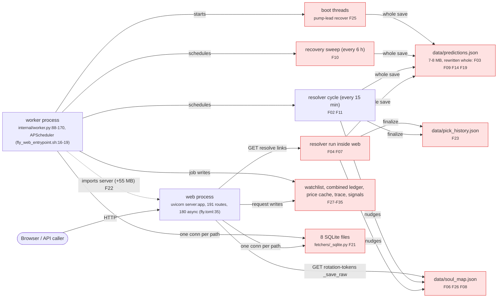

Yellow boxes are where a bug was found. Two processes share one 1 GB Fly machine and one data folder, and nothing assigns each file a single owner (F12).

### P8.5 Findings by area (upload line 297)

#### Findings by area

**Ledger and learning** (10)

| ID | Severity | Title | On stack head 1205412e |
| --- | --- | --- | --- |
| F02 | HIGH | One failed read makes the resolver save an empty ledger | fixed (a02: read error refused, 50 rows kept) |
| F25 | HIGH | Boot-time pump-lead recovery saves an empty ledger after a failed read | fixed: wipe and lost update (a25, a25b) |
| F03 | HIGH | Resolver save erases a pick the other process just added | fixed |
| F09 | HIGH | A stale save puts a graded pick back to pending | fixed |
| F10 | HIGH | 6-hour recovery sweep undoes a grade, so it is graded twice | fixed |
| F08 | HIGH | Two resolver runs grade one pick and nudge learning twice | fixed |
| F23 | HIGH | pick_history.json loses data three ways: a torn read wipes all past hour picks; a stale finalize save erases a newly recorded pick; a half-finished in-place save leaves truncated JSON that later reads as empty | fixed (PR 1603; r22a and r22b also fixed: lock, temp-file write, fail-closed read) |
| F15 | MEDIUM | Two stats formulas give different accuracy | still there |
| F19 | MEDIUM | Ledger write uses a fixed .tmp name and no fsync | fixed |
| F18 | LOW | archive_predictions_epoch copies, loads and saves outside one lock | changed (PR 1600) |

**Weights (soul_map)** (3)

| ID | Severity | Title | On stack head 1205412e |
| --- | --- | --- | --- |
| F06 | HIGH | _save_raw writes an old whole copy of soul_map: weight nudges reverted | fixed on the stack: all 5 callers moved to _mutate_raw (a06 keeps the nudge). NOT fixed on #1578's own head 803cb9db |
| F26 | HIGH | MindmapBridge saves an old soul_map_state and drops other writers' keys | still there |
| F41 | LOW | load_weights runs a repair write on every read | not checked |

**Web routes and auth** (14)

| ID | Severity | Title | On stack head 1205412e |
| --- | --- | --- | --- |
| F04 | HIGH | Public GET links run a full resolver pass inside the web process; the token check also misses resolve=on (was F07). Fix: delete both GET links or give them the web-process guard; nothing in the site calls them and the worker resolves every 15 min | still there |
| F07 | LOW | Folded into F04: token check skipped for resolve=on / t / y / %74rue. Adds nothing on its own, because the twin GET /api/resolve-predictions is open anyway; deleting the GETs removes it | still there |
| F36 | MEDIUM (unverified) | Write auth is off unless WRITE_API_TOKEN is set; ingest is open and uncapped | still there |
| F05 | LOW | GET /api/scenario-memory writes on every read | not checked |
| F40 | LOW | GET /api/ops/* shows internal status with no auth | not checked |
| F52 | HIGH | `POST /api/feedback` is in `_PUBLIC_WRITE_EXACT` and calls `nudge_expert()` + `scenario_memory.add_scenario()` with zero rate limit: anonymous attackers pin all 4 council weights to 0.1 or 2.0 even when `WRITE_API_TOKEN` is set | still there (file untouched) |
| F53 | HIGH | Outbound webhook validation bypassed by decimal/hex/octal IPs (`2130706433`, `0x7f000001`), DNS rebinding (`127.0.0.1.nip.io`), and `urllib.request.urlopen` following 302 redirects into `http://127.0.0.1:8081/jobs` or Fly 6PN hosts | still there (files untouched) |
| F54 | HIGH | Inverted `CALIBRATION_ADMIN_TOKEN` gate (`allow_force = force and not admin_token`): when unset, anonymous callers can force-overwrite live weights; when set, authenticated admins are permanently blocked; bearer check is non-constant-time and case-sensitive | still there (verified in `1205412e` `pipeline.py:419`) |
| F55 | HIGH | `/ws/signals` `"refresh"` frame bypasses HTTP-only `write_auth` + `LoadShedMiddleware` to run full signal/alert/webhook recomputations unthrottled; `SignalBroadcastHub.broadcast` awaits `ws.send_text` sequentially with no timeout (one slow client stalls all subscribers) | still there (files untouched) |
| F56 | HIGH | `_fly_client_ip` trusts caller-spoofable leftmost `X-Forwarded-For`, bypassing all `30/min` `strict_limit` routes (`/api/simivision/chat`, `/api/investigate/ask`, `/api/pump-ladder/scan`) and leaking unbounded keys in SlowAPI `memory://` storage | still there (file untouched) |
| F57 | MEDIUM | `_OWNER_SIGNING_SECRET` falls back to ephemeral `secrets.token_urlsafe(32)` per process start when `SESSION_SECRET` is unset, silently invalidating every browser watchlist cookie on every deploy/restart | still there (file untouched) |
| F58 | MEDIUM | Non-dict JSON request bodies (`[]`, `"ping"`, `123`) cause unhandled `AttributeError` (`500`) on `POST /api/scenario-memory`, `POST /api/simivision/chat`, and `POST /api/feedback` | still there (files untouched / routes unchanged) |
| F59 | HIGH | `templates/judge_council.html` has no HTML escaping helper (unlike sibling `council_ab.html:51`) and injects `j.name`, `j.netuid`, `j.consensus.verdict`, and `e.message` raw into `innerHTML`; default CSP is Report-Only with `'unsafe-inline'` | still there (files untouched) |
| F60 | MEDIUM | Shell expression interpolation of `github.event.inputs.machine_id` and `github.event.label.name` inside `run:` blocks in workflows holding `FLY_API_TOKEN`; additionally `fly-reset-message-intel.yml` live-label branch (`lines 65-93`) never outputs `should_run=true` | still there (files untouched) |

**Scheduler and threads** (6)

| ID | Severity | Title | On stack head 1205412e |
| --- | --- | --- | --- |
| F01 | MEDIUM | Retry cap never fires; failing one-shot jobs retry forever | still there |
| F11 | LOW | Abandoned resolver thread keeps running beside the revived cycle: wasted CPU, memory and network. Its ledger writes are already revoked (resolver.py:287-296, :343-353), so it does not cause the ledger races | still there |
| F12 | MEDIUM | Per-write owner check owner_guard() has no callers; web writes shared files | still 0 callers |
| F47 | LOW | Worker heartbeat is rewritten in place; a read mid-write looks like a dead worker and triggers a restart | not touched by #1578 |
| F79 | HIGH | Fly deploy/restart orphans inline worker for hard `SIGKILL` mid-save: `fly_web_entrypoint.sh:153` `exec`s `run_web_with_guard.py` (`uvicorn`), leaving the supervisor subshell and `setsid`-detached worker with zero `SIGTERM` forwarding; `_stop_inline_worker` is never called on machine shutdown, risking mid-flush JSON/SQLite truncation on every deploy | still there (files untouched) |
| F84 | LOW | Additional synchronous HTTP/RPC/scanner calls inside `async def` handlers not listed in Grokbot `F14` (`GET /wallet/{wallet}` `investigate_wallet`, `POST /api/ruggers/scan`, `POST /api/conviction-alerts/notify`, `POST /api/pump-ladder/scan`, `POST /api/calibration/retrain` `async:false`), plus private CPython `pool._threads` iteration in `chain_client.py` | still there (files untouched) |

**Other shared files** (30)

| ID | Severity | Title | On stack head 1205412e |
| --- | --- | --- | --- |
| F21 | MEDIUM | A failed SQLite write keeps the DB locked for the other process | still there |
| F24 | MEDIUM | 94 loaders turn read errors into empty data; 68 sit next to a writer | ledger, picks, portfolios only |
| F27 | HIGH | watchlist.json race wipes every profile: the shared .tmp tears the file, the read error becomes {}, and the next save writes {}. Anyone can trigger it through GET /api/watchlist/link-code (F28) | still there |
| F28 | MEDIUM | Anonymous GET mints link codes that never expire | still there |
| F29 | MEDIUM | Combined pump ledger and its effectiveness artifact lose rows (fixed .tmp, no lock) | still there |
| F30 | LOW | price_cache.json rewritten per subnet with no lock (downgraded: no production caller passes a chain client, so this branch never runs today; delete it) | still there |
| F32 | MEDIUM | Trace JSON mirror loses an append | still there |
| F33 | MEDIUM | judge_portfolios.json lost update | changed (fails closed) |
| F34 | MEDIUM | Conviction index lost update; public GET recomputes and writes | still there |
| F35 | MEDIUM | SignalStore append runs load-change-save with no lock | not checked |
| F37 | MEDIUM (unverified) | Backfill does NLP and a soul_map rewrite per message on the listener loop | not checked |
| F42 | MEDIUM | Pump ladder scan writes an old copy of its state; a failed read restarts every subnet's phase | still there |
| F38 | LOW | reset_store writes alerts.json in place | still there |
| F43 | LOW | signal_hub save_hub_state does load-change-save with no lock (short window) | not checked |
| F44 | LOW | pump_tracker drops saved state with an unknown version instead of migrating it | not checked |
| F49 | LOW | A trail event whose soul_map write failed is skipped for good after a restart: the feeds ignore emit_trail_event's BUFFERED result and advance the cursor anyway | still there (r19) |
| F50 | LOW | Two trail polls that read the same cursor both emit the same new scenario: each call gets a fresh uuid4 event_id, so the bridge's dedup misses it | still there (r20) |
| F51 | MEDIUM | analytics_trail_cursor.json: every write uses one shared .tmp path with no lock, so concurrent saves raise FileNotFoundError, drop markers, and can rename a half-written file into place, which the loader reads as an empty cursor | still there (r21, r21b, r21c) |
| F68 | HIGH | Deterministic single-process link wipe (distinct from F27 race): `save_watchlist(..., owner=...)` builds a fresh `{"version": 2, "profiles": profiles, "updated_at": ...}` dict, unconditionally deleting `"link_codes"`, `"telegram_links"`, and top-level `"netuids"` on every browser save | still there (file untouched) |
| F69 | HIGH | `scenario_memory._load()` swallows all exceptions and returns empty `{"scenarios": []}` inside `_exclusive_writer`, so one failed read wipes all scenario memory on save; `_exclusive_writer` also always locks module-global `SCENARIO_MEMORY_PATH + ".lock"` ignoring custom `path=` args | still there (file untouched) |
| F70 | MEDIUM | `desearch_spend.py` paid API spend ledger uses in-process `_lock` only, static `f"{path}.tmp"`, and fails open to `total_usd = 0.0` on any corrupt/mid-write read, silently erasing accumulated USD spend totals | still there (file untouched) |
| F71 | MEDIUM | `message_intel/price_tracker.py` overwrites `BASELINE_FILE` directly via `open(BASELINE_FILE, "w")` with zero locking and fails open to `existing = []` on read/JSON error, wiping 7 days of baseline prices after any mid-write read | still there (file untouched) |
| F72 | MEDIUM | `AlertEngine._append_alert`, `subscribe_webhook`, and `unsubscribe_webhook` perform unlocked RMW on `alerts.json` and `alert_subscriptions.json` across web requests and worker ticks (Grokbot `F38` only covered `reset_store.py`) | still there (file untouched) |
| F73 | MEDIUM | 11 additional unseen shared `.tmp` / fail-open `{}` JSON writers with zero cross-process locking: Telegram alert state files (`gainers_alert.py:48`, `trend_alert.py:82-98`, `stake_alert.py:725-733` -> duplicate Telegram alerts on wipe) + `pick_scheduler.py:131`, `pick_selection_audit.py:304`, `dev_radar/github_sync.py:66`, `caution_cells.py:42`, `council_routes.py:53`, `live_subnets.py:439, :510`, `subnet_universe.py:740`, `ab_benchmark.py:61` | still there (10/11 untouched; `pick_scheduler.py` touched) |
| F74 | MEDIUM | Twin in-place heartbeat truncation bugs (same class as Grokbot `F47`): `_touch_listener_heartbeat` and `_touch_outcome_heartbeat` overwrite heartbeat files via `open(path, "w")`; a mid-write read returns `False`, making web think the worker's outcome loop or Telegram listener died | still there (files untouched) |
| F75 | MEDIUM | `postmortems._write_tmp_json` unlinks static `path + ".tmp"` then opens with `O_CREAT \| O_EXCL`, raising `FileExistsError` under concurrent postmortem saves (26 errors in 160 writes) | still there (verified `O_EXCL=True` on `1205412e`) |
| F76 | MEDIUM | `approval/service.py` checks status via `get_record()` outside `_LOCK`, then overwrites via `_put()`, letting a stale `approve()` overwrite `rejected`; uses in-process `_LOCK` only, static `.tmp`, and fail-open `{}` *(no HTTP router yet; harden before wiring)* | still there (file untouched) |
| F77 | HIGH | Three raw `sqlite3.connect` DBs cause lock contention, FD leaks, split-brain live-DB unlink, and bare-filename crashes (extends Grokbot `F21` + Swap 12): `message_intel/models.py` runs exclusive `PRAGMA journal_mode=WAL` on EVERY connect; `wipe_message_intel_db` unlinks active `.db`/`-wal`/`-shm` while worker holds open FDs; `investigation/service.py` uses DELETE mode with no `try/finally` close; `chain_client.py` uses DELETE mode and `os.makedirs(dirname)` without `or "."` | still there (files untouched) |
| F78 | MEDIUM | Cross-process SQLite RMW split across separate `db_conn()` transactions (no `BEGIN IMMEDIATE`): `chain_price/db.py` splits `can_accept_sample_batch` -> `insert_sample_rows` -> `prune`; `taostats_client.py` splits `_get_rotation_offset` -> `_set_rotation_offset` (web & worker fetch duplicate subnets and overwrite offset) | still there (files untouched) |
| F80 | HIGH | `WhaleIntelligenceService._flock_acquire` calls `os.open(self._lock_path(), O_CREAT \| O_RDWR)` without `os.makedirs` (`FileNotFoundError` on clean dir/custom path); `__init__` also runs outside `_singleton_lock`, letting concurrent startup threads reset `self._lock` and `self.data` | still there (file untouched) |

**Memory, speed, config** (12)

| ID | Severity | Title | On stack head 1205412e |
| --- | --- | --- | --- |
| F13 | MEDIUM | Request-keyed caches grow without limit | still there |
| F14 | MEDIUM | Whole 7-8 MB ledger parsed per request on the event loop (51 call sites) | still there: 60-66 ms, no speedup |
| F22 | MEDIUM | Worker imports the whole web app for 3 helpers (+55 MB) | still there |
| F31 | MEDIUM | TaoStats rate limit counted twice per fetch | still there |
| F16 | LOW | Pick latency log is appended forever | not checked |
| F17 | LOW | Env drift: WATCHLIST_PATH, AIO pool 24 vs 4, cycle timeout 360 vs 120, Procfile | not checked |
| F20 | LOW | Five modules nobody imports (about 1,377 lines), plus an unused resolver_scheduler._save_json | still there |
| F39 | LOW | Investigation cache rows are never deleted | not checked |
| F45 | LOW | GET /api/soul-map parses and returns the whole soul_map per request | still there |
| F46 | LOW | Price freshness stops reading at the first float key, so it reports an older time than the real newest | not checked |
| F48 | MEDIUM | The PR 1599-1605 stack makes each resolver ledger commit about 3x slower and 3.7x more memory: a precondition to measure before merging on the 1 GB box | new on the stack |
| F83 | MEDIUM | `price_fetcher._save_json` omits `or "."` in `os.makedirs(dirname)` (`FileNotFoundError` on bare filename) and mutates TMC caches without a lock; `hourly_pick._PICK_CACHE` mutates locklessly + `NaN` sort; Telegram bot `_last_summary_at` and `trend_alert._seen_chats` grow unbounded per `chat_id` (extends Grokbot `F13`) | still there (files untouched) |

**Domain logic** (9)

| ID | Severity | Title | On stack head 1205412e |
| --- | --- | --- | --- |
| F61 | HIGH | `PumpTracker` loads JSON `str` keys (`"1"`) while runtime callers index by `int` (`1`), splitting state dicts in memory so `_save_state` overwrites historical snapshots/phases with the 1-item `int` entry on every restart | still there (file untouched) |
| F62 | HIGH | Judge portfolio applies `_JUDGE_RISK_MULTIPLIER` twice (`open_position` scales `size` by `1.3`/`0.7`, then `close_position` multiplies `_compute_pnl` -- which already multiplied by `1.3`/`0.7` -- by `size`), distorting P&L to `1.69x` (pulse) and `0.49x` (echo) vs `1.3x`/`0.7x` on direct close | still there (verified on `1205412e` `portfolios.py`) |
| F63 | HIGH | For 30 to 50 resolved rows (`MIN_RESOLVED_SAMPLE=30`, `CERT_BACKTEST_N=50`), `holdout_n == len(ordered_rows)` makes `training_rows = ordered_rows[:-holdout_n] == []`, ignoring all history and proposing uniform `1.15` Laplace priors for all 4 experts | still there (verified on `1205412e` `pipeline.py`) |
| F64 | HIGH | `conviction_alerts/delivery.py` calls `load_watchlist()` with `owner=None`, which always returns `[]` once any v2 browser profile is saved -> `_watchlist_netuids()` returns `None` and ignores all watchlist pins; `_post_json` also uses raw `urllib.request.urlopen` (8s timeout, follows redirects, no URL validation) synchronously inside `async def POST /api/conviction-alerts/notify` | still there (files untouched) |
| F65 | MEDIUM | `build_subnet_report` reads `state.get("subnets")` while `IndicatorEngine.get_indicator_state()` returns `{"per_subnet": {...}}`, silently dropping all technical indicators from every `/api/report/{netuid}` and `/subnet/{netuid}` page | still there (files untouched) |
| F66 | MEDIUM | `weighing_room._judge_long_rows` breaks at `len(rows) >= limit` BEFORE calling `rows.sort(key=...)`, silently dropping high-conviction judge-long subnets appearing later in snapshot order | still there (file untouched) |
| F67 | MEDIUM | `Selector.process_daily_rotation` executes `[int(k) for k in registry.keys()]` without filtering non-numeric keys (e.g., `"_meta"`), crashing daily rotation with `ValueError` | still there (file untouched) |
| F81 | MEDIUM | Null numeric & mixed naive/aware timestamp `TypeError` crashes at external boundaries: `taomarketcap._parse_subnet_row` `round(None, 4)`, `taostats_client._get_cached` `datetime.now() - aware_dt`, `SignalTracker._parse_iso` mixed naive/aware comparison, `indicators/routes.py:59` `None` sort crash | still there (files untouched) |
| F82 | MEDIUM | `http_client._cache_key_builder` ignores query `params` (collisions serve SN1 data as SN99 for 60s); `@_RETRY` wraps `resp.raise_for_status()`, wasting backoff sleeps on deterministic 400/401/404 responses | still there (file untouched) |

### P8.6 State charts (upload line 418)

#### State charts

Each chart is a small TLA+ model checked with TLC. Each rule is something the code must always keep. Every broken rule was then replayed against the real code on main, and all 11 breaks reproduced. There are 5 specs and 6 charts (the ledger spec has two configs). These specs model main's whole-copy saves only. A seventh spec from the review, LedgerMerge (fail-closed read, merge by id, learning after commit), models the stack's fix: TLC checks 108 states, and all four ledger rules hold with no deadlock (rerun by me). The charts below draw only the shortest bug paths: blue is on the path, yellow is where a rule breaks.

##### 1. Ledger, one resolver plus a new pick (predictions.json)

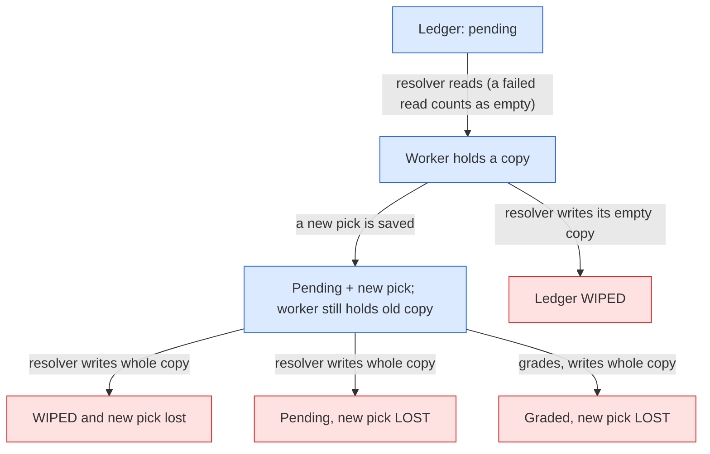

- Rule HistoryNeverWiped: past resolved rows are never deleted. Broken in 2 steps: the read fails and is treated as empty, then the whole copy is written. Repro r02 reproduces it.
- Rule NewPickNeverLost: a pick that append_prediction saved stays saved. Broken in 3 steps: the resolver copies the file, the pick is appended, the resolver writes. Repro r03 reproduces it with two real processes.
- Hidden: 8 steps the view folds away (lock waits, stats refresh), plus 6 that stay in one chart state. TLC saw 26 states; the chart draws 11.
- Left out: multiple pending rows, crash mid-write, and the fsync gap (that one is F19).

##### 2. Ledger, worker resolver against a web-request resolver

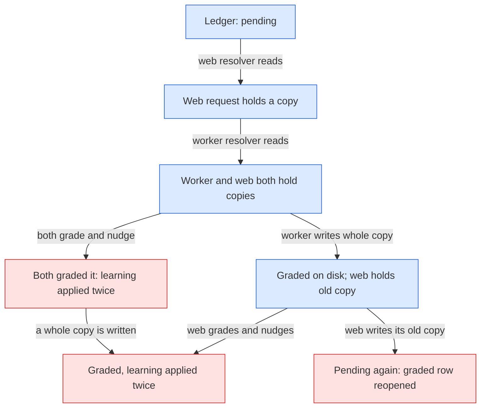

- Rule LearningAppliedOncePerPick: each pick nudges learning at most once. Broken when both resolvers grade the same due pick. Repro r07 reproduces it.
- Rule GradedNeverReopens: once graded on disk, a pick never goes back to pending. Broken in 6 steps: the web copy is taken before the worker's save, then the web writes it back. Repro r08 reproduces it.
- Hidden: 7 steps the view folds away, plus 19 that stay in one chart state. TLC saw 43 states; the chart draws 12. A full model with append and read failures has 384 states (out-full).
- Left out: which of the three learning nudges fires (all three behave the same here), and HTTP timing.

##### 3. Weights file (soul_map.json): whole-copy saver against a locked nudge

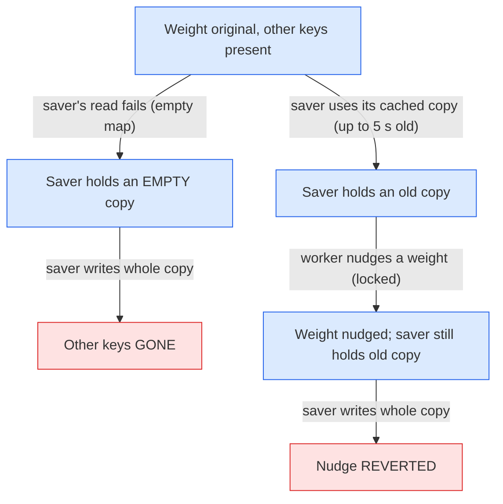

- Rule UnrelatedKeysNeverDropped: saving one key never deletes the others. Broken in 2 steps: the read fails and returns an empty map, then _save_raw does clear() plus update(). Repro r04(b) reproduces it; fixed on the stack head.
- Rule WeightNudgeNeverReverted: a committed nudge stays. Broken in 3 steps: cached copy, worker nudge, whole save. Repro r04(a) reproduces it on main. On the stack, r04(a) calls _save_raw, which has no callers left, so it proves nothing there; the real-caller replay a06 keeps the nudge on 1205412e and reverts it on 803cb9db.
- Hidden: 24 steps (cache refresh and lock acquire). TLC saw 28 states; the chart draws 13.
- Left out: MindmapBridge, which is the same shape with a longer copy window (F26), and the 5 s cache expiry timing.

##### 4. Background job retry (job_scheduler._guarded)

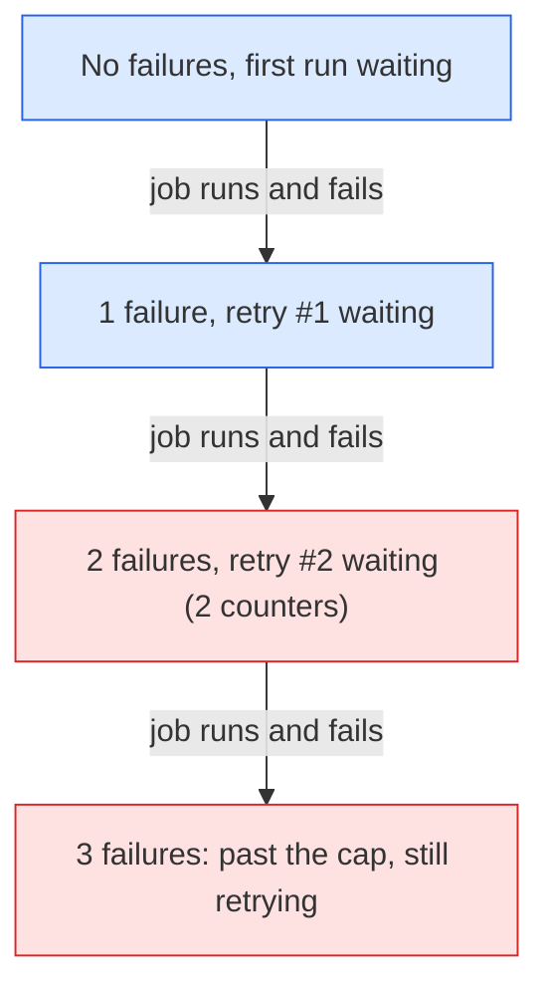

- Rule GivesUpAfterCap: after cap+1 failures in a row, no retry is waiting. Broken in 3 steps, because each retry gets a new id (job:retry:retry...) and a fresh counter. Repro r01: 12 retries with a cap of 5.
- Rule OneCounterPerJob: one failure counter per job. Broken in 2 steps (r01 shows 12 counter keys, each at 1).
- Hidden: 6 steps. The model uses cap 2 and depth 4 to stay small.
- Left out: misfire grace, interval jobs (they use retryable=False), and the ConflictingIdError that is swallowed at job_scheduler.py:59.

##### 5. Pick lifecycle: resolver against the 6-hour recovery sweep

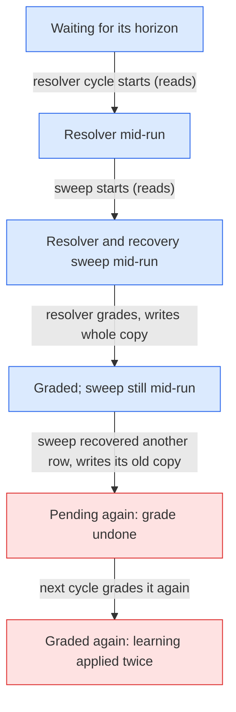

- Rule GradedStaysGraded: broken in 7 steps. The sweep copies the file before the resolver saves, recovers some other row, and writes its old copy. Repro r09 reproduces it (it needed an Event to line up the timing).
- Rule LearningAppliedOnce: broken in 9 steps. The next resolver cycle grades the reopened row again.
- Hidden: 12 steps, plus 109 that stay in one chart state. TLC saw 139 states; the chart draws 17.
- Left out: the sweep's retry cap (folded into one step) and the heavy_job_slot gate, which is per process and does not cover the sweep.
- Model caveat: SNoWrite checks the current disk instead of what the sweep loaded, so the model lets the sweep regrade and nudge and then skip its write. The code cannot do that (expired_recovery.py:146-148 saves whenever it recovered a row). With one sweep this changes nothing; with two or more it could invent a double nudge.

##### 6. Resolver cycle timeout and revive

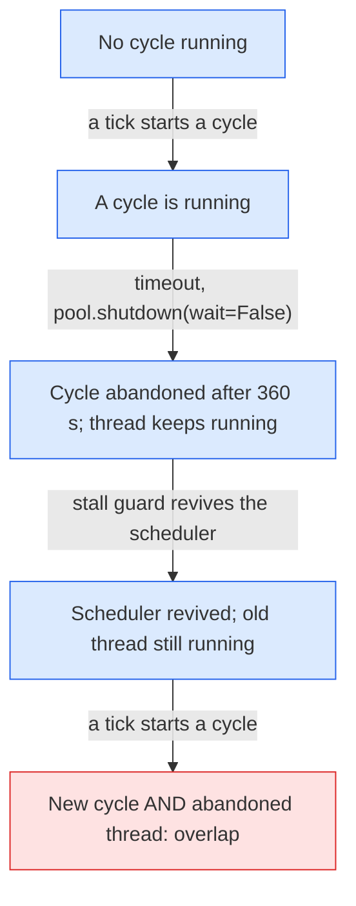

- Rule OneCycleThreadAlive: at most one resolver cycle thread is working at a time. Broken by tick, timeout and abandon (pool.shutdown(wait=False) at resolver_scheduler.py:1283), revive, then another tick. Repro r10 shows two live resolver-cycle-work threads. Already tracked as #1552 and #1113.
- Hidden: 11 steps, plus 36 that stay in one chart state. TLC saw 237 states; the chart draws 9.
- Left out: the 360 s timeout value (fly.toml:53). Correction: the spec's own header is right that the abandoned thread's ledger writes are revoked (resolver.py:287-296, :343-353). The overlap wastes resources (F11, now low); it does not cause the ledger races in charts 1, 2 and 5.

### P8.7 Debugging diagrams (upload line 606)

#### Debugging diagrams

##### Sequence: worker resolver against a web GET resolver

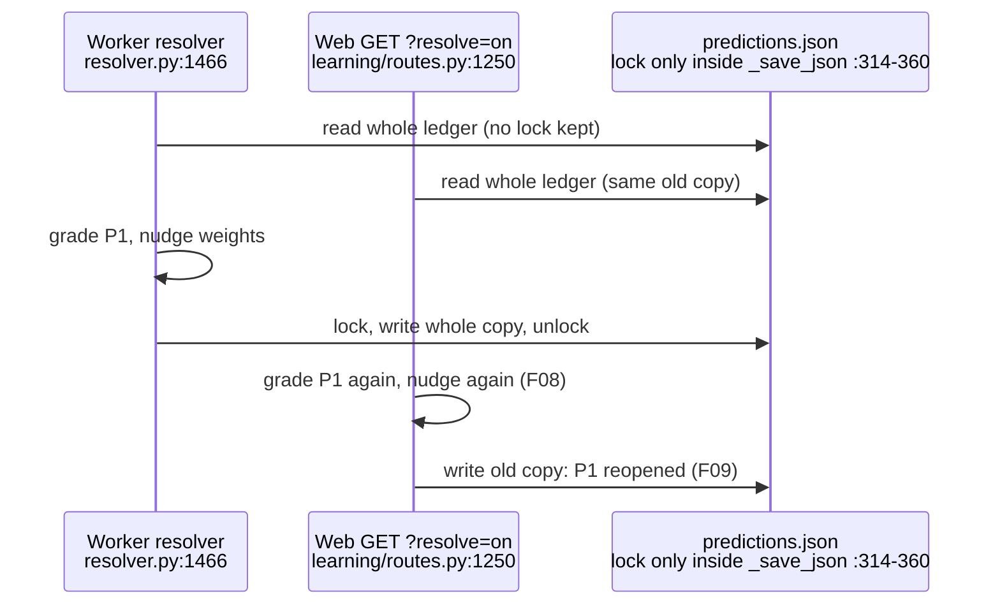

How to use it: if a pick shows up graded twice or flips back to pending, check the web logs for a resolve GET during the worker's cycle window.

##### Sequence: recovery sweep against the resolver cycle

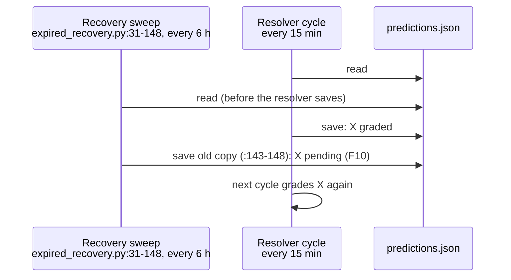

How to use it: a double nudge that lands right after a 6-hour outcome-snapshot run points here, not at the web.

##### Sequence: GET rotation-tokens against a worker weight nudge

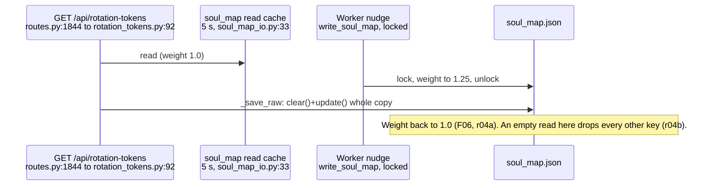

How to use it: if a weight moves and then snaps back, look for a rotation-tokens or pick-mirror save in the 5 seconds after it.

##### Who writes each shared file

|  | Worker jobs | Web GET | Web POST | Boot / one-off |
| --- | --- | --- | --- | --- |
| predictions.json | 8 | 5 | 1 | 2 |
| soul_map.json | 19 | 1 | 0 | 1 |
| pick_history.json | 2 | 1 | 0 | 0 |
| scenario_memory.json | 0 | 1 | 1 | 0 |
| signal_timeline.json | 1 | 0 | 0 | 0 |
| 8 SQLite files | 5 | 2 | 1 | 0 |

Cells count writer call sites reachable from each kind of caller (details in diagrams/ownership_notes.md). How to use it: any row with more than one non-gray column has no single owner, so look there first for a lost update.

##### Worker job timeline, first 3 hours after boot

|  | 0 | 15 | 30 | 45 | 60 | 75 | 90 | 105 | 120 | 135 | 150 | 165 | 180 |
| --- | --- | --- | --- | --- | --- | --- | --- | --- | --- | --- | --- | --- | --- |
| resolver (15 min) | 1 | 1 | 1 | 1 | 1 | 1 | 1 | 1 | 1 | 1 | 1 | 1 | 1 |
| indicators (15) | 1 | 1 | 1 | 1 | 1 | 1 | 1 | 1 | 1 | 1 | 1 | 1 | 1 |
| pump desk snapshot (15) | 1 | 1 | 1 | 1 | 1 | 1 | 1 | 1 | 1 | 1 | 1 | 1 | 1 |
| pump ladder (20) | 1 | 1 | 1 | 0 | 1 | 1 | 1 | 0 | 1 | 1 | 1 | 0 | 1 |
| whale warm (20) | 1 | 1 | 1 | 0 | 1 | 1 | 1 | 0 | 1 | 1 | 1 | 0 | 1 |
| score snapshots (30) | 1 | 0 | 1 | 0 | 1 | 0 | 1 | 0 | 1 | 0 | 1 | 0 | 1 |
| subnet refresh (60) | 0 | 0 | 0 | 0 | 1 | 0 | 0 | 0 | 1 | 0 | 0 | 0 | 1 |
| hour pick (180) | 1 | 0 | 0 | 0 | 0 | 0 | 0 | 0 | 0 | 0 | 0 | 0 | 1 |
| selector (360) | 1 | 0 | 0 | 0 | 0 | 0 | 0 | 0 | 0 | 0 | 0 | 0 | 0 |
| outcome + recovery sweep (6 h) | 1 | 0 | 0 | 0 | 0 | 0 | 0 | 0 | 0 | 0 | 0 | 0 | 0 |

| Label | Value |
| --- | --- |
| 0 | 9 |
| 15 | 5 |
| 30 | 6 |
| 45 | 3 |
| 60 | 7 |
| 75 | 5 |
| 90 | 6 |
| 105 | 3 |
| 120 | 7 |
| 135 | 5 |
| 150 | 6 |
| 165 | 3 |
| 180 | 8 |

Defaults from resolver_scheduler.py:99, indicator_scheduler.py:27, desk_snapshot_scheduler.py:17, pump/scheduler.py:20, background_boot.py:214, score_snapshots.py:61, scheduler.py:30, pick_scheduler.py:31, selector_scheduler.py:16 and outcome_snapshot_scheduler.py:19. The chart assumes every job starts at boot; real start delays shift these by seconds to minutes. How to use it: an OOM or a slow request at boot or on the hour lines up with the 7-9 jobs that fire together there (#1538).

##### Module dependency graph: one big cycle and god modules

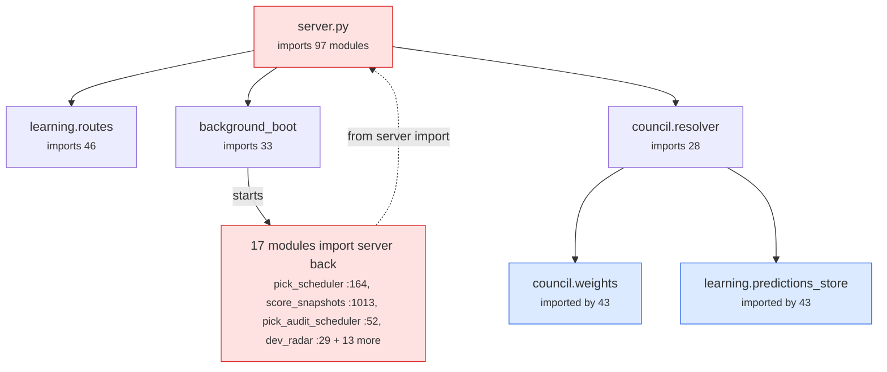

Import graph: 412 modules and 1,472 edges. 242 modules sit in one cycle. How to use it: when an import-time side effect or a memory jump shows up in the worker, start at the 17 back-imports. Importing server costs +55 MB and 578 modules (r13).

##### Error propagation: how a read error turns into data loss

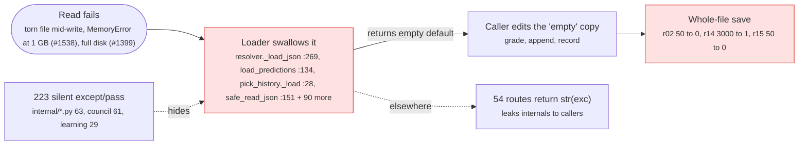

Census from tools/read_default.py: 94 loaders turn a JSON read error into a default, and 68 of them are in modules that also write. How to use it: when a file suddenly shrinks, find its loader in read_default.json and check whether its caller saves afterwards.

### P8.8 Efficiency and design improvements (upload line 756)

#### Efficiency and design improvements

| Change | Why | Evidence |
| --- | --- | --- |
| Give every shared file one owner process; others send it a request | Removes the lost-update family in one move instead of locking each site | Ownership heatmap; owner_guard() has 0 callers (F12) |
| Loaders fail closed: raise on an unreadable file and never save after one | Stops every wipe path (F02, F23, F25, F24) | The PR 1599-1605 stack already does this for the ledger, pick history and portfolios |
| Edit under the lock: read, change and write inside one lock | A lock that covers only the write protects nothing | resolver._save_json :314-360; weights._save_raw :119-127 |
| Stop parsing the whole ledger per call (SQLite rows, not a copy cache) | 55-69 ms and 34 MB peak per parse, 66 call sites. A cache that hands out private copies is slower: deepcopy 122 ms vs re-parse 73 ms | r05; bench/cache_copy.py; #1508 (206 vs 90 ms) |
| Split a small 'helpers' module out of server.py | Worker saves about 55 MB and the 242-module cycle shrinks | r13; import graph |
| One stats function | The dashboard and the API show different accuracy | F15 repro: 0.8 vs 0.5 |
| Wrap db_conn in a transaction with rollback | A failed write locks the DB for the other process | r12 |
| Bound request-keyed caches (LRU) and expire link codes | Anonymous traffic can grow memory and files | r11; F28 |
| Spread hourly job start times | 7-9 jobs fire in the same minute on a 1 GB box | Timeline above |
| Delete the five dead modules | About 1,377 lines nobody imports | F20; #1487 and #1488 |

### P8.9 Swaps for performance (upload line 771)

#### Swaps for performance

The same thing slows the app down and loses data: big JSON files rewritten whole for tiny changes, and status notes stored inside data files. Ten swaps fix most of it, in the order below. Every time below was measured on a copy, not on prod.

| Item | Value | Note |
| --- | --- | --- |
| Resolver commit of one changed row (stack head, merge path) | 919 ms | lock held 451 ms, 114 MB peak (F48) |
| Add one row to the ledger (stack head, under the lock) | 354 ms | SQLite row: under 1 ms |
| Add one row to the ledger (main) | 308 ms | SQLite INSERT 0.24 ms |
| Grade one row (resolver) | 307 ms | SQLite UPDATE 0.26 ms |
| Store one price in price_cache.json | 125 ms | SQLite upsert 0.10 ms |
| Duplicate check before every new pick | 51 ms | indexed lookup 0.07 ms |
| Read the 3 pending rows | 47 ms | SQLite 0.44 ms |
| One job heartbeat into soul_map.json | 46 ms | own row 0.07 ms |
| Price freshness check per page poll | 17 ms | file time 0.01 ms |

Median of 7 alternating runs per side, on an 8-core box with Python 3.12 and 3.13, using the prod-shaped 2,158-row ledger copy and the repo's 4.3 MB price cache. The soul_map test file is synthetic, 790 KB, close to prod's 840 KB. Fly's 1 GB machine was not measured and is likely slower. Reading every row is no faster in SQLite (47 vs 54 ms), so the win only comes when callers stop reading everything.

| # | Swap: today, then better | Where | Bugs it removes | Measured or estimate | Cost and risk | Cheapest test |
| --- | --- | --- | --- | --- | --- | --- |
| 1 | Write big JSON files compact in one shot: it must be f.write(json.dumps(data, separators=(",", ":"))). Keeping json.dump(f, ...) and only dropping indent saves about 20 ms. Do it after the stack merges | predictions_store.py:210 (main), :474 (stack); soul_map_io.py:374; price_fetcher.py:151; pick_history.py:37 | none directly; halves how long a plain append holds the ledger lock. It does not touch the stack's deepcopies, which are most of F48 | Measured: ledger lock held 354 ms, then 182 ms (Python 3.12); file 10.6 MB, then 7.1 MB. The profile shows the pretty-printer is about 90% of the time | One line per file. Files stop being pretty. The raw-bytes hash in scripts/rev3_prod_audit.sh and soul_map byte-size alarms shift once | swaps/bench_1578_compact.py, then the ledger tests |
| 2 | Take status notes out of data files: each job writes its own small status file (or row); stats and watchdog are computed when read | liveness.py:418-446; resolver_scheduler.py:1751-1772; indicator_scheduler.py:244; scheduler.py:216-222; pump/scheduler.py:46-58; resolver.py:1418-1420, :1617-1620 | F42 (meta half); shrinks the F26 window; stops a full ledger rewrite every cycle. After the stack merges (it rewrites resolver.py and resolver_scheduler.py) | Measured: one heartbeat 46 ms into soul_map vs 0.07 ms into its own row. Estimate: main rewrites the 10.6 MB ledger at least twice per 15-minute cycle (about 2 GB a day) | Readers move in the same change: /api/ops/readiness, liveness restore, freshness | Count soul_map writes per hour in a soak, before and after |
| 3 | The web process stops writing shared files. GETs only read, and writes go to the worker | routes.py:1250, :1824 (resolve GETs); rotation_tokens.py:92; learning/routes.py:1654; conviction_index routes.py:32-39; worker_proxy.py:302-339 already proxies to the worker when split mode is on | F04 (F07 goes with it), F05, F34, F12 (owner_guard can finally be called). F08 and F06's web half are already fixed by the stack | Not measured. Takes full resolver passes, about 300 ms or more each, off the web event loop (F14) | Medium. After the stack merges. Delete the two resolve GETs; no site code calls them | Rerun r06 and r07; the write_sites and routes levers show no GET reaching a writer |
| 4 | Make the shared SQLite helper safe: roll back on error, set a busy timeout, create tables once | fetchers/_sqlite.py:24-38; store/query.py:46, :190 | F21 | Not a speed change; a prerequisite for 5 and 6 | Small | r12 stops reproducing |
| 5 | Move the predictions ledger from one JSON file to SQLite rows (#1509 design W5) | predictions_store.py (51 load sites: about 9 need only pending rows, 17 only resolved, 18 both) | Speed and lock time (F48), F18; makes F14 go away for most routes. F03, F09, F19 and F25 are already fixed by the stack | Measured: add a row 308 ms, then 0.24 ms; grade 307, then 0.26; duplicate check 51, then 0.07 | Large. Migration memory (#1509 estimates +45 MB against about 62 MB free), so stream the rows. Needs an export-to-JSON fallback | Rerun r03, r07 and r09 against the new store; prod stats must match _compute_stats |
| 6 | Price cache: store the TAO price series once plus one alpha price per subnet, instead of 129 scaled copies in one 4.3 MB file. Delete the dead judges branch and its float keys. Freshness reads the file time | price_fetcher.py:230-252, :391, :450-453; subnet_judges.py:221-247; freshness.py:177-191 | F30 (by deletion), F46 | Measured: whole-file parse 17 ms per subnet lookup. Estimate: up to 128 parses (about 2 s) per 15-minute indicator cycle | Small to medium; state_vector and signal_hub read the same file | r17 passes; one indicator cycle parses the file once |
| 7 | Small shared JSON files get one owner and a locked edit. Delete the trace JSON copy, since store.db already has it | watchlist/store.py:129-181; combined_ledger.py:54-60; trace/store.py:152-162; judges/portfolios.py:49-61; signals/store.py:113-133; signal_hub/state.py:40-47 | F27, F29, F32, F33, F35, F38, F43 | Not measured: these files are small and capped, so this is about correctness, not speed | Small each. SQLite is not worth it here | The existing ditto repros for each file |
| 8 | Run slow route code off the web event loop (plain def handlers or to_thread) | 128 of 180 async handlers (F14) | F14 | Measured: one ledger parse 60-69 ms and 34 MB peak (r05 rerun; the earlier 95 ms did not reproduce) | Small, but only after swaps 3 and 7. Today async handlers run one at a time, which accidentally serializes web writers; with up to 40 threadpool workers the shared-.tmp race of F27 would start inside one process, and parallel 34 MB parses stack up on 1 GB | Load test /api/predictions with /health polled alongside |
| 9 | The worker stops importing the whole web app | pick_scheduler.py:164, :175; score_snapshots.py:1013; pick_audit_scheduler.py:52; dev_radar/service.py:29 | F22, #1538 memory pressure | Measured: +55 MB RSS and 578 modules (r13) | Small: move three helpers to their own module | r13 RSS before and after |
| 10 | Bounded growth and calmer timers: prune pump desk snapshots (a new file every 15 minutes, never deleted), rotate pick_score_latency.jsonl, add start jitter, use one TaoStats rate limiter | desk_snapshot.py:203-213; daily_pick.py:44, :77; job timeline; taostats_client.py:92-111 | F16, F31, job pile-ups | Estimate: 96 snapshot files a day | Small | File count after a day; the F31 ditto repro |

Checked and not worth changing: a second Fly machine (split mode exists, but swap 3 gets the same one-writer result without splitting the volume); SQLite for the small capped files; async HTTP (TaoMarketCap calls are already cached, and the chain client already runs in parallel); the 90-second worker health probe (26-41 ms); the 60-second browser polls (cheap once swap 6 lands).

##### Swap order

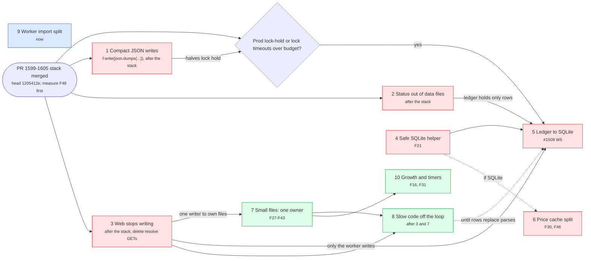

Only swap 9 (blue) can start now. Swaps 1, 2 and 3 edit code the open stack rewrites, so they come right after it merges (or inside it). Swap 8 waits for swaps 3 and 7. Swap 5 waits for the stack, the safe SQLite helper and one prod metric. Swaps 6, 7 and 10 can run in parallel at any time, with swap 7 after the one-owner decision.

##### Storage layout: before and after

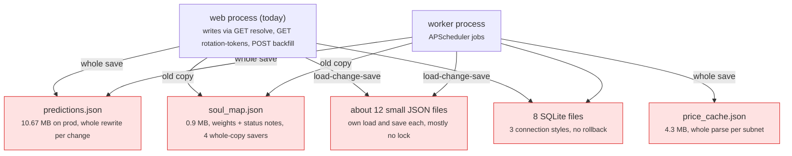

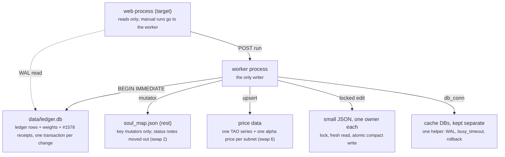

Left is main today; yellow marks a store with a confirmed lost-update or wipe bug. Right is the target after swaps 1-9 and 11-12. Weights sit in ledger.db so a grade and its weight nudge commit in one transaction, the clean end state for F08. The cache DBs stay separate on purpose: each can be deleted on its own, and the Telegram listener's writes should not share a lock with the ledger.

##### Second pass: cross-check and six more swaps

A second pass with its own scripts and the same inputs reached the same ranking. The numbers line up, six swaps were missing, and two public read-only prod GETs fill the Fly-not-measured gap.

| Measurement (median of 7) | First pass | Second pass |
| --- | --- | --- |
| #1578 lock held per one-row change | 354 ms | 353 ms |
| Ledger save, indent=2 vs compact | lock hold 354 to 182 ms | real save_predictions 239 to 60 ms |
| Add one row, JSON vs SQLite | 308 vs 0.24 ms | 262 vs 0.22 ms |
| Grade one row, JSON vs SQLite | 307 vs 0.26 ms | 265 vs 0.39 ms |
| Read every row, JSON vs SQLite | 47 vs 54 ms | 49 vs 66 ms |
| Price cache: parse per lookup / miss write | 17 / 125 ms | 18 / 133 ms |

| Prod, read-only GET, Nov 24 06:05 MST | Value |
| --- | --- |
| data/predictions.json on disk (/api/ops/volume-stat) | 10,668,414 bytes |
| data/soul_map.json on disk | 901,387 bytes |
| Last resolver cycle, total (/api/predictions/resolver) | 4,491 ms, against a 360 s timeout |
| Of which resolve_due / expire_stale | 3,132 ms / 520 ms |
| Of which soul_map cycle-summary save | 577 ms |

One prod cycle is one sample. expire_stale includes one ledger load and one save; on this box that pair takes about 290 ms, so Fly looks roughly 1.8x slower (estimate).

| # | Swap: today, then better | Where | Evidence | Bugs it removes | Cost and order |
| --- | --- | --- | --- | --- | --- |
| 11 | Whole-copy soul_map saves become key mutators through write_soul_map, which exists and already skips unchanged writes | council/weights.py:119-128 and callers rotation_tokens.py:92, prediction_loop.py:514, :585, formula_versions.py:216, calibration/pipeline.py:82; mindmap_bridge.py:172-225; weights.py:556-572; soul_map_io.py:323, :360-364 | r04 and ditto repros. soul_map was 24.2 MB before compaction, when a 101 s save forced the 360 s timeout (fly.toml:52) | F06, F26, F41 | Narrowed after review: F06 is done on the stack (all five callers moved). F26 needs a mutator that writes only the keys the bridge changed (it already uses the gateway, mindmap_bridge.py:218, :222). F41 needs the repair moved to boot. Plus: delete the dead _save_raw |
| 12 | Swap 4's helper covers all 8 SQLite files, not 6: message_intel connects per call, and investigation_cache and volume_cache connect per call with no WAL | message_intel/models.py:32-36; investigation/service.py:78-122; chain_client.py:137-150, :794-840; fetchers/_sqlite.py:24-38 | Code read. Commit time with synchronous NORMAL vs FULL: ranges overlap, so the reason is correctness, not speed. Do not merge the cache DBs | F21, F39 | Low. With swap 4 |
| 13 | Delete the dead modules, and move pytest and py-spy out of the prod requirements | datastore/pump_tracker.py (1,027 lines), datastore/price_fetcher.py, internal/conviction_decay.py, council/input_processor.py, internal/price_oracle.py, resolver_scheduler._save_json :295; requirements.txt | 0 imports by dotted path. The dead pump_tracker still shows up as a writer of pump_cycles.json and indicator_state.json, so audits overcount writers | F20 | Tiny. First, before swap 7 |
| 14 | Swap 3's first step is one line: give both resolve GETs the guard POST /api/predictions/resolver/run already has, which returns 503 on the web process | internal/learning/routes.py:1580 (guard), :1249-1258 and :1824 (the GETs); write_auth.py:43-50 | 0 callers of either GET in static/, templates/, scripts/ or .github (rg). heavy_job_slot is a per-process lock (heavy_job_gate.py:24-36), so it cannot see a web pass | F04 (F07 goes with it) | Tiny. Deleting the GETs is equally small and preferred. After the stack (same file). External callers unknown, prod logs not read |
| 15 | Heartbeat written to a temp file and renamed, or read from the worker's existing /jobs HTTP server | internal/worker_heartbeat.py:20-30; scripts/fly_web_entrypoint.sh:121; worker.py:55-84 | r18: in a tight loop 70% of reads saw an empty file. In prod the window is microseconds every 30 s, so the chance is tiny | F47 | Tiny. Any time |
| 16 | orjson, only if the SQLite ledger stays deferred for months | Same writers as swap 1, plus load_predictions | dumps 190 to 6.5 ms with indent kept, loads 61 to 23.5 ms, round trip equal on the prod-shaped ledger. New dependency; NaN and non-string keys behave differently | none | Low cost, medium risk. Optional; swap 1 gets most of the gain with no new package |

Swap 1 safety check: 479 tests in 48 files that touch the ledger, soul_map, price cache, watchlist, weights and file helpers give the same result with every indent=2 write forced compact (the same 12 failures both ways, all pre-existing). A parsed-ledger cache that hands out private copies is slower than re-parsing (deepcopy 122 ms vs 73 ms; #1508 found 206 vs 90 ms), so the roadmap's cache item now points at SQLite rows instead.

##### Is the 25-30 MB SQLite gate right?

Partly. Waiting for #1578 is right. Waiting for the file to reach 25-30 MB is not.

- Correction from the review: #1509's save limit (400 ms) is already passed by the stack. A resolver commit of one changed row takes 919-957 ms and holds the lock 451 ms on a fast 8-core box (F48). That is the real reason the gate has tripped.
- Withdrawn: 'a second writer class appeared'. The web and the worker both wrote the ledger when #1509 was written, so its authors did not count them as a second class.
- File size is the wrong trigger. Lost updates don't depend on size. Every resolver cycle rewrites the whole file to touch 3 pending rows out of 2,158.
- A SQLite ledger fixes none of F06, F26, F42 or F27-F35. Those are in soul_map, pump state and small files. Swaps 2, 3 and 7 fix them, and none of those needs SQLite.
- The stack already fixes the ledger's own lost updates with a merge under the lock. So SQLite is mostly about speed, lock time and memory, not about correctness.
- Better gate: after the stack and swap 1, log how long prod holds the ledger lock and how often it times out. Migrate when p95 passes a budget you pick, or when lock timeouts appear.
- Second pass adds: #1509's list also says migrate when merge-by-id passes about 60 lines. The stack's merge_ledger_changes is 60-61 non-blank lines (68 with its helpers), so that criterion trips, just, when #1578 merges.
- Second pass adds: the size trigger is far off. Prod is 10.67 MB on disk today and was 8.4 MB on Oct 24 (#1508), about 2.2 MB a month, so 25 MB around June 2027. That is an estimate from two points, and compact writes would make the file 7.1 MB.

> Editor notes on P8.9 (not Grok text; the section above is copied unchanged). Counts and checks as of 2a199aec, 2026-11-24.
>
> - **"Only swap 9 (blue) can start now" does not hold.** Swap 9 edits `internal/council/pick_scheduler.py` (:164, :175) and moves three helpers out of `server.py` (`_get_subnets_with_source`, `_get_subnets_hydrate` and `_market_context_with_weights`, `server.py:2616`, `:2633`, `:2662`). Both files are in `git diff --name-only 2a199aec...1205412e` (118 files), and refactor lane R2 ("Move the subnet source and market context out of server.py") moves the same helpers. Swap 9 therefore depends on the #1599 to #1605 stack landing, and on deciding which PR, Swap 9 or R2, owns the move. Row W55 keeps lane After R9.
> - **Swap 14, "0 callers of either GET", is wrong for one of them.** `static/js/home_live_refresh.js:331` calls `GET /api/predictions/resolved` (read-only branch, no resolve parameter). Only the resolve=true branch and `GET /api/resolve-predictions` have no caller in static/, templates/, scripts/ or .github, and `tests/test_endpoint_contract.py:198` lists `/api/resolve-predictions`. Deleting the `/api/predictions/resolved` route is rejected; decision 18 carries the narrowed default.
> - **Swaps 6 and 7 against the locking rows.** Row W46 (G-F30) is conditional on Swap 6 and row W44 (G-F32) on Swap 7: if the swap is adopted the row becomes a deletion.

### P8.10 Adversarial review (upload line 973)

#### Adversarial review

An independent reviewer reran the repros on three trees: main 2a199aec, the PR 1599-1605 stack head 1205412e, and #1578's own head 803cb9db. I spot-checked the claims that change the plan (a06, a14, a14b, a27, the WRITE_API_TOKEN check, the GET callers, LedgerMerge in TLC) and agree with all of these corrections.

| Change | Why | Proof |
| --- | --- | --- |
| #1578 head relabelled as the PR 1599-1605 stack head 1205412e | #1578's own head 803cb9db differs by 70 files and still has F06 | a06: nudge kept on 1205412e, reverted on 803cb9db |
| 8 of 11 highs fixed on the stack, not 6 | F02, F06 and F25 are fixed; the old repros no longer exercised the new code | a02, a06, a25, a25b |
| F07 folded into F04; fix is delete or guard the GETs | The twin GET is open anyway; no site code calls either GET | r06; rg finds only tests |
| F27 raised to high and moved to Now | Anonymous trigger, total wipe | a27: 200 profiles -> 0 (rerun by me) |
| F11 lowered to wasted resources | Abandoned-cycle ledger writes are already revoked | resolver.py:287-296, :343-353 |
| F14 numbers corrected | 95 ms did not reproduce; 60-69 ms on main and the stack | r05 reruns |
| F46 impact marked unknown | Prod's price cache was not checked for float keys | r17 runs on repo data only |
| New F48: stack commit cost | Save 308 -> 919 ms, peak memory 31 -> 114 MB, lock held 451 ms; a precondition on the 1 GB box | a14, a14b, a14c |
| Sequence fixed | Stack first; two done Next rows removed; WRITE_API_TOKEN after the browser writes are allowed; one owner before locking; swaps 1-3 after the stack; swap 8 after 3 and 7; swap 11 narrowed to F26 and F41; swap 1 must be f.write(json.dumps(...)) | Roadmap and Swap order above |
| #1509 gate reason corrected | The stack already passes the 400 ms save limit; web plus worker was already true when #1509 was written | a14c |
| State charts corrected | Cycle chart no longer blames the orphan for ledger races; lifecycle SNoWrite caveat; r04(a) replaced by a06 on the stack; LedgerMerge spec added | TLC: 108 states, all rules hold |

Not added: the reviewer's N3 (PR 1600's history skips PR 1599's merge commit; the content is identical, so it is harmless). The heyditto second opinion (bugroadmap-adv) failed its check on all 6 launches (CHECK: FAILED, 47 problems in its skill-quote gate) and does not count as a result; the reviewer used it only for leads and checked each one. At that point the totals were 48 findings: 11 high, 18 medium, 2 unverified medium, 17 low (see the Replit cross-check below for the current count).

### P8.11 Replit cross-check (upload line 993)

#### Replit cross-check

Joshua forwarded four leads from a Replit agent. I treated them as unverified and wrote my own repros for each one, run on main 2a199aec and on the PR 1599-1605 stack head 1205412e (repros/r19-r22, outputs in the matching .out files). None of the files involved (trail_cursor, scenario_feed, pump_feed) was on the Page before. Everything confirmed is marked Verified (2 agents: Devil + Replit).

| Replit claim | My result | Evidence (main / stack) | Where it went |
| --- | --- | --- | --- |
| 1. Trail write skipped after restart | CONFIRMED | r19, real failure (soul_map lock held past the 5 s deadline), separate processes: BUFFERED, cursor advanced, fresh process emits 0, trail empty. Same on both trees, scenario and pump feeds | New F49, LOW |
| 2. Concurrent pollers write the same scenario twice | CONFIRMED | r20: both polls report 1, 2 rows and 2 distinct event_ids for one scenario. Same on both trees. Prod callers are the event loop and the homepage render thread in the web process | New F50, LOW |
| 3. trail_cursor shared .tmp with no lock | CONFIRMED (worse than claimed) | r21/r21c: FileNotFoundError on about a third of saves and most markers lost, with processes or threads. r21b: a half-written .tmp gets renamed into place and the whole cursor (300 pump phases) is wiped. The error also empties GET /api/pump-analytics | New F51, MEDIUM |
| 4. More F23 cases for pick_history.json | CONFIRMED on main; fixed on the stack | r22a: stale finalize erases the new pick while both calls succeed. r22b: half-written save, then the history reads as empty and 500 rows go to 0. On the stack both are prevented (lock; temp-file write raises instead) | F23 repro cases |

Leads Replit did not add, and I did not either: a malformed pump cursor read as INACTIVE (a product decision; the real way it happens is F51's torn file); sync file reads in async handlers (already covered by F14 and swap 8); GET routes starting the pump-ladder scheduler (looks like intended lazy start; not proven a bug); pytest logging noise after a passing run (no effect on the app shown). At that point the totals were 51 findings: 11 high, 19 medium, 2 unverified medium, 19 low.

### P8.12 Gemini cross-check (upload line 1006)

#### Gemini cross-check

Joshua forwarded an addendum from Gemini, which says Gemini and Replit each verified it on main 2a199aec and on the stack head 1205412e. At Joshua's request, and because quota was low, Devil did not re-run any of it. Every finding and correction it brought is labelled "Verified by Gemini + Replit (not re-checked by Devil)" and uses Gemini's own wording.

| What | Count | Notes |
| --- | --- | --- |
| New findings F52-F84 | 33 | 15 high, 17 medium, 1 low, going by the severity in each row. The addendum's own headline says 13 high and 19 medium; the rows are used here |
| Still present on the stack head 1205412e | 33 of 33 | Merging the stack fixes none of them (Gemini) |
| Writer files not seen before | 32 | From a 412-file writer census |
| Corrections to existing findings | 5 | F27 (+F68), F36 (security prerequisite), F08 (single-process double nudge, fixed on the stack), F21 (+F77, F78), F47 (+F74); cross-references also added on F14 (F84) and F38 (F72) |
| Chronic symptoms that survived 2-11 earlier fix commits | 5 of 7 | Gemini's git-history archaeology, summarised below |

| Chronic symptom (since Aug 2026) | Earlier fix commits it survived | Why those fixes didn't hold (Gemini) |
| --- | --- | --- |
| soul_map.json overwrites and lock convoys | 11 (73a07366..3f448eaf) | 0c76e48d's 5 s cache widened the _save_raw clobber window; d3bde0de fixed the corrupt-read wipe and fsync but left _save_raw (fixed on 1205412e) and MindmapBridge (F26, still open) |
| predictions.json lost appends and wipes | 6 (9f8b76d9..3479324a) | Wrapped the final write in flock while the read-modify-write stayed outside the lock (fixed on 1205412e) |
| Resolver timeout wedges and double nudges | 7 (9a99e5e4..75f2bab2) | Timeout bumps (120 -> 180 -> 360 s) plus 5 mid-side-effect revocation checks created split-commit double nudges (fixed on 1205412e via learning_effects.py) |
| Single-worker event-loop starvation | 11 (000b7aed..00e84b59) | Spot-offloaded individual routes instead of converting pure-sync async def handlers to def (F14, F84) |
| SQLite lock errors and dirty-transaction reuse | 2 (f329ccff, 3d98a06e) | Migrated only 5 of 8 DBs, omitted conn.rollback() on exception (F21), left 3 raw DBs (F77) |
| Auth, SSRF and rate-limit bypasses | 2 (6af4db9f, 3d98a06e) | Lexical-only IP check (F53), exempted weight-mutating /api/feedback (F52), missed WebSockets (F55) and allow_force (F54) |

Not added: Gemini's two extra diagrams (attack surface; deploy SIGKILL path); their content is in F52-F56, F59 and F79. Totals are now 84 findings: 26 high, 36 medium, 2 unverified medium, 20 low. Of the 26 highs, 8 are fixed on the stack and 18 are still open there (F04, F26, F27 and 15 from Gemini).

### P8.13 How this lines up with your register and open issues (upload line 1052)

#### How this lines up with your register and open issues

| Your register / issue | Overlap | What this adds |
| --- | --- | --- |
| Register pattern non_atomic_json_dump (59 candidates) | F23, F24, F29, F30, F32, F38 are confirmed instances | Cross-process repros, plus the read-error-to-empty amplifier |
| Register pattern silent_except_pass (223) | Feeds the error map | Ranked by whether a writer sits next to it (68) |
| Register faults (60 sites: timeout join, exception text, file IO in async) | Not re-reported | Counted in the error map only |
| #1509 ledger write-path design | F02, F03, F09, F10, F15, F19, F25 | Closes its 'not tested across two OS processes' gap (r03) |
| #1508 read amplification, #1538 OOM | F14, F22, F13, timeline | Measured numbers: 60-69 ms and 34 MB per load, +55 MB server import |
| #1552, #1113 orphan cycle thread | F11 | State chart plus repro r10 |
| #1559 finalize side effects, #1569 resolved ids unbounded | F08, F26 | Double nudge repro r07; bridge stale save |
| #1487, #1488 dead code | F20 | Exact list with line counts |

### P8.14 heyditto jobs (upload line 1089)

#### heyditto jobs

| Job | Scope | Check | Findings used |
| --- | --- | --- | --- |
| Job 1 | server.py, internal top level, council, store, trace, scripts, deploy | CHECK: PASS (05:41 MST) | F01, F06, F15, F19, F23, F26, F29, F32, F36, F41, F45 (repros re-run by me) |
| Job 2 | learning, judges, pump, fetchers, signals, calibration, indicators, chain_price, conviction | CHECK: PASS (05:39 MST) | F15, F20, F24, F25 lead, F30, F31, F33, F34, F35, F42, F43, F44 |
| Job 3 | message_intel, bots, whales, watchlist, share_pages, ops, static, templates, workflows | CHECK: PASS | F27, F28, F36, F37, F38, F39, F40 |

Model engy/deepseek-v4.1-flash-1017, mode nopost, no 402 errors. Job 3's first run failed its check (no qa.md) and passed on resume. All three passed their checks, and every finding taken from them was still re-run or re-read by me; each repro was also re-run on the PR 1599-1605 stack head (1205412e). Not added: job 1's replay 'rogue guard' claim (its test fails here for a missing data/predictions_archive folder, not the reason it gave); job 1's unbounded resolved_prediction_ids (already #1569); job 2's unverified low items (desk_payload timeout ignored, pump scan thread leak, calibration retrain race, serial alert delivery). Where the jobs disagreed, the repro wins: job 3 called MindmapBridge correct, but job 1's repro shows it dropping keys.

### P8.15 Files and rerun commands (upload line 1099)

#### Files and rerun commands

```
# notes, levers, repros, diagrams (box)
/workspace/bug-roadmap/notes.md
/workspace/bug-roadmap/diagram.mmd                # system map (mermaid)
/workspace/bug-roadmap/diagrams/*.mmd             # sequences, timeline, deps, error map
/workspace/bug-roadmap/diagrams/ownership.csv     # heatmap data + ownership_notes.md
/workspace/bug-roadmap/repros/r01..r22*.py        # temp-dir repros, never touch repo data
/workspace/bug-roadmap/repros_vs_1578.txt         # same repros on the stack head 1205412e (PR 1605)
/workspace/bug-roadmap/adversarial-review.md, adv/  # review, a*.py repros, LedgerMerge spec
/workspace/bug-roadmap/tools/{write_sites,routes,read_default,bug_pattern_sweep}.py
/workspace/bug-roadmap/swaps/                     # first swaps pass: bench_swaps.py, bench_1578_*.py, swaps.md
/workspace/bug-roadmap/bench/                     # second swaps pass: bench_storage.py, real_save.py, mutate_1578.py,
                                                  #   cache_copy.py, orjson_bench.py, s1_test_check.txt, prod_*.json

# rerun one repro on main
cd /workspace/bug-roadmap/wt && timeout 120 /workspace/pr1340-venv/bin/python ../repros/r02_resolver_read_failure_wipes_ledger.py

# rerun all state charts
cd /workspace/bug-roadmap/statecharts && for d in ledger soulmap jobretry lifecycle cycle; do (cd $d && rm -rf out* && ./regen.sh); done
```

