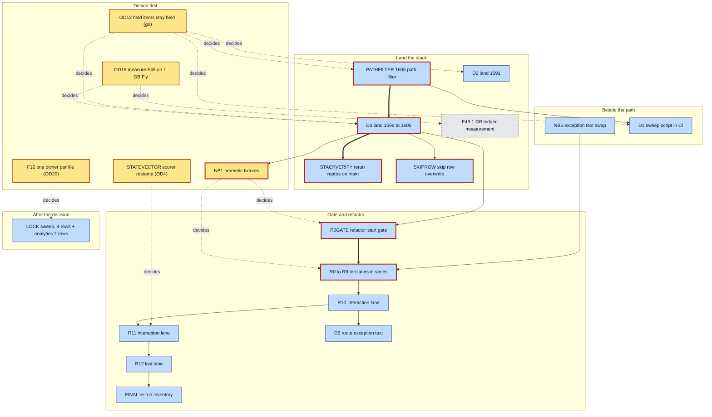
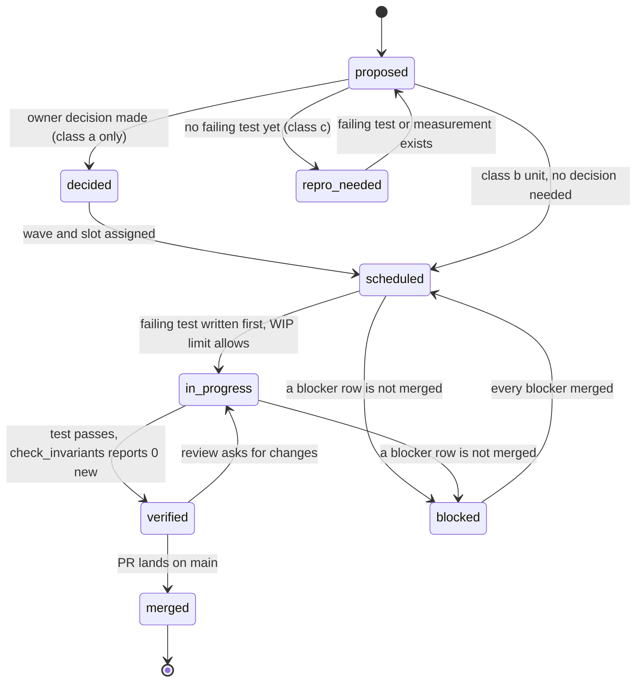
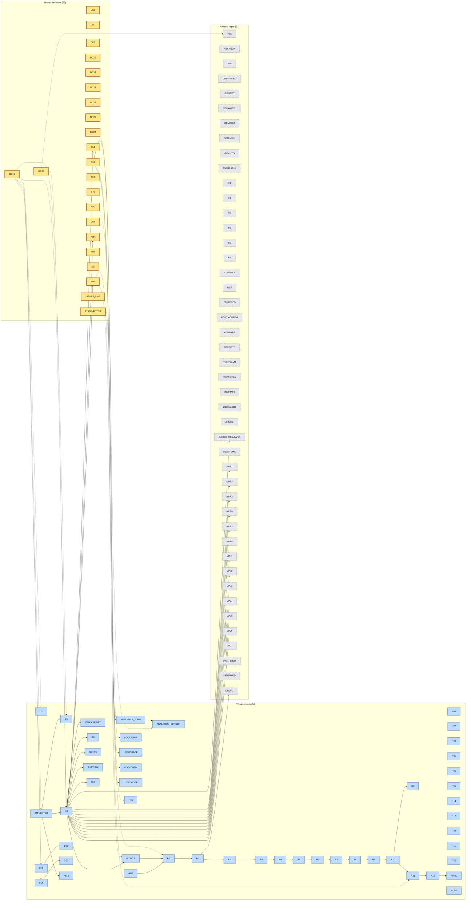

## Bug roadmap diagrams

Generated by `build_diagram.py` from the `w(...)` rows in `build.py`. Edge counts, unresolved references, orphan rows and the critical path check are in `diagram_counts.txt`.

### Gating view (21 nodes)

Read top to bottom. Dashed arrows are owner decisions that gate a row (10 drawn). Solid arrows are one row blocking another (13 drawn, thick ones included). The red outline marks every node on the critical path from section 7.3, in the order that section gives: PATHFILTER, D3, STACKVERIFY, SKIPROW, NB1, R0GATE, then lanes R0 to R9. Thick arrows are only the path steps that have a direct blocker edge in the row data (3 of 6). The other path steps are 1 drawn as a dashed decision edge and 2 with no arrow, which section 7.3 orders alone. diagram_counts.txt lists them. Rows with no gate are left out here and appear in the full graph.

### Lifecycle of one work row

This is the lifecycle each roadmap row goes through, from proposed to merged, including its blocked state. It is not Grok's runtime statecharts, which are in Part 8.

Full graph, all 118 rows

Amber is an owner decision, blue is a PR-sized unit, grey dashed is a row that needs a repro first. Dashed arrows are decisions, solid arrows are blockers.

